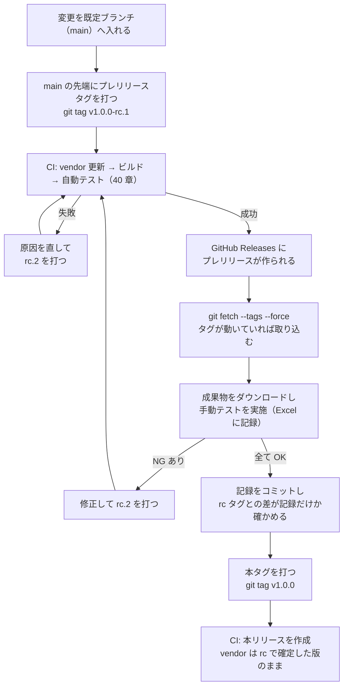

# 41. E2E テスト仕様: 手動テスト

> 索引: [README](README.md) | E2E テスト: [40](40-e2e-auto.md) / **41**

本文書は、人が操作して確認する E2E テストのケースを定める。方針・環境・自動テストは [40. 方針と自動テスト](40-e2e-auto.md) にある。

## 41.1 本文書と記録用ファイルの関係

### E2E-200: 正と生成物 **MUST**

| もの | 位置づけ |
| --- | --- |
| **本文書（41 章）** | **正**。テストケースの定義はここでのみ行う |
| `docs/tests/gen_manual_test_xlsx.py` | 本文書から記録用 Excel を生成するスクリプト |
| `docs/tests/manual_cases.py` | 本文書のケース定義の読み取りと「テストケース一覧」との照合、Excel に入れる表記の正規化。生成スクリプトが使う（4.66.0 で分けた） |
| `docs/tests/results/MarkView_手動テスト結果_v<version>.xlsx` | 生成した**実施記録用のファイル**。ケースの追加・変更はここで行わない |

- ケースを追加・変更・削除する場合、**本文書を直す**。Excel を直接編集してケースを変えない。
- Excel に記入するのは、実施日・実施環境・実施者・結果・備考といった**実施のたびに変わる情報**に限る。
- **未記入の雛形をリポジトリに置かない。** 検証するバージョンごとに生成する。複写とリネームの手順を挟まないため、雛形を誤って上書きしたまま次の検証に入る事故が起きない。
- 実施を終えた Excel は `docs/tests/results/` に置いたままコミットする。どのリリースで何を確認したかが、リポジトリの履歴として残る。

> [!IMPORTANT]
> 本文書と Excel の内容が食い違った場合、**本文書を正とする**。Excel は生成物であり、再生成すれば本文書の内容に戻る。

生成コマンド:

```bash
python docs/tests/gen_manual_test_xlsx.py --version v1.0.0-rc.1
```

`docs/tests/results/MarkView_手動テスト結果_v1.0.0-rc.1.xlsx` が作られる。ID・テストグループ・環境・優先度・概要・前提条件・手順・確認内容・関連要求に加え、表紙と各行の**ソフトウェアバージョン**が記入済みの状態で出る。

| 項目 | 内容 |
| --- | --- |
| 必要なもの | Python 3.10 以上と `openpyxl`（`pip install openpyxl`） |
| 動作環境 | Windows / Linux のどちらでもよい。**Excel のインストールは不要** |
| CI での実行 | 行わない。検証者が手元で生成する |

- スクリプトは**グループの節**（`## 41.n Gn 名称` の見出しを持つ節）の箇条書きを読み取る。**節と項目の書式を変えると生成が壊れる**ため、既存のケースと同じ形（`### E2E-nnn: 概要` と `- **環境**:` 以下の項目）を守る。
- **`手順` と `確認内容` は、どちらも番号付きリスト（`1.` `2.` …）で書く。** 記録用 Excel にも同じ番号で出る。**不具合を指摘するときに「確認内容 3 が NG」と番号で言えるようにするため**であり、文言を引き写す手間と写し間違いをなくす。1 つのケースの中に OK と NG が混在したとき、どれが NG だったかを短く正確に残せる。
- **1 項目が長くなっても、途中で改行して 2 行に分けない。** 行の頭が `1.` で始まらない行は読み取られず、**その項目が途中で切れたまま Excel に入る。**
- **ケースの中の引用（`> [!NOTE]` / `> [!IMPORTANT]` など）は、記録用 Excel に入らない**（生成スクリプトは `>` で始まる行を読まない）。**判定の条件（NG とする条件・「対象外」とする条件）は、必ず番号付きの確認内容に書く**——引用にだけ書くと、Excel を見て実施する人に届かない（4.80.0）。
- **Excel には、太字（`**`）とコード（`` ` ``）の記号を落として入れる。ただしコードスパンの中は書かれたとおりに残す**（4.65.0）。利用者が入力する記法そのもの（E2E-384 の `` `**fresh**` ``）は、コードスパンで書けば Excel にも `**fresh**` と出る。**4.64.0 までの生成スクリプトは先に太字を落としており、`fresh` になっていた。** 太字の範囲がコードスパンを含んでいてもよい。
- スクリプトは、抽出したケースが**「テストケース一覧」節**の一覧と**一致することを自身で検査**し、食い違えばファイルを作らずにエラーで終了する。片方だけを直したまま気づかない状態にならないようにするためである。
- **スクリプトは節番号を当てにしない。** グループの節は見出しの `Gn` で、一覧は見出しの文言「テストケース一覧」で探す。グループを増やすと後続の節番号がずれるためであり、**番号で探すと、ケースを 1 つ足しただけで生成が止まる。**

### E2E-201: 実施の単位 **MUST**

| 契機 | 実施範囲 |
| --- | --- |
| **プレリリースの初回検証**（`rc.1`） | **全ケース**を、各ケースの環境欄に挙げた環境で実施する（環境欄に W1 を含むものは W1 で、L1 を含むものは L1 で。L1 だけのケースもある。WA / LA は下の行） |
| **2 回目以降のプレリリース**（`rc.2` 以降） | 前回 NG だったケースと、修正が影響するテストグループ。それ以外は前回の結果を引き継ぐ |
| arm64 環境が入手できたとき | 環境欄に WA / LA を含むケース |

- 手動テストは**ビルドされた成果物を必要とする**ため、PR 単位の検証（BR-052）では実施しない（E2E-002, E2E-011）。PR で行うのは自動の検査だけである。
- 結果を引き継ぐ場合は、**新しい rc の版で Excel を生成し直し**、再実施しないケースの実施時の列（テスト実施日・実施環境・実施者・テスト確認結果・実測・備考・不具合番号）を前の rc のファイルから写す。**写した行は、ソフトウェアバージョンの列をその結果を得た rc の版に書き換え**、備考にもどの rc で確認した結果かを残す。**前の rc のファイルを複写して版名を改める方法は採らない**——E2E-200 が雛形を置かない理由と同じく、古い版名や古いケースの定義が残ったまま次の検証に入る。
- **本文書を改訂した場合は引き継がない。** 生成し直して全ケースを実施する。ケースの内容が変わった以上、前回の OK は別のケースに対する結果である。
- 実施で NG があった場合、修正してから次のプレリリースを作り、そのケースを再実施する。**NG のまま本リリースを行わない。**
- 「対象外」とした場合は、なぜ実施できなかったかを備考に残す。

### E2E-202: 環境コード **MUST**

40 章 E2E-010 で定めた環境コードを用いる。

| コード | 環境 |
| --- | --- |
| W1 | Windows 11 / amd64（主環境） |
| L1 | Ubuntu 24.04 / amd64 |
| WA | Windows 11 / arm64 |
| LA | Ubuntu 24.04 / arm64 |

各ケースの「環境」は**そのケースを実施すべき環境**を示す。`W1` のみのケースは Windows でだけ確認すればよい。`W1 / L1` は両方で確認する。

### E2E-203: 優先度 **MUST**

| 優先度 | 意味 |
| --- | --- |
| **高** | 壊れていると配布物として成立しない。NG ならリリースしない |
| 中 | 主要機能。NG ならリリースしない |
| 低 | 補助的な振る舞い。NG ならリリースしない |

**優先度は、実施と修正の順の目安である。どの優先度でも、NG のまま本リリースを行わない**（E2E-201, E2E-205 の手順 5・6）。4.80.0 までは「中: NG なら原則リリースしない」「低: NG でも影響を判断のうえリリースしてよい」としており、E2E-201 / E2E-205 と食い違っていた（4.81.0。利用者の判断）。

### E2E-204: 記録する項目 **MUST**

Excel の各列の意味は以下とする。列の追加・削除は本文書の改訂を伴う。

| 列 | 内容 | 記入 |
| --- | --- | --- |
| ID | `E2E-nnn` | 生成時 |
| テストグループ | G1〜G20 とその名称 | 生成時 |
| テスト環境 | 実施すべき環境コード | 生成時 |
| 優先度 | 高 / 中 / 低 | 生成時 |
| テスト概要 | 何を確かめるケースか | 生成時 |
| 前提条件 | 実施前に整えておく状態 | 生成時 |
| テスト手順 | 操作の順序 | 生成時 |
| テスト確認内容 | 満たすべき結果 | 生成時 |
| 関連要求 | 根拠となる要求 ID | 生成時 |
| テスト実施日 | 実施した日付 | **実施時** |
| ソフトウェアバージョン | 検証した成果物のバージョン | 生成時（`--version` に渡した値）。**前の rc から結果を引き継いだ行は、その結果を得た版に書き換える**（E2E-201） |
| 実施環境 | 実際に実施した環境コード | **実施時** |
| 実施者 | 実施した人 | **実施時** |
| テスト確認結果 | OK / NG / 対象外 / 未実施 | **実施時** |
| 実測・備考 | 実際の挙動、気づいた点 | **実施時** |
| 不具合番号 | NG のとき、`docs/bugs/` の調査報告に付した `BUG-nnn`（Issue を起票した場合はその番号でもよい）。**同じ原因の NG には同じ番号を付ける** | **実施時** |

### E2E-205: リリースまでの検証手順 **MUST**

手動テストは、**利用者が受け取るのと同じ手順で作られた成果物**に対して行う（E2E-011）。そのため、本リリースの前にプレリリースを作り、その成果物を検証する。



| 手順 | 内容 |
| --- | --- |
| 1 | **打つ前に、3 つの対応表（90.3 / 31.10 / 40.5）に `TBD` が残っていないことを確かめる**（E2E-031, 90.6.5。4.81.0 で書き足した）。プレリリースタグ（`v<version>-rc.<n>`、BR-080）を**既定ブランチ（`main`）の先端に**打って push する。**作業ブランチの先端に打たない**——CI が資産を更新したとき、そのコミットを `main` へ push するのは `main` の先端がタグと一致するときだけであり（BR-043, BR-050）、一致しなければ更新はタグの側にだけ残る |
| 2 | CI の自動テスト（40 章）がすべて通ることを確認する。失敗した場合はここで止め、修正して次の rc を打つ。**通ったら `git fetch --tags --force` を実行し、CI がタグを新しいコミットへ付け替えたかを確かめる**（BR-043 の手順 7）。付け替えていれば、そのコミットを作業ブランチへ取り込む（`main` に載っていなければ `main` へも取り込む） |
| 3 | GitHub Releases のプレリリースから、検証する環境向けの成果物をダウンロードする。あわせて**リリースノートの「変更点」が BR-051 の基準どおりか**を見る（rc なら直前のタグから、本タグなら直前の本リリースから。**全履歴が並んでいたら基準の選択が壊れている**）|
| 4 | `python docs/tests/gen_manual_test_xlsx.py --version <rc タグ>` で記録用 Excel を生成し、実施範囲（E2E-201）のケースを実施して結果を記入する |
| 5 | NG があれば修正し、次の rc を打って 2 へ戻る。NG を残したまま先へ進まない |
| 6 | 全ケースが OK（または理由のある「対象外」）になったら、記入済みの Excel を `docs/tests/results/` にコミットする。**`git diff --name-only <rc タグ> HEAD` がその記録ファイル 1 つだけを返すことを確かめてから**、本タグを打つ。他のファイルが出たら本タグを打たず、rc を作り直す（BR-080） |
| 7 | 本リリースの成果物が、検証した rc と同じ内容から作られていることを確認する（下記） |

**rc で検証した内容が本リリースでも保たれること**を、以下で担保する。

- 本タグでは埋め込み資産の自動更新を行わない（BR-043）。**CI が rc のタグを付け替えていた場合は、そのコミットを取り込んでから本タグを打つ（手順 2）。** 取り込んでいれば、rc で確定した Mermaid / KaTeX / PlantUML がそのまま配布される。**取り込まずに打つと、rc で検証していない版の資産が配布される**（`v1.0.0-rc.4` で、付け替えられた KaTeX の更新がどのブランチにも載っていなかった）。
- 手順 7 の確認は、rc と本リリースの**アプリケーション情報ダイアログの `Bundled` 行が一致すること**で行う。実行ファイルのハッシュはバージョン文字列とビルド日時が異なるため一致しない。ハッシュの比較では確認できない。
- rc と本タグの間に別の変更を入れない。**例外は、その rc の手動テストの記録（`docs/tests/results/` の Excel 1 ファイル）だけである**（BR-080）。手順 6 の `git diff --name-only` で確かめる。入れた場合は改めて rc を作り直し、手動テストをやり直す。

> [!NOTE]
> プレリリースを挟まず本タグだけを打つと、**検証していない成果物が公開される**。E2E-011 が「リリースと同じ手順で作られた成果物」を求めるのは、ローカルビルドでは BR-043 の資産更新が反映されず、手元と配布物で Mermaid のバージョンが食い違いうるためである。

### E2E-206: 手順の書き方 **MUST**

各ケースの前提条件・手順・確認内容に書くファイルとディレクトリのパスは、**リポジトリのルートからの相対パスで、省略せずに書く**（`testdata/e2e/generated/edit/tasks-lf.md`。`generated/edit/tasks-lf.md` や `tasks-lf.md` と書かない。4.79.0。利用者の指示）。

| 事項 | 決めたこと |
| --- | --- |
| パス | リポジトリのルートからの相対パス。区切りは `/` とする（W1 の PowerShell のコマンドレットと MarkView の引数は `/` を受け付ける）。**ファイルツリーの項目も同じ形で書く**（ツリーに出る名前は、その末尾の部分である） |
| カレントディレクトリ | **ターミナルのコマンドは、リポジトリのルートで実行する。** 前提条件に別の指定があるケース（E2E-212 など）を除く |
| `MarkView` | 検証する配布物（E2E-011）を展開した実行ファイル。手順の `MarkView <パス>` は、その実行ファイルを絶対パスで起動し、引数をリポジトリのルートからの相対パスで渡すことを表す（W1 の PowerShell: `& <展開先>\MarkView.exe testdata/e2e`、L1 の bash: `<展開先>/MarkView testdata/e2e &`）。**L1 で前景のまま起動すると端末が塞がる**ため、後ろで起動するか、別の端末で起動する（4.80.0） |
| `/` を使えないコマンド | W1 の `fc.exe` は `/` を引数の印として読むため、パスを `\` で書く（`fc.exe /b testdata\e2e\generated\edit\undo.md testdata\e2e\generated\edit\expected\undo-original.md`） |
| リポジトリの外 | 配布物の展開先・OS の一時ディレクトリ（`%TEMP%\MarkView` など）・GitHub の URL は、そのまま書く |
| 生成するファイル | `go run ./scripts/gentestdata`（`-edit`）が作るものも `testdata/e2e/generated/…` の形で書く（E2E-012） |

- **パスを省くと、同じ名前のファイルを取り違える。** `README.md` は `testdata/e2e/` と `testdata/e2e/generated/` の両方にあり、`tasks-lf.md` は `testdata/e2e/generated/edit/` と `testdata/e2e/generated/edit/bytes/` の両方にある。記録用 Excel には前後のケースの文脈が出ないため、**1 つのセルのパスだけでファイルが決まる**ようにする。
- **リポジトリにコミットされたファイルを書き換える手順を書かない。** 書き換える手順は、`scripts/gentestdata` が作る `testdata/e2e/generated/` の中のファイル（コミットされない）に対して行う。**コミットされたファイルの写しが要るときは、`go run ./scripts/gentestdata -edit` が `testdata/e2e/generated/edit/work/` に作る写しを使う**（E2E-012）。4.78.0 までの E2E-226 は、コミットされた `testdata/showcase.md` を書き換えていた（4.80.0 で、書き換え先を `testdata/e2e/generated/edit/` に限っていた 4.79.0 の書き方を改めた——E2E-322 は `testdata/e2e/generated/` の直下の生成物に書き足す）。

## 41.2 テストグループ

| グループ | 名称 | ケース |
| --- | --- | --- |
| G1 | 起動と終了 | E2E-211〜E2E-215 |
| G2 | ファイルを開く | E2E-221〜E2E-226 |
| G3 | Markdown の表示 | E2E-231〜E2E-240 |
| G4 | ファイルツリー | E2E-241〜E2E-248 |
| G5 | アウトラインと本文のスクロール | E2E-251〜E2E-253 |
| G6 | リンクと履歴 | E2E-261〜E2E-266 |
| G7 | 検索と表示倍率 | E2E-271〜E2E-274 |
| G8 | テーマ | E2E-281〜E2E-283 |
| G9 | コピー | E2E-291〜E2E-293 |
| G10 | 情報ダイアログ | E2E-301〜E2E-302 |
| G11 | 設定の永続化 | E2E-311〜E2E-315 |
| G12 | 異常系 | E2E-321〜E2E-328 |
| G13 | 配布物とアイコン | E2E-331〜E2E-334 |
| G14 | 外部エディタ | E2E-341〜E2E-345 |
| G15 | 図と画像の拡大表示 | E2E-351〜E2E-354 |
| G16 | 表の並べ替え | E2E-361〜E2E-362 |
| G17 | 右クリックメニュー | E2E-371〜E2E-373 |
| G18 | 編集モード | E2E-381〜E2E-388 |
| G19 | 図と画像のファイル | E2E-391〜E2E-395 |
| G20 | コードブロックと図の書き換え・修飾 | E2E-401〜E2E-405 |

**G19 と G20 は v1.2.0 の機能である**（4.79.0）。G20 の ID は 4xx になる——G18 の 38x に空きが無いためであり、手動テストの帯を `E2E-2xx`〜`E2E-4xx` とした。**ツリーの右クリックメニューとフィルター（E2E-247 / E2E-248）と、戻る・進むのボタン（E2E-266）は、既存のグループの空きに置いた。** v1.2.0 で直す不具合（BUG-023〜BUG-027）は、調査報告が指す既存のケース（E2E-262 / E2E-322 / E2E-233 / E2E-236 / E2E-383 / E2E-384）に手順を足した。

## 41.3 G1 起動と終了

### E2E-211: 配布物のダブルクリック起動
- **環境**: W1 / L1
- **優先度**: 高
- **関連要求**: FR-013, UI-013, UC-01
- **概要**: 配布物を展開したフォルダから、引数なしで起動して README が表示されることを確認する
- **前提条件**: 配布アーカイブを展開している。**同梱の `README.md` が実行ファイルの隣にある状態**（BR-020, BR-021）から手を加えない
- **手順**:
  1. ファイルマネージャで実行ファイルをダブルクリックする
  2. ウィンドウが開くまで待つ
- **確認内容**:
  1. ウィンドウが開き、**アーカイブに同梱された `README.md`** の内容が表示される
  2. ウィンドウタイトルが `README.md - MarkView` である
  3. 起動から表示まで体感で待たされない（1 秒程度）

### E2E-212: シェルからの起動（カレントディレクトリ優先）
- **環境**: W1 / L1
- **優先度**: 高
- **関連要求**: FR-013
- **概要**: カレントディレクトリの README が、実行ファイルの隣の README より優先されることを確認する
- **前提条件**: 配布アーカイブを展開したままにしている（実行ファイルの隣に、配布物の `README.md` がある。`testdata/e2e/README.md` とは内容が違う）
- **手順**:
  1. ターミナルで `testdata/e2e` へ `cd` する（この手順だけ、カレントディレクトリをリポジトリのルートから動かす。E2E-206）
  2. 実行ファイルをフルパスで引数なし起動する
  3. 終わったら、ターミナルのカレントディレクトリをリポジトリのルートへ戻す
- **確認内容**:
  1. **カレントディレクトリ側**の `testdata/e2e/README.md` が表示される（実行ファイルの隣の `README.md` ではない）
  2. ファイルツリーのルートがカレントディレクトリ（`testdata/e2e`）になっている

### E2E-213: 引数でファイルを指定して起動
- **環境**: W1 / L1
- **優先度**: 高
- **関連要求**: FR-012, FR-030, UI-013
- **概要**: コマンドライン引数で指定した文書が表示されることを確認する
- **前提条件**: ターミナルのカレントディレクトリをリポジトリのルートにしている（E2E-206）
- **手順**:
  1. `MarkView testdata/e2e/docs/design.md` を実行する
- **確認内容**:
  1. `testdata/e2e/docs/design.md` の内容が表示される
  2. ファイルツリーのルートが `testdata/e2e/docs` になっている
  3. タイトルが `design.md - MarkView` である

### E2E-214: 引数でディレクトリを指定して起動
- **環境**: W1
- **優先度**: 中
- **関連要求**: FR-012, FR-013, UI-013, UI-052
- **概要**: ディレクトリを指定した場合、そこをルートとして README が開くことと、README の無いディレクトリでは操作案内が出ることを確認する
- **前提条件**: `go run ./scripts/gentestdata -edit` を実行している。ターミナルのカレントディレクトリをリポジトリのルートにしている（E2E-206）
- **手順**:
  1. `MarkView testdata/e2e` を実行する
  2. MarkView を終了し、`MarkView testdata/e2e/generated/edit` を実行する（`README.md` が無い。E2E-012）
- **確認内容**:
  1. `testdata/e2e/README.md` が表示される
  2. ファイルツリーのルートが `testdata/e2e` になっている
  3. **手順 2 で、本文ペインに `Open a file` / `Press Ctrl+O to choose a file` / `Or drop a file onto this window` / `Use the file tree to browse documents` の操作案内が出て、`Markdown` の語を含まない。ウィンドウタイトルが `MarkView` である**（FR-013, UI-052, UI-013。開くファイルの種類を名指ししない案内は 4.73.0。4.80.0 で確かめる手順を足した）

### E2E-215: 終了
- **環境**: W1 / L1
- **優先度**: 高
- **関連要求**: UI-090, UI-114
- **概要**: 通常の手段で終了でき、次回起動に影響が残らないことを確認する
- **前提条件**: `MarkView testdata/e2e` で起動し、`testdata/e2e/README.md` を表示している
- **手順**:
  1. テーマを切り替え、ファイルツリーペインを表示して幅を変えてから、ウィンドウの閉じるボタンで終了する
  2. 再度起動する
  3. テーマを元に戻してから、`Ctrl+Q` で終了する
- **確認内容**:
  1. いずれの手段でも終了できる
  2. 終了時にエラーダイアログが出ない
  3. **手順 2 の再起動で、手順 1 で変えたテーマと、ファイルツリーペインの表示と幅が復元される**（UI-114。4.80.0。4.79.0 までは設定を変えずに終了しており、何も保存しない実装でも OK になった）

## 41.4 G2 ファイルを開く

### E2E-221: ファイル選択ダイアログから開く
- **環境**: W1 / L1
- **優先度**: 高
- **関連要求**: FR-010, FR-030, FR-110, UI-020, UI-024
- **概要**: ツールバーのボタンからファイルを選んで開けることと、フィルタが 5 つあり、開けないファイルを選んでも表示とツリールートが変わらないことを確認する
- **前提条件**: `MarkView testdata/e2e` で起動し、`testdata/e2e/README.md` を表示している。ファイルツリーを表示している
- **手順**:
  1. ツールバーのファイルを開くボタン（左から 3 つ目のフォルダのアイコン）をクリックし、ダイアログのフィルタの一覧を開いて見る
  2. `testdata/showcase.md` を選択して開く
  3. もう一度ボタンを押し、`Supported files` のまま `testdata/e2e/diagrams` と `testdata/e2e/images` を見る。続けてフィルタを `Diagrams` に切り替えて `testdata/e2e/diagrams` を、`Images` に切り替えて `testdata/e2e/images` を見てから、キャンセルする
  4. もう一度ボタンを押し、フィルタを `All files` に切り替えて `testdata/e2e/notes.txt` を選択して開く
- **確認内容**:
  1. OS 標準のファイル選択ダイアログが開き、初期ディレクトリが `testdata/e2e`（いまのツリールート）である（FR-010）
  2. **フィルタが `Supported files` / `Markdown files` / `Diagrams` / `Images` / `All files` の 5 つで、既定が `Supported files` である**（FR-010。4.73.0）。**`Supported files` では `testdata/e2e/notes.txt` が出ない**
  3. 手順 2 で選択した文書が表示され、ファイルツリーのルートが `testdata` に変わる（FR-030）
  4. **手順 3 の `Diagrams` で、`testdata/e2e/diagrams` の `.puml` / `.plantuml` / `.mmd` / `.mermaid` が出て、`part.iuml` は出ない**（FR-010 の表）
  5. **手順 4 で、表示（`testdata/showcase.md`）もツリールート（`testdata`）も変わらず、ステータス領域に `Not a supported file:` で始まり `notes.txt` を含む英語のメッセージが出る**（FR-010, FR-110）
  6. フィルタの名前が英語である（UI-024）
  7. **手順 3 の `Supported files` で、`testdata/e2e/diagrams` の図のファイル（`part.iuml` を除く）と、`testdata/e2e/images` の 3 つ（`alpha.png` / `nosize.svg` / `broken.png`）が出る。`Images` でも `testdata/e2e/images` の 3 つが出る**（FR-010。`Supported files` は開けるファイルの 3 種類のすべて。4.80.0）

> [!NOTE]
> **4.72.0 までのフィルタは `Markdown files` の 1 つだった。** v1.2.0 で開けるファイルが 3 種類になり（[1.7](01-overview.md)）、既定の `Supported files` は 3 種類のすべてを並べる。**ボタンの位置も変わった**——左端は戻るボタンであり、ファイルを開くボタンは左から 3 つ目（区切り線の後ろの最初のボタン）である（UI-020）。

### E2E-222: ショートカットでダイアログを開く
- **環境**: W1
- **優先度**: 中
- **関連要求**: FR-010, UI-090
- **概要**: `Ctrl+O` でダイアログが開くことを確認する
- **前提条件**: `MarkView testdata/e2e` で起動し、`testdata/e2e/README.md` を表示している
- **手順**:
  1. `Ctrl+O` を押す
  2. ダイアログをキャンセルする
- **確認内容**:
  1. ダイアログが開く
  2. キャンセルしても表示中の文書が変わらない

### E2E-223: ドラッグ＆ドロップで開く
- **環境**: W1 / L1
- **優先度**: 高
- **関連要求**: FR-011, UI-070
- **概要**: ウィンドウに Markdown をドロップして開けることを確認する
- **前提条件**: MarkView が起動し、ファイルツリーを表示している。ファイルマネージャで `testdata` を開いている
- **手順**:
  1. `testdata/showcase.md` をウィンドウ上へドラッグする
  2. ドラッグ中の表示を確認する
  3. 本文ペインにドロップする。続けて、もう一度 `testdata/showcase.md` をドラッグしてツールバーにドロップし、さらにファイルツリーのペインにもドロップする
  4. **本文中のリンクと、選択した文字を、ウィンドウの中でドラッグする**（ドロップしない。4.70.0）
  5. **拡大画面（FR-122）を開いて図をドラッグし、閉じてから手順 1・2 をもう一度行う**（4.70.0）
- **確認内容**:
  1. ドラッグ中にウィンドウ全体へオーバーレイと `Drop a file to open` の案内が出る（UI-070。**4.73.0 で `Drop a Markdown file to open` から改めた**——開けるファイルが 3 種類になった）。**W1 と L1 の両方で見る**（4.70.0。[BUG-020](../bugs/2026-09-21-bug-020-file-drop-webview-navigation.md)。**WebKitGTK は `dataTransfer.types` に `Files` を入れない**ため、Chromium の形だけを見る実装では L1 で出ない）
  2. ドロップした文書が表示される（FR-011）
  3. ファイルツリーのルートがドロップしたファイルの親（`testdata`）に変わる
  4. 手順 3 で、本文ペイン以外（ツールバー・ファイルツリーのペイン）にドロップしても同じ結果になる
  5. **手順 4 では案内が出ない**（ウィンドウ内で完結するドラッグ。UI-070。**リンクのドラッグにも `text/uri-list` が付く**ため、型だけでは見分けられない）
  6. **手順 5 で案内が出る**（[BUG-020](../bugs/2026-09-21-bug-020-file-drop-webview-navigation.md)。**中止された `dragstart` で旗が固定されると、ここで二度と出なくなる**）

> [!IMPORTANT]
> **確認内容 1 と 2 以降は、壊れる原因がまったく別である。**
> **`v1.1.0-rc.1` では「1 が NG なのに 2・3 は OK」という裏返しが起きた**（L1。BUG-020）——案内が出なくても、Wails の GTK 側の経路が Go へパスを届けるため文書は開く。**「開けたから配線できている」とも言えない。**
> 1 はフロントエンドだけで完結する表示であり、2 以降は Wails を通ってパスが Go へ届くかである（[IMP-245](12-impl-frontend.md), [IMP-313](13-impl-interface.md)）。
> **1 だけが OK で 2 以降が NG になる**ことが実際に起きた（[調査報告](../bugs/2026-09-04-bug-001-file-drop-windows.md)）。**「案内が出たから配線できている」と判断しない。**
> NG のときは**どの番号が NG だったかを備考に残す**（E2E-204）。

### E2E-224: ディレクトリのドロップ
- **環境**: W1
- **優先度**: 中
- **関連要求**: FR-011, FR-030
- **概要**: ディレクトリをドロップした場合の動作を確認する（README の無いディレクトリを含む）
- **前提条件**: `go run ./scripts/gentestdata -edit` を実行している。MarkView が起動している。ファイルマネージャで `testdata` を開いている
- **手順**:
  1. `testdata/e2e` ディレクトリをウィンドウへドロップする
  2. `testdata/e2e/generated/edit` ディレクトリ（`README.md` が無い。E2E-012）をウィンドウへドロップする
- **確認内容**:
  1. `testdata/e2e` がファイルツリーのルートになる
  2. 直下の `testdata/e2e/README.md` が表示される
  3. 手順 2 で、`testdata/e2e/generated/edit` がファイルツリーのルートになり、本文は `testdata/e2e/README.md` のまま、ウィンドウタイトルも `README.md - MarkView` のままである。**ステータス領域にエラー（`Not a supported file`）が出ない**（FR-011。4.89.0。v1.1.0 までは `Not a Markdown file` が出ていた）

### E2E-225: 開けないファイルのドロップ
- **環境**: W1
- **優先度**: 中
- **関連要求**: FR-011, FR-110, UI-070
- **概要**: 開けないファイルをドロップしたときと、開けないファイルと開けるファイルを一緒にドロップしたときの振る舞いを確認する
- **前提条件**: `MarkView testdata/e2e` で起動し、`testdata/e2e/README.md` を表示している。ファイルマネージャで `testdata/e2e` を開いている
- **手順**:
  1. `testdata/e2e/notes.txt` をウィンドウへドロップする
  2. ファイルマネージャで `testdata/e2e/notes.txt` と `testdata/e2e/mermaid.md` の 2 つを選び、まとめてウィンドウへドロップする
- **確認内容**:
  1. 手順 1 で、表示中の文書もツリールートも変わらない
  2. ステータス領域に `Not a supported file:` で始まる英語のメッセージが出て、数秒後に消える（FR-110）
  3. **手順 2 で `testdata/e2e/mermaid.md` が表示される**（複数のファイルのうち、開けるファイルを採る。FR-011）
  4. アプリが異常終了しない

> [!NOTE]
> **4.78.0 までは `.png` をドロップしていた。** v1.2.0 で画像は開けるファイルになった（FR-027）ため、**`.png` のドロップは画像ファイルを開く操作である**（E2E-394）。開けないファイルには `notes.txt` を使う。

### E2E-226: ファイル更新の自動反映
- **環境**: W1 / L1
- **優先度**: 高
- **関連要求**: FR-014, AR-070, UC-03
- **概要**: 外部エディタで保存したときに自動で再描画され、スクロール位置が保たれることを確認する
- **前提条件**: `go run ./scripts/gentestdata -edit` を実行している。`MarkView testdata/e2e/generated/edit/carry.md` で起動し、ファイルツリーで `testdata/e2e/generated/edit/bytes` を展開している。**本文の折りたたみ（`<details>`）を開いて**、中ほどまでスクロールしている
- **手順**:
  1. 別のエディタで `testdata/e2e/generated/edit/carry.md` を開き、先頭付近に一文を追加して保存する
  2. MarkView の画面を見る
  3. 続けて 3 回連続で保存する
- **確認内容**:
  1. 保存後 1 秒以内に表示が更新される
  2. **スクロール位置が保たれている**（先頭に戻らない）
  3. 連続保存で表示が何度もちらつかない
  4. ファイルツリーの展開状態が保たれている
  5. **開いていた折りたたみが、開いたまま残っている**（同じ文書の再描画。FR-014, DSP-352）

## 41.5 G3 Markdown の表示

### E2E-231: GitHub 準拠の描画
- **環境**: W1 / L1
- **優先度**: 高
- **関連要求**: FR-020, MD-001, MD-002, MD-011, MD-020, MD-022, MD-023, MD-024, MD-025, MD-026, MD-033, MD-050, MD-051, MD-072, MD-073, UI-050, NFR-030, NFR-061, FR-147
- **概要**: 主要な記法が GitHub と同じ体裁で表示されることを確認する
- **前提条件**: `testdata/showcase.md` を開いている。**W1 と L1 の両方で実施する**
- **手順**:
  1. ブラウザで GitHub 上の**同じ rc のタグ**の `testdata/showcase.md` を開き、並べて比較する
  2. 見出し・段落・リスト・引用・表・水平線を上から順に見る
  3. 折りたたみ（`<details>`）・脚注・絵文字ショートコードを確認する
- **確認内容**:
  1. 見出しの階層と大きさが GitHub と同等である
  2. `h1` / `h2` の下に境界線がある
  3. 表に罫線があり、ヘッダ行が強調されている
  4. タスクリストのチェックボックスが表示され、**編集モードでない間は、クリックしても状態が変わらない**（MD-022）。**寸法は W1 と L1 で 2px 以内の差を許容する**（NFR-061。エンジンが描く部品であり、BUG-009 で許容差と決着した）。**チェック済みの塗りの色は W1 と L1 で同じであること**（4.70.0。DSP-121。[BUG-018](../bugs/2026-09-21-bug-018-task-checkbox-accent-color.md)。**色は許容差ではない**——`accent-color` を指定しており、OS のテーマのアクセント色に従ってはならない）
  5. 引用が左の縦線付きで表示される
  6. **折りたたみが開閉する**（MD-026。サニタイズで `<details>` が落ちていない）
  7. 脚注が文書末尾に一覧で描画され、参照箇所と相互に行き来できる（MD-050）
  8. `:sparkles:` などの絵文字ショートコードが絵文字になっている（MD-051）
  9. **見出しにマウスを乗せると、左側にアンカーのアイコンが出る**（MD-020, DSP-023）
  10. アイコンをクリックすると、その見出しが本文ペインの上端へ移動する
  11. **アイコンが出ても見出しの文字の位置がずれない**（絶対配置。DSP-023）
  12. アウトラインの文言にアイコンが混ざっていない（IMP-227）
  13. **生 HTML の `<script>` と `onclick` が消えている**（MD-072, NFR-030）。**配布物のサニタイズが実際に効いていることを、ここで一度だけ確かめる**
  14. **Front Matter が本文に出ていない**（MD-073）
  15. 本文の最大幅で中央寄せになり、横スクロールが出ていない（UI-050）
  16. **取り消し線（`~~`・`<del>`・`<s>`・`<strike>`）が、GitHub と同じく線付きで出る**（MD-072。`<strike>` は 4.74.0 で許可した）
  17. **文字色の `span`（7 色）は、MarkView では色が付き、GitHub では付かない。この差は受け入れたものであり、NG にしない**（[1.3.3](01-overview.md), MD-072, FR-147）。Dark での色は E2E-281 が見る

> [!NOTE]
> **画像はここで見ない。** `showcase.md` は読み込みに失敗するリモート画像を含むが、
> **その体裁は E2E-236 が受け持つ**（FR-022, DSP-123）。ここで重ねて見ると、
> 同じ症状が 2 つのケースから別々に報告される。
>
> **確認内容 4 は編集モードでない状態で見る。** 編集モードの間はクリックで切り替わるのが正しい（FR-141。E2E-383 が見る）。
>
> **確認内容 4 の許容差は [BUG-009](../bugs/2026-09-06-bug-009-task-checkbox-size-webkitgtk.md) で決着したものである。**
> **「W1 と L1 で同じ」と書いてはならない**——許容すると決めた以上、
> **次の実施者が同じ NG を上げない書き方にする**のがここの目的である。
>
> **本文の最大幅（確認内容 15）は倍率で変わらない。** 980 論理ピクセルの固定値であり（UI-050）、
> 倍率が効くのは文字の大きさである（FR-081, DSP-021）。**倍率は E2E-273 で見る。**

### E2E-232: シンタックスハイライト
- **環境**: W1 / L1
- **優先度**: 高
- **関連要求**: MD-030, MD-031, MD-032
- **概要**: コードブロックが言語ごとに色分けされることを確認する
- **前提条件**: `testdata/showcase.md`（コードブロックの節に Go / JSON / Shell / diff がある）を開いている
- **手順**:
  1. 各コードブロックを目視で確認する
  2. 横に長いコードブロックを確認する
- **確認内容**:
  1. キーワード・文字列・コメントが色分けされている
  2. 配色が GitHub と同系統である
  3. 行番号が表示されていない
  4. 長い行はコードブロック内で横スクロールし、**ページ全体は横スクロールしない**

### E2E-233: GitHub Alerts
- **環境**: W1 / L1
- **優先度**: 中
- **関連要求**: MD-040, MD-002
- **概要**: 5 種類の Alert が色とアイコン付きで表示され、リストや引用の中の `[!NOTE]` は GitHub と同じく普通の引用になることを確認する
- **前提条件**: `testdata/showcase.md` を開いている。ブラウザで GitHub 上の**同じ rc のタグ**の `testdata/showcase.md` を開いている
- **手順**:
  1. GitHub Alerts の節の NOTE / TIP / IMPORTANT / WARNING / CAUTION の表示を確認する
  2. `> [!SOMETHING]`（未知の種別）の表示を確認する
  3. **リストの項目の中の `> [!NOTE]` と、引用の中の `> > [!WARNING]` を、GitHub の表示と見比べる**
- **確認内容**:
  1. 各種別が異なる色の左ボーダーとアイコンで表示される
  2. ラベルが `Note` / `Tip` / `Important` / `Warning` / `Caution` の英語表記である
  3. **アイコンが表示されている**（サニタイズで消えていない）
  4. 未知の種別は通常の引用として表示される
  5. **手順 3 の 2 つは Alert にならず、`[!NOTE]` / `[!WARNING]` の文字が残った普通の引用になる。GitHub も同じ描き方である**（MD-040。[BUG-025](../bugs/2026-11-08-bug-025-nested-alerts.md)）。**MarkView だけが色・アイコン・ラベルの付いた Alert で描いたら NG**

> [!IMPORTANT]
> **確認内容 5 は v1.1.0 では NG になる**（v1.0.0 から、入れ子の引用でも Alert として描いていた。BUG-025）。GitHub の公式文書は「Alerts cannot be nested within other elements.」としている。
>
> **入れ子の例は `testdata/showcase.md` に足すと 4.79.0 で決めた**（BR-053。利用者の判断。実装の段階で足し、ゴールデン（UT-214）も更新する。90.6.5）。GitHub と並べて見比べられ、ゴールデンも入れ子の描き方を守る。

### E2E-234: Mermaid 図
- **環境**: W1 / L1
- **優先度**: 高
- **関連要求**: FR-023, MD-080, MD-081, MD-002, DSP-270, FR-050, AR-060, FR-122, UI-104
- **概要**: Mermaid 図が GitHub と同じ見た目で描画され、図の中のリンクが本文のリンクと同じく扱われ、WebView の中で遷移しないことを確認する
- **前提条件**: `testdata/e2e/mermaid.md` を開いている（E2E-012）。**ネットワークを切断しておく**
- **手順**:
  1. 1〜3 節のフローチャート・シーケンス図・クラス図の表示を確認する
  2. 4 節の構文エラーを含む Mermaid ブロックと、その後ろの 5 節の図の表示を確認する
  3. **1 節の図の `Open URL` のノード（`click` の URL）と、`label link` のノード（ラベルに書いた HTML のリンク）をクリックする**
  4. 1 節の図の `Run callback` のノード（`click` のコールバック）をクリックする
  5. 1 節の図の拡大画面を開き、`Open URL` と `label link` のノードをクリックしてから、`Esc` で閉じる
  6. **ネットワークをつなぎ直し**、ブラウザで GitHub 上の**同じ rc のタグ**の `testdata/e2e/mermaid.md` を開き、1〜3 節の図を MarkView の図と並べて比べる。**MarkView は Light と Dark の両方で見る**（テーマボタンで切り替える）
- **確認内容**:
  1. **オフラインでも図が描画される**
  2. 図が本文幅に収まっている
  3. 4 節の構文エラーのブロックはエラー内容とソースが表示され、**5 節の図は描画される**（他の図の描画を妨げない）
  4. **手順 3 で、既定のブラウザが `https://example.com/mermaid-click` と `https://example.com/mermaid-label` を開こうとする**（切断しているため、接続できない旨はブラウザの側に出る。FR-050, MD-081）。**MarkView のウィンドウは遷移せず、本文を表示したまま**である（AR-060）
  5. **手順 4 で何も起こらない**（コールバックは実行しない。`securityLevel: strict`。MD-081）
  6. **手順 5 で何も起こらない**（遷移もせず、ブラウザも開かない）。拡大画面は開いたまま（UI-104）
  7. **手順 6 で、ノードの影と枠のグラデーションの有無が GitHub と同じである**（MD-080, DSP-270）。**MarkView にだけ付いていたら NG**（[BUG-021](../bugs/2026-09-28-bug-021-mermaid-neo-look.md)）。**GitHub にだけ付いていたら、それも NG として報告する**——GitHub が `neo` に切り替えたということであり、IMP-231 の `look` を追従させる

> [!IMPORTANT]
> **確認内容 4 の「ウィンドウが遷移しない」が要である**（[BUG-015](../bugs/2026-09-17-bug-015-mermaid-click-link-navigation.md)）。v1.0.0 では、`click` の URL のノードを押すと
> **MarkView のウィンドウの中身がリンク先に置き換わり、戻れなくなった。** 同梱の Mermaid は `strict` でもこのノードを SVG のリンク（`xlink:href`）で包む。
> **ブラウザが開いたことだけを見て OK にしない。** MarkView のウィンドウが本文のままであることを必ず見る。
>
> **確認内容 7 は `v1.1.0-rc.2` の E2E-238 / E2E-354 の NG から足した**（4.71.0。[BUG-021](../bugs/2026-09-28-bug-021-mermaid-neo-look.md)）。rc.1 から同梱した Mermaid 12.0.0 が既定の見た目を変え、**すべてのノードに影が付いていたが、rc.1 ではどのケースも見ていなかった。** **Dark で見ると分かりやすい**（灰色の影が光のにじみに見える）。**形の細部は比べない**——ノードの大きさ・配置・線の形は Mermaid の版とレイアウトで変わり、GitHub と同梱資産の版は一致しない。**見るのは影とグラデーションの有無だけである。**

### E2E-235: 数式
- **環境**: W1
- **優先度**: 中
- **関連要求**: MD-060
- **概要**: 数式が描画され、通貨表記が誤認されないことを確認する
- **前提条件**: `testdata/showcase.md` を開いている（数式の節にインライン数式・ブロック数式・通貨表記がある）。ネットワークを切断しておく
- **手順**:
  1. `$a+b$` と `$$...$$` の表示を確認する
  2. `$100 と $200` のような通貨表記の表示を確認する
  3. `$x_1 + x_2$` の表示を確認する
- **確認内容**:
  1. オフラインでも数式が描画される
  2. 通貨表記が数式にならず、そのまま表示される
  3. `x_1` の `_` が強調（斜体）にならず、下付き文字として描画される

### E2E-236: 画像
- **環境**: W1 / L1
- **優先度**: 高
- **関連要求**: FR-022, FR-014, FR-015, MD-071, AR-040, NFR-061, DSP-123
- **概要**: ローカル画像とリモート画像の表示と、読み込み失敗時の体裁と、書き換えた画像が再描画で新しくなることを確認する
- **前提条件**: `go run ./scripts/gentestdata -edit` を実行している。`MarkView testdata/e2e` で起動し、`testdata/e2e/README.md` を表示している（画像の節に、相対パスのローカル画像・存在しない画像・リモート画像がある）。**W1 と L1 の両方で実施する**
- **手順**:
  1. 相対パスのローカル画像を確認する
  2. 存在しない画像の箇所を確認する
  3. **ネットワークに接続した状態で**リモート画像を確認する
  4. **ネットワークを切断して** `F5` を押し、リモート画像の箇所を確認する
  5. `Ctrl+O` で `testdata/e2e/README.md` をもう一度開き直し、手順 2 の箇所を再確認する
  6. `Ctrl+O` で `testdata/e2e/generated/edit/swap.md`（赤い画像 `testdata/e2e/generated/edit/swap.png` を埋め込んだ文書）を開く
  7. ターミナルで青い画像を `testdata/e2e/generated/edit/swap.png` に上書きし（W1 の PowerShell: `Copy-Item testdata/e2e/generated/edit/swap-blue.png testdata/e2e/generated/edit/swap.png -Force`、L1: `cp testdata/e2e/generated/edit/swap-blue.png testdata/e2e/generated/edit/swap.png`）、MarkView の表示を見てから `F5` を押す
  8. 別のエディタで `testdata/e2e/generated/edit/swap.md` の末尾に 1 行足して保存する
  9. 画像を書き換えずに `F5` を数回押す
- **確認内容**:
  1. ローカル画像が表示される
  2. 本文幅を超える画像が縮小されている
  3. 存在しない画像は alt テキストとプレースホルダになり、他の描画が止まらない
  4. **プレースホルダが破線 1px の枠で、alt が淡い文字色で出る**（DSP-123）
  5. **枠の中に `alt` の文字列が読める。** 枠だけが出て文字が出ない、あるいは壊れた画像のアイコン（□＋`?`）が出る場合は **NG**（BUG-008）
  6. **W1 と L1 で 4・5 の見え方が同じ**（NFR-061）
  7. リモート画像が表示される
  8. 手順 4 でも同じ破線の枠と alt になる（ローカルとリモートで扱いが変わらない）
  9. **手順 5 でも枠が出る。** 2 回目以降に枠が消える場合、配線前に失敗した画像を取りこぼしている（IMP-226）
  10. **手順 7 で、上書きしただけでは赤いままであり（埋め込み画像のファイルは監視しない。FR-014）、`F5` の後は青になる**（FR-022, FR-015）。**`F5` の後も赤いままなら NG**（[BUG-026](../bugs/2026-11-08-bug-026-stale-embedded-image.md)）
  11. 手順 8 の自動の再描画の後も青のままである（FR-014, FR-022）
  12. 手順 9 で、画像が一瞬消えたり壊れた画像の枠になったりしない（ファイルが変わっていない画像は取り直さない。FR-022）

> [!IMPORTANT]
> **確認内容 5・6 が要である**（[BUG-008](../bugs/2026-09-06-bug-008-broken-image-alt-webkitgtk.md)）。4（枠が出るか）は**こちらが CSS で描くもの**であり、両環境で出る。
> 5（`alt` が読めるか）は、**4.32.0 より前はエンジンの既定に任せていた**部分であり、
> **Linux では欠けていた**（BUG-008）。**枠だけを見て OK にしない。**
>
> **4 と 5 を分けて番号を振っているのは、この 2 つが別々に壊れるからである。**
>
> **確認内容 10 は v1.1.0 では NG になる**（W1 / L1 とも。利用者が実機で確かめた。BUG-026 の 7.1）。**WebView は、1 つのページの中で一度読んだ画像を、同じ URL なら応答のキャッシュの指示に関わらず使い回す**（FR-022）。ウィンドウを閉じて開き直すと直って見えるため、**`F5` で確かめる。**

> [!NOTE]
> **`sample.png` は縮小表示になるため、v1.1.0 からは右上に原寸表示と拡大画面のボタンが出る**（FR-120）。
> **ボタンはここで見ない。** E2E-351〜E2E-353 が受け持つ。**画像をファイルとして開いたときの表示は E2E-393 が見る**（FR-027）。

### E2E-237: 日本語の表示
- **環境**: W1 / L1
- **優先度**: 高
- **関連要求**: MD-010, FR-021
- **概要**: 日本語が文字化けせず、適切な書体で表示されることを確認する
- **前提条件**: 日本語を含む文書（`docs/specs/README.md`）を開いている。`go run ./scripts/gentestdata -edit` を実行している（`testdata/e2e/generated/edit/bytes/`。E2E-012）
- **手順**:
  1. 本文・見出し・コードブロック内の日本語を確認する
  2. BOM 付き UTF-8 のファイル（`testdata/e2e/generated/edit/bytes/tasks-crlf-bom.md`。BOM と CRLF）を、**編集モードにせずに**開く
  3. CRLF 改行のファイル（`testdata/e2e/generated/edit/bytes/table-crlf.md`）を、編集モードにせずに開く
- **確認内容**:
  1. 日本語が文字化けしない。豆腐（□）にならない。**手順 2 と 3 のファイルでも見る**（4.70.0。`testdata/e2e/generated/edit/bytes/` の 4 つは末尾に日本語の行を持つ。E2E-012。**BOM・CRLF と多バイト文字の組み合わせ**を見るため）
  2. BOM が本文の先頭に文字として現れない
  3. CRLF のファイルで余分な改行や `^M` が現れない

### E2E-238: 仕様書自体の表示（ドッグフーディング）
- **環境**: W1
- **優先度**: 中
- **関連要求**: NFR-072
- **概要**: 本仕様書一式を MarkView で読み、実用に耐えることを確認する
- **前提条件**: `docs/specs/README.md` を開いている
- **手順**:
  1. README から各文書へ相対リンクでたどる
  2. Mermaid 図・表・Alerts・コードブロックの表示を確認する
  3. アウトラインから節へ移動する
- **確認内容**:
  1. すべての文書が破綻なく表示される
  2. リンクで文書間を移動できる
  3. 図表が正しく描画される
  4. 読み進めるうえで支障がない

### E2E-239: PlantUML 図
- **環境**: W1 / L1
- **優先度**: 高
- **関連要求**: FR-024, MD-083, MD-085, NFR-061, UI-060
- **概要**: PlantUML 図が描画され、テーマに追従することを確認する
- **前提条件**: `testdata/showcase.md` を開いている（PlantUML の節に sequence 図（Graphviz 不要）と class 図（**Graphviz 必須**）がある）。**ネットワークを切断しておく**
- **手順**:
  1. sequence 図と class 図の表示を確認する
  2. ツールバーのテーマボタンを押して配色を確認する
  3. `Ctrl+O` で PlantUML を含まない文書（`testdata/e2e/README.md`）へ切り替え、`Alt+←` で戻る
- **確認内容**:
  1. **オフラインでも両方の図が描画される**
  2. **class 図（Graphviz）が描けている**。`viz-global.js` の読み込みに失敗しても sequence 図だけは描けてしまうため、**こちらを必ず見る**
  3. 図が本文幅に収まっている
  4. テーマに追従して図の配色が切り替わる
  5. 文書を戻しても図が再び描画される
  6. **L1 でも同じ図が描ける**。**速さは問わない**（性能の基準環境は W1。7.1）が、**描けなければ不具合とする**。FR-024 と MD-083 は MUST であり、対象環境を限定していない（NFR-061）
  7. **図を描いた後もステータス領域が正しい**。ファイルのパス・文字コード・行数が出ており、**PlantUML のログ 1 行（`[ nnn ms] PlantUML version ...`）に置き換わっていない**（UI-060, DSP-150）

> [!IMPORTANT]
> **確認内容 7 は図が描けた後に見る。** 文書を開いた直後は正しく、**資産の読み込みと描画が終わった時点で壊れる**。
> 早く見ると気づけない。
>
> 同梱資産が `#status` を決め打ちで書き換えていたために、**PlantUML を含む文書を開くと以降の通知がすべて
> 出なくなっていた**（[調査報告](../bugs/2026-09-05-bug-006-status-id-collision.md)）。**rc.2 では検出できなかった。**

### E2E-240: PlantUML の制限
- **環境**: W1
- **優先度**: 中
- **関連要求**: FR-024, FR-110, MD-083, MD-084, NFR-032, UI-060
- **概要**: 描けないものが、理由とともに示されることを確認する
- **前提条件**: `testdata/e2e/plantuml-limits.md` を開いている（1 節 正常な図、2 節 構文エラー、3 節 `!include`、4 節 `!includeurl`、5 節 標準ライブラリ、6 節 4096 px 超え、7 節 `salt`、8 節 `ditaa`）。**ネットワークを切断しておく**
- **手順**:
  1. 各ブロックの表示を上から順に確認する
  2. 描けなかったブロックのコピーボタンを押して貼り付ける
  3. **この文書を表示したまま、開けないファイル（`testdata/e2e/notes.txt`）をウィンドウへドロップする**
- **確認内容**:
  1. 構文エラーのブロック（2 節）は **PlantUML のエラー図が図として出る**（行番号を含む。FR-024）
  2. `!include` と標準ライブラリのブロック（3〜5 節）は**図にならず**、理由と元のソースが英語で出る
  3. **4096 px 超えのブロック（6 節）は図にならず、理由（`PlantUML could not render this diagram.`。上限を超えたことは区別して出さない。FR-024, DSP-272。4.81.0）と元のソースが出る。** **`Syntax Error?` の図が出たら NG**——大きさの制限に達する前に、ソースが文法違反で弾かれている（BUG-010）
  4. **`salt`（7 節）と `ditaa`（8 節）は、エラー図が出るか、理由と元のソースが出るかのどちらかである**（判定は「SVG が得られたか」だけで行うため。DSP-272）。**どちらであっても空白にならない**
  5. **どのブロックも他の図の描画を妨げない**。同じ文書内の正常な図（1 節）は描けている
  6. コピーで**元の PlantUML ソース**が貼り付けられる
  7. **待たされる箇所がない**（外部への接続試行がない。NFR-032）
  8. **図を描いた後もステータス領域が正しい**（パス・文字コード・行数が出ている。UI-060, DSP-150）
  9. **手順 3 で英語の一時メッセージ（`Not a supported file:` で始まるもの）が出て、数秒後に消える**（FR-110, DSP-151。4.78.0 までは `.png` をドロップしていた——v1.2.0 で画像は開けるファイルになった）

> [!IMPORTANT]
> **確認内容 3 と 4 で書き方を変えているのは、期待値を確定できるかどうかが違うからである**（[BUG-010](../bugs/2026-09-06-bug-010-plantuml-4096-testdata.md)）**。**
>
> **3（6 節）は確定できる。** 図の大きさは検証用データ側で決められるため、
> **「理由と元のソースが出る」と断定して書く**（実測: `Diagram too large for browser rendering: 72x4276 (max 4096)`）。**上限の値は MarkView が処理系へ渡す**（MD-083。1.2026.8 から処理系の既定は 8192 px であり、渡さないと 6 節が図になる。4.64.0）。
> **4.32.0 より前は 3 も「どちらでもよい」と書いており、6 節が構文エラーになっていることを見分けられなかった**（BUG-010）。
>
> **4（7・8 節）は確定できない。** `salt` / `ditaa` の返し方は同梱資産の版で変わりうる。
> **断定して書くと、資産が自動更新される（BR-043）たびに手動テストが誤って NG になる。**

> [!IMPORTANT]
> **確認内容 8・9 が要である。** この文書は描けない図を多く含むため、**処理系のログが何度も書き込まれる。**
> ステータス領域の id が同梱資産と衝突していると、**ここで確実に壊れる**
> （[調査報告](../bugs/2026-09-05-bug-006-status-id-collision.md)）。
> **9 は「通知の経路が生きているか」を見ている。** 8 が OK でも 9 が NG なら、壊れ方が違う。

> [!NOTE]
> **環境を W1 のみに留める。** 4096 px の判定は同梱した処理系の内部で行われ（値は MarkView が渡す）、
> **描画エンジンに依存しない**（実測は Chromium 系で行い、拒否のメッセージまで確認している）。
> **Linux で PlantUML が描けることは E2E-239 が W1 / L1 の両方で見ている**（NFR-061）。

## 41.6 G4 ファイルツリー

### E2E-241: ツリーの表示と切り替え
- **環境**: W1
- **優先度**: 高
- **関連要求**: FR-031, FR-034, FR-037, UI-010, UI-020, UI-021, UI-030, UI-041, FR-025
- **概要**: ファイルツリーの表示・非表示と、既定のフィルターで並ぶ内容と、種類ごとのアイコンを確認する
- **前提条件**: `go run ./scripts/gentestdata -edit` を実行している。`MarkView testdata/e2e` で起動している。**ツリーのフィルターは既定（Markdown と図を表示し、画像を隠す）にしておく**——変えていたら、MarkView を終了して設定ファイル（E2E-313）を削除し、起動し直す
- **手順**:
  1. ツールバーのファイルツリーボタンを押す
  2. ツリーの内容を確認し、`testdata/e2e/diagrams` と `testdata/e2e/docs` を展開する
  3. ペインの見出しの行と、その下のツリールートの名前の行を見る。ツリールートの名前の行にマウスを乗せて待つ
  4. ペインの幅を下限まで狭め、`testdata/e2e/generated/edit/bytes` まで展開して、ツリーを横にスクロールする。ペインの幅を戻す
  5. もう一度ファイルツリーボタンを押して閉じる
- **確認内容**:
  1. ペインが即座に開閉する（アニメーションで待たされない）
  2. **ディレクトリと、Markdown と図のファイルが表示される。** `testdata/e2e/diagrams` の下に `multi.puml` / `no-diagram.puml` / `no-end.plantuml` / `flow.mmd` / `two.mmd` / `blank.mermaid` が出る（FR-031, FR-037 の既定）
  3. **画像と開けないファイルが出ない。** `testdata/e2e/notes.txt` と `testdata/e2e/diagrams/part.iuml`（取り込み用の断片。FR-025）が無く、**画像だけのディレクトリはディレクトリごと出ない**——展開した `testdata/e2e/docs` の下に `testdata/e2e/docs/img` が無く、ルートの直下に `testdata/e2e/images` が無い（表示している種類を含まないディレクトリ。FR-031）
  4. `node_modules` `vendor` `.hidden` が表示されない（`.git` も同じ規則で除外される。E2E-012）
  5. ディレクトリが先、ファイルが後の順に並んでいる。ファイルは種類で分けずに名前の順に並ぶ（FR-031）
  6. **ファイルのアイコンが種類で分かれている。** Markdown と図で違い、PlantUML と Mermaid は同じ図のアイコンである（UI-030）
  7. 手順 3 で、見出しの行に `FILES` と右端のフィルターボタン（漏斗）があり、その下にツリールートの名前 `e2e` が出て、マウスを乗せると `testdata/e2e` の絶対パスが出る（UI-030）
  8. **手順 4 で、ツリーを横にスクロールしても、見出しの行（`FILES` とフィルターボタン）とツリールートの名前の行は動かない**（右端のボタンが画面の外へ流れない。UI-030。4.73.0）。ファイル名は省略されない
  9. **両方のペインを開いたとき、左から `Files` → `Outline` → 本文の順に並ぶ**（UI-010, UI-041）。**ツールバーでも、ファイルツリーのボタンがアウトラインのボタンの左にある**（UI-020。4.73.0 で入れ替えた）
  10. ボタンが ON のとき押下状態に見える（UI-021）

> [!NOTE]
> **4.72.0 までのツリーは Markdown だけを並べた。** v1.2.0 では図のファイルも既定で並び、画像はフィルターで選んだときだけ並ぶ（FR-037）。**フィルターの操作そのものは E2E-248 が見る。** ここでは既定の状態だけを見るため、前のケースでフィルターを変えていたら戻してから始める。

### E2E-242: ツリーからのファイル選択
- **環境**: W1
- **優先度**: 高
- **関連要求**: FR-033, FR-030, UI-031, UI-051, UI-090
- **概要**: ツリーからファイルを選んでも、ルートが変わらないことを確認する
- **前提条件**: `MarkView testdata/e2e` で起動し、ファイルツリーを表示している
- **手順**:
  1. `testdata/e2e/docs/design.md` をクリックする
  2. ファイルツリーのルート表示を確認する
  3. **`Tab` でツリーの項目へフォーカスを移す**（マウスに触れない。v1.2.0 では、見出しの行のフィルターボタンの次にツリーの項目が来る）
  4. `↑` `↓` で移動し、`→` でディレクトリを展開し、`←` で折りたたむ
  5. **一度展開したディレクトリを `←` で畳み、その状態で `↓` を押す**
  6. ファイルの上で `Enter` を押して開く
  7. **開いた直後に、マウスに触れずに `PageDown` を押す**
  8. `Alt+←` を押す
- **確認内容**:
  1. 選択した文書が表示される
  2. **ファイルツリーのルートが変わらない**
  3. 選択したファイルがツリー上で強調表示される
  4. 本文が先頭から表示される
  5. **手順 3 で、ツリーのどれか 1 つの項目にフォーカスが乗る**（枠が出る。DSP-016, DSP-330）
  6. **枠は行の高さで出る。** 展開中のディレクトリで、配下の木全体が囲まれていない（IMP-248）
  7. **手順 4 でキーボードだけで移動・展開・折りたたみができる**（UI-031）
  8. **手順 5 で、畳んだディレクトリの中へ入らず、次の兄弟へ移る**（IMP-248）
  9. **手順 6 でファイルが開く**
  10. **手順 7 で本文がスクロールする。** ツリーにフォーカスが残っていると効かない（UI-051, IMP-220 の手順 11）
  11. **手順 8 で直前の文書へ戻る。** `Alt+←` がツリーに奪われていない（UI-090, IMP-248）
  12. `↑` `↓` を押しても、**本文ペインが一緒にスクロールしない**（既定動作を抑止している。IMP-248）

> [!IMPORTANT]
> **確認内容 10 と 11 が要である。** どちらも「キーボード操作を足したことで、
> 別のものを壊していないか」を見ている。
>
> **10** は、`Enter` で開いた後にフォーカスがツリーへ残っていないかを見る。残っていると
> **利用者から見れば [BUG-007](../bugs/2026-09-05-bug-007-viewer-focus-on-open.md) と同じ症状**になる。
>
> **11** は、`Alt+←`（履歴の移動。UI-090）をツリーが奪っていないかを見る。
> **修飾キーの付いたキーをツリーが横取りすると、戻れなくなる。**

> [!NOTE]
> **手順 5 を省かない。** ツリーは遅延展開であり（FR-032）、**一度も開いていない
> ディレクトリの群は空である。** そのため「畳んだ中へ入ってしまう」誤りは、
> **一度展開してから畳んだ後でなければ現れない。**

### E2E-243: ディレクトリの展開と折りたたみ
- **環境**: W1
- **優先度**: 中
- **関連要求**: FR-032
- **概要**: 遅延展開が機能することを確認する
- **前提条件**: `go run ./scripts/gentestdata` を実行している。`MarkView testdata/e2e` で起動し、ファイルツリーを表示している
- **手順**:
  1. 折りたたまれた `testdata/e2e/generated` をクリックして展開する
  2. 展開したまま、ターミナルで `testdata/e2e/generated/added-243.md` を作る（W1 の PowerShell: `Set-Content testdata/e2e/generated/added-243.md "# added"`）
  3. `testdata/e2e/generated` を折りたたんでから再度展開する
  4. ターミナルで `testdata/e2e/generated/added-243.md` を消す（`Remove-Item testdata/e2e/generated/added-243.md`）
- **確認内容**:
  1. 展開時に子が表示される
  2. 再展開したときに、新しく追加した `testdata/e2e/generated/added-243.md` が現れる

### E2E-244: ツリーの再読み込み
- **環境**: W1
- **優先度**: 中
- **関連要求**: FR-035, FR-015
- **概要**: ペインの再表示と再読み込みでツリーが最新になることを確認する
- **前提条件**: `go run ./scripts/gentestdata` と `go run ./scripts/gentestdata -edit` を実行している。`MarkView testdata/e2e/generated` で起動し（`testdata/e2e/generated/README.md` が表示される）、ファイルツリーを表示して、**サブディレクトリ `testdata/e2e/generated/edit` を展開しておく**（手順 6 で使う）
- **手順**:
  1. ターミナルで `testdata/e2e/generated/added-1.md` を作る（W1 の PowerShell: `Set-Content testdata/e2e/generated/added-1.md "# added 1"`）
  2. ツリーペインを閉じて開き直す
  3. ターミナルで `testdata/e2e/generated/added-2.md` を作る（`Set-Content testdata/e2e/generated/added-2.md "# added 2"`）
  4. ツールバーの `Reload` を押す
  5. ターミナルで、**展開している `testdata/e2e/generated/edit` の直下**に `testdata/e2e/generated/edit/added-3.md` を作る（`Set-Content testdata/e2e/generated/edit/added-3.md "# added 3"`）
  6. `testdata/e2e/generated/edit` を折りたたんでから開き直す
  7. ターミナルで、作った 3 つのファイルを消す（`Remove-Item testdata/e2e/generated/added-1.md, testdata/e2e/generated/added-2.md, testdata/e2e/generated/edit/added-3.md`）
  8. ターミナルで `testdata/e2e/generated/added-4.md` を作り（`Set-Content testdata/e2e/generated/added-4.md "# added 4"`）、`Ctrl+Shift+E` を 2 回押してペインを閉じて開き直す。終わったら `testdata/e2e/generated/added-4.md` を消す（`Remove-Item testdata/e2e/generated/added-4.md`）
- **確認内容**:
  1. 手順 2 のあと、`testdata/e2e/generated/added-1.md` がツリーに現れる（FR-035 の 1 番目の契機）
  2. 手順 4 のあと、`testdata/e2e/generated/added-2.md` がツリーに現れる（FR-035 の 2 番目の契機）
  3. 手順 6 のあと、`testdata/e2e/generated/edit/added-3.md` が **`testdata/e2e/generated/edit` の下に**現れる（FR-035 の 3 番目の契機）
  4. 表示中の文書（`testdata/e2e/generated/README.md`）がツリー上で選択されたままである（DSP-331）
  5. **手順 8 の `Ctrl+Shift+E` でも、手順 2 と同じく `testdata/e2e/generated/added-4.md` がツリーに現れる**（ツールバーのボタンとショートカットが同じ経路を通る。IMP-240。4.80.0 で手順を足した——4.79.0 までは `Ctrl+Shift+E` を押す手順が無かった）

> [!IMPORTANT]
> **手順 5 はルート直下ではない。** 3 番目の契機（折りたたみ直し）が読み直すのは
> **そのディレクトリだけ**であり（[DSP-330](22-display-states.md)）、ルート直下に足しても現れない。
>
> **ツリールートは折りたためるノードではない。** ルート名はペインの見出しの行の下に表示され（UI-030）、
> 直下の項目は一覧に並ぶ。**折りたためるのはサブディレクトリだけである。**
>
> 旧版は手順 5 を「ルート直下」としており、**手順どおりに実施すると確認内容 3 が必ず NG になった。**
> 実施者が「実装の不具合」と誤って記録しうる形であった（4.30.0 で修正）。
>
> **ファイルを足す先は `testdata/e2e/generated/` の中にする**（4.79.0）。生成物であり `.gitignore` の対象のため、消し忘れてもリポジトリを汚さない。4.78.0 までは足す場所を決めておらず、ツリールートの直下（コミットされたディレクトリ）へ足すことになった。

> [!IMPORTANT]
> **FR-035 は再読み込みの契機を 5 つ定めている**（4.73.0 で、ツリーの右クリックメニューでツリールートを変えたときと、フィルターを切り替えたときを足した）。**ここでは 1〜3 番目を確かめる。** 4 番目は E2E-247 の確認内容 9（`Set as tree root`）、5 番目は E2E-248 の確認内容 4（フィルターの切り替え）が見る。
> v1.0.0 で実装されていたのは 3 番目だけで、**1 番目と 2 番目はどの実装 ID にも割り当てられていなかった**（[調査報告](../bugs/2026-09-04-bug-002-filetree-reload-on-show.md)）。
> 旧版のこのケースは 1 番目しか見ておらず、2 番目は**手動テストでも検出できなかった。**

### E2E-245: ペイン幅の変更
- **環境**: W1
- **優先度**: 中
- **関連要求**: UI-030, UI-114
- **概要**: ペイン幅をドラッグで変更でき、保存されることを確認する
- **前提条件**: ツリーとアウトラインの両方を表示している
- **手順**:
  1. ツリーペインの右端の境界をドラッグして広げる
  2. 極端に狭く、極端に広くしてみる
  3. アプリを再起動する
- **確認内容**:
  1. ドラッグ中にカーソルが変わり、幅が追従する
  2. 下限（160px 程度）より狭くならない
  3. ウィンドウ幅の 40 % より広くならない
  4. 再起動後も変更した幅が保たれている

### E2E-246: 狭いウィンドウでの自動非表示
- **環境**: W1
- **優先度**: 中
- **関連要求**: UI-026
- **概要**: ウィンドウを狭めたときにアウトラインが一時的に隠れることを確認する
- **前提条件**: ツリーとアウトラインの両方を表示している。**両ペインの幅を既定（アウトライン 240 / ツリー 260）に戻しておく**（下記 IMPORTANT）
- **手順**:
  1. ウィンドウを最小サイズ付近まで狭める
  2. ツールバーのアウトラインボタンの状態を確認する
  3. ウィンドウを元の幅に戻す
  4. 両ペインを下限（160）まで狭めてから、もう一度ウィンドウを最小サイズ付近まで狭める
  5. ウィンドウとペインの幅を元に戻す
- **確認内容**:
  1. 手順 1 で、本文が読めなくなる前にアウトラインペインが隠れる
  2. 隠れている間も**アウトラインボタンは ON のまま**である
  3. 手順 3 でウィンドウを広げると、操作なしでアウトラインが戻る
  4. ファイルツリーは隠れない
  5. **手順 4 ではアウトラインが隠れない。それが正しい**（本文が 320px あり、閾値 240 を下回らない）

> [!IMPORTANT]
> **幅を固定せずに実施してはならない。** 隠すかどうかは `ウィンドウ幅 - アウトライン幅 - ツリー幅 < 240` で決まり、**ペイン幅は利用者が変えられて設定に保存される**（UI-030, UI-040, UI-110, UI-114）。
> **直前の E2E-245 が幅を極端に変える手順を含む**ため、続けて実施すると幅を引き継いだまま始まる。両ペインが下限（160）にあると、**最小ウィンドウ幅でも本文は 320px あり、UI-026 は発火しない**（[DSP-380](22-display-states.md) の表）。
> 実際にこの状態で NG が記録された（[調査報告](../bugs/2026-09-04-bug-003-outline-auto-hide.md)）。**幅を戻せない場合は `%TEMP%\MarkView\config.json` を削除して起動する**（設定が無くても既定値で動く。UI-113）。
> 手順 4 は「発火しないことの確認」であり、**閾値を下げて無理に発火させる修正を防ぐ。**

### E2E-247: ファイルツリーの右クリックメニュー
- **環境**: W1 / L1
- **優先度**: 高
- **関連要求**: FR-036, UI-032, UI-031, UI-024, FR-030, FR-033, FR-035, FR-052, FR-063, FR-091, FR-110, FR-140, UI-103, NFR-035, NFR-061
- **概要**: ファイル・ディレクトリ・ツリールートの名前の行のメニューの項目と動作、右クリックしただけでは何も選ばないこと、既に無いファイルと編集欄を開いている間の扱いを確認する
- **前提条件**: `go run ./scripts/gentestdata -edit` を実行している。ツリーのフィルターは既定にしておく（E2E-241）。`MarkView testdata/e2e` で起動し（`testdata/e2e/README.md` が表示される）、ファイルツリーを表示して、`testdata/e2e/docs` と `testdata/e2e/diagrams` を展開している。テキストエディタを開いている
- **手順**:
  1. ツリーの `testdata/e2e/docs/design.md` を右クリックし、メニューを見てから `Esc` を押す
  2. もう一度 `testdata/e2e/docs/design.md` を右クリックし、`Open` を選ぶ
  3. `testdata/e2e/diagrams/multi.puml` を右クリックし、`Open in editor...` を選ぶ。開いたエディタ選択ウィンドウを見て、エディタを選んで（前に選んだエディタが初期選択になっていればそのまま）`Open` を押す
  4. ペインの見出しの行のフィルターボタンで枚を開き、`Images` を入れて閉じる。`testdata/e2e/images` を展開し、`testdata/e2e/images/alpha.png` を右クリックして、`Esc` で閉じる
  5. `testdata/e2e/docs/design.md` を右クリックし、`Open containing folder` を選ぶ
  6. `testdata/e2e/docs/design.md` を右クリックし、`Copy path` を選び、テキストエディタへ貼り付ける
  7. ディレクトリ `testdata/e2e/docs` を右クリックし、`Open in file manager` を選ぶ。もう一度右クリックし、`Copy path` を選んでテキストエディタへ貼り付ける
  8. MarkView のツールバーの戻るボタンで `testdata/e2e/README.md` へ戻る（手順 7 の後はテキストエディタにフォーカスがあるため、`Alt+←` は使わない）。`testdata/e2e/docs` を右クリックし、`Set as tree root` を選ぶ。ツリーとステータス領域を見る
  9. ツリールートの名前の行（`docs`）を右クリックし、`Set parent as tree root` を選ぶ
  10. `Tab` でツリーの項目へフォーカスを移し、`↑` / `↓` で `testdata/e2e/mermaid.md` に合わせて `Shift+F10` を押す。メニューの `Open` に合わせて `Enter` を押す。アプリケーションキーのあるキーボードでは、ツリーの別の項目でそれも押し、`Esc` で閉じる
  11. ツリーで `testdata/e2e/generated` と `testdata/e2e/generated/edit` を展開し、ツリーがペインの高さに収まらなくなるまでウィンドウの高さを縮める。項目を右クリックしてメニューを開いたまま、ツリーをホイールでスクロールする。ウィンドウの高さを戻す
  12. ペインの見出しの行（`FILES`）と、ツリーの項目の無い余白を、それぞれ右クリックする
  13. 手順 11 で展開した `testdata/e2e/generated/edit` を展開したまま、ターミナルで `testdata/e2e/generated/edit/conflict.md` を削除する（W1 の PowerShell: `Remove-Item testdata/e2e/generated/edit/conflict.md`、L1: `rm testdata/e2e/generated/edit/conflict.md`）。ツリーに残っている `testdata/e2e/generated/edit/conflict.md` を右クリックし、`Open` を選ぶ
  14. ツリーから `testdata/e2e/generated/edit/table.md` を開いて編集モードにする。ツリーの `testdata/e2e/generated` を右クリックして `Set as tree root` を選び、ツリールートの名前の行を右クリックして `Set parent as tree root` を選ぶ。`apple` のセルをダブルクリックして編集欄を開いたまま、ツリーの `testdata/e2e/README.md` を右クリックして `Open` を選ぶ。編集欄を `Cancel` で閉じ、もう一度 `testdata/e2e/README.md` を右クリックして `Open` を選ぶ。フィルターの枚で `Images` を外す
  15. ツリールートの名前の行を右クリックして `Set parent as tree root` を選ぶ操作を、ファイルシステムの根（W1 はドライブの根、L1 は `/`）に着くまで繰り返し、根でもう一度右クリックする
  16. L1 のみ: MarkView を終了し、`xdg-open` が見つからない状態で起動し直して（`env PATH=/nonexistent <MarkView の絶対パス> testdata/e2e`）、ファイルツリーの `testdata/e2e/docs` を右クリックし、`Open in file manager` を選ぶ
- **確認内容**:
  1. 手順 1 で、`Open` / `Open in editor...` / `Open containing folder`、区切り線、`Copy path` のメニューが右クリックした位置に出る（UI-032）。項目名は英語で、先頭の語だけを大文字で始めている（UI-024, UI-032）
  2. **手順 1 で、右クリックしただけでは `testdata/e2e/docs/design.md` が開かず、ツリーの強調も `testdata/e2e/README.md` から動かない。`Esc` でメニューが閉じ、フォーカスが開く前の位置へ戻る**（FR-036, UI-032）
  3. 手順 2 で `testdata/e2e/docs/design.md` が開き、ツリールートは変わらず、フォーカスが本文ペインへ移る（FR-033, UI-032）
  4. **手順 3 で、エディタ選択ウィンドウの見出しの下に `multi.puml` が出て、`Open` で `testdata/e2e/diagrams/multi.puml` がエディタで開く**（FR-036, FR-091, UI-103）。**画面に出ている `testdata/e2e/docs/design.md` が開いたら NG。** MarkView の表示は `testdata/e2e/docs/design.md` のまま変わらない
  5. **手順 4 で、画像ファイルのメニューの `Open in editor...` が淡色で選べない**（FR-036, UI-032）
  6. **手順 5 で、OS のファイルマネージャが `testdata/e2e/docs` を開く。ファイルを選んだ状態にはならない**（FR-036, NFR-035）
  7. **手順 6 で、`testdata/e2e/docs/design.md` の絶対パスが貼り付けられる**（FR-036）
  8. 手順 7 で、ディレクトリのメニューが `Open in file manager` / `Set as tree root`、区切り線、`Copy path` であり、ファイルマネージャが `testdata/e2e/docs` を開き、`docs` の絶対パスが貼り付けられる（FR-036, UI-032）
  9. **手順 8 で、ツリールートが `testdata/e2e/docs` になり、ツリーが読み直される。表示中の `testdata/e2e/README.md` と履歴は変わらず（戻るボタンは淡色、進むボタンは押せるまま）、ツリールートの外になったため強調された行が無くなり、ステータス領域の左が絶対パスと `(outside tree)` になる**（FR-030, FR-035, FR-036, FR-052）
  10. 手順 9 で、ツリールートが `testdata/e2e` に戻り、`testdata/e2e/README.md` の強調とステータス領域の相対パスが戻る。ツリールートの名前の行のメニューは `Open in file manager` / `Set parent as tree root`、区切り線、`Copy path` である（FR-036, UI-032）
  11. **手順 10 で、フォーカスのある項目の下にメニューが出て、`Enter` で `testdata/e2e/mermaid.md` が開く**（UI-031, UI-032 の SHOULD）。アプリケーションキーが無ければ、その部分は「対象外」とし、備考に残す
  12. 手順 11 でメニューが閉じる（UI-032）
  13. **手順 12 では、MarkView のメニューも WebView の標準のメニューも出ない**（FR-063, UI-032）
  14. **手順 13 で、ステータス領域に `File not found:` で始まるメッセージが出て、表示中の文書は変わらない**（FR-036, FR-110）
  15. **手順 14 で、ツリールートを変えても編集モードは続く。編集欄を開いている間は、メニューは出るが、`Open` を選んでも文書が切り替わらず、ステータス領域に `Save or cancel the open edit first.` が警告の色で出て、フォーカスが編集欄に戻る。`Cancel` の後の `Open` では `testdata/e2e/README.md` に切り替わり、編集モードが終わる**（FR-036, FR-140）
  16. **手順 15 で、根では `Set parent as tree root` が淡色で選べない**（FR-036, UI-032）
  17. **手順 16 で、ステータス領域に `Cannot open:` で始まるエラーが出て、表示は変わらない**（FR-110）。W1 ではこの確認を「対象外」とし、備考に残す

> [!IMPORTANT]
> **確認内容 2 と 4 が要である。** 2 は「右クリックしただけで開いてしまう」実装を捕まえる（FR-036）。4 は、エディタへ渡すのが**ツリーで選んだファイル**であって画面に出ている文書ではないことを見る——取り違えるとエラーも出ずに別のファイルが開く（E2E-345 と同じ形）。
>
> **手順 13 はツリーを読み直す前に行う。** ツリーは自動では更新されない（FR-035）ため、消したファイルが並んだまま残る。この状態で押せることが、Go 側で確かめてから使う（FR-036）ことの出番である。

### E2E-248: ファイルツリーのフィルター
- **環境**: W1 / L1
- **優先度**: 高
- **関連要求**: FR-037, UI-033, UI-024, UI-090, FR-031, FR-035, FR-052, FR-122, UI-052, DSP-115, UI-030
- **概要**: フィルターの枚の開き方・閉じ方・その場での反映と、隠した種類の文書を表示しているときの強調、`Esc` の順序、枚が状態画面の下に隠れないことを確認する
- **前提条件**: `go run ./scripts/gentestdata` を実行している。MarkView を終了して設定ファイル（E2E-313）を削除し、`MarkView testdata/e2e` で起動している（フィルターは既定）。ファイルツリーを表示し、`testdata/e2e/docs` を展開している
- **手順**:
  1. ペインの見出しの行の右端のフィルターボタンにマウスを乗せて待つ
  2. フィルターボタンを押し、枚を見る。3 つの選択肢にマウスを乗せて待つ
  3. `Markdown` のチェックボックスをクリックする
  4. `Tab` / `Shift+Tab` で `Images` にフォーカスを移し（フォーカスの枠が `Images` にあるのを見てから）、`Space` で入れる。ツリーを見る
  5. `Diagrams` を外し、ツリーを見る
  6. 枚を開いたまま、ツリーの項目の無い余白と本文をクリックし、ツリーの下の方の（枚に隠れていない）`testdata/e2e/tables.md` を開く
  7. 枚の閉じるボタンで閉じ、フィルターボタンにマウスを乗せて待つ。ツリーで `testdata/e2e/images` を展開し、`testdata/e2e/images/alpha.png` を開く
  8. もう一度枚を開いて `Images` を外す。`testdata/e2e/images/alpha.png` を表示したまま、ツリーとステータス領域を見る
  9. `Diagrams` と `Images` を入れ直す。枚を開いたまま `Ctrl+F` で検索バーを開き、検索バーに文字を入れたまま `Esc` を押す。続けて `Esc` を押す
  10. 枚と検索バーを開き、本文をクリックしてから `Esc` を押す。もう一度 `Esc` を押す
  11. 枚を開き、`F1` で情報ウィンドウを開く。情報ウィンドウを閉じてから枚を開き、ツリーの `testdata/e2e/tables.md` を右クリックして `Open in editor...` を選び、エディタ選択ウィンドウを `Cancel` で閉じる。もう一度枚を開き、`Ctrl+Shift+E` でファイルツリーペインを隠す
  12. ファイルツリーペインを表示し、ペインの幅を下限まで狭める。ツリーから `testdata/e2e/generated/large-12mb.md` を開き（確認画面）、枚を開く
  13. 枚を開いたまま、ツリーから `testdata/e2e/media.md` を開き、1 節の図の拡大画面のボタンを押す。`Esc` で閉じる
  14. 枚を開き、`Images` を外して `Diagrams` を入れたまま（既定）、閉じるボタンで閉じる
- **確認内容**:
  1. 手順 1 のツールチップが `Filter / フィルター (Markdown, Diagrams)` である（UI-024, UI-033）
  2. **手順 2 で、ボタンの下に `Show in tree` の枚が出て、`Markdown (.md/.markdown/.mdown/.mkd)` / `Diagrams (.puml/.pu/.wsd/.plantuml/.mmd/.mermaid)` / `Images (.png/.jpg/.jpeg/.gif/.svg/.webp/.avif/.bmp/.ico)` の 3 つが並ぶ**（FR-037）。Markdown と Diagrams にチェックがあり、Images には無い。**フォーカスは `Diagrams` にあり、枚を開いている間はフィルターボタンが押された見た目になる**（UI-033）。選択肢のツールチップは `Markdown / マークダウン (always shown)` / `Diagrams / 図 (PlantUML, Mermaid)` / `Images / 画像` である（UI-024）
  3. **手順 3 で `Markdown` のチェックは外れない**（淡色。文言は読める濃さを保つ。UI-033）
  4. **手順 4 で、その場で `testdata/e2e/docs/img` と `testdata/e2e/images` がツリーに現れ、展開していた `testdata/e2e/docs` は展開したまま**である（FR-037, FR-035）
  5. 手順 5 で、`testdata/e2e/diagrams` がツリーから消える（図しか含まないディレクトリ。FR-031）
  6. **手順 6 で、外をクリックしても枚は閉じず**、開いたまま文書を開ける（UI-033）
  7. 手順 7 で枚が閉じ、フォーカスがフィルターボタンへ戻る。ツールチップが `Filter / フィルター (Markdown, Images)` になる（UI-024）。**ボタンの見た目は既定のときと変わらない**（UI-033）。`testdata/e2e/images/alpha.png` は画像ファイルとして開き、ツリーで強調される。**`testdata/e2e/images` の 3 つのファイルは、Markdown とも図とも違う画像のアイコンで出る**（UI-030）
  8. **手順 8 で、`testdata/e2e/images` がツリーから消え、強調された行が無くなる。ステータス領域の左は相対パス（`images/alpha.png`）のままで、`(outside tree)` は付かない**（FR-031, FR-052）
  9. **手順 9 の 1 回目の `Esc` で検索バーだけが閉じ、2 回目で枚が閉じる**（フォーカスのある方から閉じる。UI-090）
  10. **手順 10 の 1 回目の `Esc` で枚だけが閉じ、2 回目で検索バーが閉じる**（どちらにもフォーカスが無ければ枚が先。UI-090）
  11. 手順 11 で、情報ウィンドウを開いても、エディタ選択ウィンドウを開いても、ペインを隠しても枚が閉じる（UI-033）
  12. **手順 12 で、枚がペインの外（本文の上）へはみ出し、確認画面の下に隠れずに全体が見えて操作できる**（UI-033, UI-052, DSP-115。**W1 と L1 の両方で見る**）
  13. 手順 13 で、拡大画面を開くと枚が閉じる（FR-122, UI-033）
  14. 手順 14 の後、ツールチップが `Filter / フィルター (Markdown, Diagrams)` に戻る

> [!NOTE]
> **確認内容 12 は、90.6.5 の「実装の時点で実機で確かめると決めたもの」である**（枚の重なり順。DSP-015, DSP-115）。**フィルターの保存と、多重起動での後勝ちは E2E-311 / E2E-314 / E2E-315 が見る**（UI-110, UI-113, UI-115）。**フィルターが開く操作に効かないこと**（画像を隠したまま画像へのリンクを開く）は E2E-394 が見る。

## 41.7 G5 アウトラインと本文のスクロール

### E2E-251: アウトラインの表示
- **環境**: W1
- **優先度**: 高
- **関連要求**: FR-040, FR-043, UI-040
- **概要**: 見出しの階層がアウトラインに反映されることを確認する
- **前提条件**: `go run ./scripts/gentestdata -edit` を実行している。`MarkView testdata/e2e` で起動し、`testdata/e2e/README.md`（見出しが 6 段ある）を表示している
- **手順**:
  1. アウトラインペインの内容を確認する
  2. アウトラインボタンで開閉する
  3. `Ctrl+O` で `testdata/e2e/generated/edit/code.md`（見出しに太字とインラインコードがあり、コードブロックの中に `#` で始まる行がある。E2E-012）を開き、アウトラインを見る
  4. `Ctrl+O` で見出しのない文書（`testdata/e2e/generated/edit/history/a.md`）を開く
- **確認内容**:
  1. 手順 1 で、見出しが階層構造でインデント表示される（レベル 6 まで）
  2. 手順 3 で、見出し内の強調やコード記法がプレーンテキストになっている
  3. 手順 3 で、コードブロック内の `#` 始まりの行が項目に含まれていない
  4. 手順 4 で `No headings` と表示される
  5. 手順 2 で、ボタンを押すたびにアウトラインペインが閉じて開き、ボタンの押下状態も合わせて変わる（FR-043）

### E2E-252: アウトラインからの移動
- **環境**: W1
- **優先度**: 高
- **関連要求**: FR-041
- **概要**: アウトラインのクリックで該当箇所へ移動することを確認する
- **前提条件**: `testdata/e2e/README.md` を開き、アウトラインを表示している
- **手順**:
  1. 中ほどの見出し（`途中まで読み進めたところ`）をクリックする
  2. 末尾の見出し（`段落 6`）をクリックする
- **確認内容**:
  1. 手順 1 で、該当する見出しがペイン上端付近に来る。手順 2 の末尾の見出しでは、文書の末尾までスクロールする（見出しの下に余白が無いため、ペインの上端までは来ない）
  2. スクロールが即座に行われる（ゆっくり流れない）

### E2E-253: スクロール連動とキーボード操作
- **環境**: W1
- **優先度**: 高
- **関連要求**: FR-042, UI-051
- **概要**: 本文がキーボードでスクロールでき、アウトラインが追従することを確認する
- **前提条件**: `MarkView testdata/e2e` で起動し（`testdata/e2e/README.md` が表示される）、ファイルツリーとアウトラインを表示している。**開いた直後の状態にする。本文をクリックしない**
- **手順**:
  1. **マウスに一度も触れずに** `PageDown` を押す
  2. `PageUp` / `End` / `Home` / `↓` / `↑` を順に押す
  3. **ファイルツリーから別の長い文書（`testdata/e2e/contextmenu.md`）を開き、マウスに触れずに** `PageDown` を押す
  4. 本文をゆっくりスクロールする（マウスホイール）
  5. 一気に末尾までスクロールする
- **確認内容**:
  1. **手順 1 で本文がスクロールする**（UI-051）
  2. **手順 2 のキーがすべて効く**（`End` で末尾、`Home` で先頭）
  3. **手順 3 でもスクロールする**（開く経路によらない）
  4. 現在位置の見出しがアウトライン上で強調される
  5. 強調が 1 つだけである
  6. 強調項目がアウトラインの表示範囲外に出そうなとき、自動でスクロールして見える位置に来る
  7. スクロールがカクつかない

> [!IMPORTANT]
> **手順 1 を、本文をクリックする前に行う。** 本文ペインは `tabindex="-1"` を持つため、
> **一度クリックするとフォーカスが入り、以降はキーが効いてしまう**（IMP-202）。
> **クリックしてから確かめると、不具合があっても OK になる。**
>
> 実際に、この順序でなかったために **rc.2 では検出できなかった**
> （[調査報告](../bugs/2026-09-05-bug-007-viewer-focus-on-open.md)）。旧版の手順は
> 「本文をゆっくりスクロールする」から始まっており、**先にマウスで触れることが前提になっていた。**

> [!NOTE]
> **スクロール位置が保たれるかは別のケースが持つ。** フォーカス移動が `preventScroll` を欠くと
> 位置が先頭へ戻るため（IMP-220 の条件 1）、**本ケースが OK でもあちらが NG になりうる。**
>
> | 契機 | 見るケース |
> | --- | --- |
> | 手動の再読み込み（`F5`。FR-015） | **E2E-274 の確認内容 4** |
> | ファイル更新の自動検知（FR-014） | E2E-226 の確認内容 2 |
> | 履歴での復元（`Alt+←`。FR-051） | E2E-262 の確認内容 2 |
> | テーマ切り替え（UI-105） | E2E-281 の確認内容 5 |
> | 編集モードの書き込みの後の再描画（FR-143） | E2E-383 の確認内容 9 |

## 41.8 G6 リンクと履歴

### E2E-261: 相対リンクでの文書間移動
- **環境**: W1
- **優先度**: 高
- **関連要求**: FR-050, AR-042, MD-070, UC-05
- **概要**: `.md` へのリンクが同じウィンドウで開くことを確認する
- **前提条件**: `MarkView testdata/e2e` で起動し、`testdata/e2e/README.md` を表示している（`./docs/design.md` へのリンク `docs/design.md を開く` がある）
- **手順**:
  1. `docs/design.md を開く` のリンクをクリックする
- **確認内容**:
  1. **同じウィンドウ**でリンク先が表示される（新しいウィンドウが開かない）
  2. ファイルツリーのルートが変わらない
  3. タイトルとステータスのパス表示が更新される
  4. アウトラインが新しい文書のものに切り替わる

### E2E-262: 履歴での前後移動
- **環境**: W1
- **優先度**: 高
- **関連要求**: FR-051, FR-110, UI-021
- **概要**: `Alt+←` で元の文書に戻れて位置も復元されることと、履歴の先の文書を開けなかったときにその項目を取り除いて位置を戻すことを確認する
- **前提条件**: `go run ./scripts/gentestdata -edit` を実行している。`MarkView testdata/e2e` で起動し、`testdata/e2e/README.md` を表示している
- **手順**:
  1. `testdata/e2e/README.md` を「途中まで読み進めたところ」の節までスクロールし、`docs/design.md を開く` のリンクをクリックする
  2. `Alt+←` を押す
  3. `Alt+→` を押す
  4. MarkView を終了して `MarkView testdata/e2e/generated/edit/history` で起動し直し、ファイルツリーを表示する。ツリーで `testdata/e2e/generated/edit/history/a.md` → `testdata/e2e/generated/edit/history/b.md` → `testdata/e2e/generated/edit/history/c.md` の順に開く
  5. ターミナルで `testdata/e2e/generated/edit/history/b.md` を削除する（W1 の PowerShell: `Remove-Item testdata/e2e/generated/edit/history/b.md`）
  6. `Alt+←` を押し、ツールバーの戻る・進むボタンを見る
  7. ツリーで `testdata/e2e/generated/edit/history/d.md` を開く
  8. `Alt+←` を 2 回押す。続けて `Alt+→` を 2 回押す
- **確認内容**:
  1. `Alt+←` で `testdata/e2e/README.md` に戻る
  2. **戻った位置が、リンクをクリックしたときのスクロール位置である**（先頭に戻らない）
  3. `Alt+→` で再びリンク先へ進む
  4. **手順 6 で、ステータス領域に `File not found:` で始まり `b.md` を含むメッセージが出て、表示は `testdata/e2e/generated/edit/history/c.md` のまま**である（FR-051, FR-110）。**進むボタンは淡色**のまま（`testdata/e2e/generated/edit/history/c.md` が履歴の最後のまま。UI-021）、戻るボタンは押せる
  5. **手順 8 の 1 回目の `Alt+←` で `testdata/e2e/generated/edit/history/c.md` へ戻り、`File not found` が出ない。2 回目で `testdata/e2e/generated/edit/history/a.md` へ戻る**（開けなかった `testdata/e2e/generated/edit/history/b.md` は履歴から取り除かれている。FR-051。[BUG-023](../bugs/2026-11-08-bug-023-history-step-on-open-failure.md)）
  6. 手順 8 の `Alt+→` で `testdata/e2e/generated/edit/history/c.md`、`testdata/e2e/generated/edit/history/d.md` の順に進む

> [!IMPORTANT]
> **確認内容 5・6 は v1.1.0 では NG になる**（BUG-023）。開けなかったのに履歴の位置だけが `b.md` へ進み、その間に `d.md` を開くと前方の履歴（`c.md`）が捨てられて、**見ていた文書へ戻れなくなる。** **確認内容 4 は v1.1.0 でも見かけは OK になる**（`File not found` が出て、表示は `c.md` のまま。戻る・進むのボタンは v1.1.0 に無い）——**4 が OK でも「再現しなかった」と判断しない**（4.80.0。4.79.0 は「確認内容 4・5 が NG」としていた）。
> **修正を入れる前に、v1.1.0 の配布物で手順 4〜8 を行い（手順 6 のボタンは見ない）、確認内容 5・6 が NG になることを確かめる**（記録用 Excel に残さない開発時の確認。90.6.5。E2E-327 の IMPORTANT と同じ扱い）。**`testdata/e2e/generated/edit/history/` を `scripts/gentestdata` に足す前なら、調査報告の 7.1 のとおりに文書を置いたディレクトリで行う。** **BUG-023 は実機での再現をまだしていない。**
>
> **ボタンとサイドボタンでの移動は E2E-266 が見る。** 同じ入口を通る（FR-051）。

### E2E-263: アンカー付きリンク
- **環境**: W1
- **優先度**: 中
- **関連要求**: FR-050, MD-021, AR-053
- **概要**: 見出しへのリンクが機能することを確認する
- **前提条件**: `MarkView testdata/e2e` で起動し、`testdata/e2e/README.md` を表示している（同じ文書の中の日本語の見出しへのリンクと、`./docs/design.md#設計の方針` のリンクがある）
- **手順**:
  1. 「日本語の見出しへのリンク」の節の `同じ文書の「ファイルツリーの確認」へ` のリンクをクリックする
  2. 「途中まで読み進めたところ」の節の `docs/design.md の「設計の方針」へ直接飛ぶ` のリンクをクリックする
  3. `Alt+←` で戻り、`同じ文書の「レベル 3 の見出し」へ` のリンクをクリックする
  4. `Ctrl+O` で `docs/specs/90-traceability.md` を開き、90.1 節にある、全角の括弧や中黒を含む見出しへのリンクをクリックする
  5. `Ctrl+O` で `testdata/e2e/id-collision.md` を開き、**`#user-content-` で始まるリンク**（GitHub が出力する見出しの `id` を直接指した形）の `[→ Overlay](#user-content-overlay)` をクリックする
- **確認内容**:
  1. 該当見出しの位置までスクロールする
  2. 他文書のアンカーでは、文書が切り替わったうえで該当位置に移動する
  3. 日本語見出しへのリンクも機能する
  4. **全角記号を含む見出しへのリンクも機能する**（MD-021 の 4）。`docs/specs/90-traceability.md` の 90.1 節にある、90.3 / 90.4 / 90.5 / 90.6.5 への 4 本のリンクがこれに当たる
  5. **手順 5 のリンクも、同じ見出し（`Overlay`）へ移る**（MD-021, AR-053）

### E2E-264: 外部リンクと、画像と開けないファイルへのリンク
- **環境**: W1 / L1
- **優先度**: 高
- **関連要求**: FR-050, FR-053, FR-027, FR-051, FR-110, AR-060, UI-013, UI-060, FR-025
- **概要**: 外部 URL が既定のブラウザへ、開けないファイルへのリンクが既定のアプリケーションへ委譲され、画像へのリンクは MarkView で開くことと、委譲できないときは本文を残したまま通知されることを確認する
- **前提条件**: `MarkView testdata/e2e` で起動し、`testdata/e2e/README.md` を表示している（「リンク」の節に、`https://` のリンク、`./docs/img/sample.png` へのリンク `図を MarkView で開く`、`./notes.txt` へのリンク `notes.txt を既定のアプリケーションで開く`、`./diagrams/part.iuml` へのリンク `取り込み用の断片を開く`、`./docs/img/nosuch.png` へのリンク `存在しない画像を開く` がある。「途中まで読み進めたところ」の節に `./docs/design.md` へのリンク `docs/design.md を開く` がある。E2E-012）
- **手順**:
  1. 外部 URL のリンクをクリックする
  2. `図を MarkView で開く` のリンクをクリックし、ウィンドウタイトルとステータス領域を見てから、`Alt+←` を押す
  3. L1 のみ: MarkView を終了し、`xdg-open` が見つからない状態で起動し直して（`env PATH=/nonexistent <MarkView の絶対パス> testdata/e2e/README.md`）、`notes.txt を既定のアプリケーションで開く` のリンクと、外部 URL のリンクをクリックする
  4. 外部 URL・`図を MarkView で開く`・`notes.txt を既定のアプリケーションで開く`・`docs/design.md を開く` のリンクを、それぞれ**マウスの中ボタン**で押す（L1 で手順 3 を行った後は、MarkView を終了して通常どおり `MarkView testdata/e2e` で起動し直してから）
  5. `notes.txt を既定のアプリケーションで開く` と `取り込み用の断片を開く` のリンクをクリックする
  6. `存在しない画像を開く` のリンクをクリックする
- **確認内容**:
  1. 外部 URL が**既定のブラウザ**で開く。MarkView のウィンドウ内で遷移しない
  2. **手順 2 で、`testdata/e2e/docs/img/sample.png` が MarkView の本文ペインに画像ファイルとして開く。OS の既定の画像ビューアは開かない**（FR-053, FR-027。4.73.0）。タイトルが `sample.png - MarkView`、ステータス領域の左が `docs/img/sample.png` になる（UI-013, UI-060）。`Alt+←` で `testdata/e2e/README.md` へ戻る（FR-051）
  3. **手順 5 で、`testdata/e2e/notes.txt` と `testdata/e2e/diagrams/part.iuml` が OS の既定のアプリケーションへ渡り**（関連付けが無ければ OS がアプリケーションを選ぶ画面を出す）、MarkView の表示は変わらない（FR-050。`.iuml` は開けるファイルではない。FR-025）
  4. **手順 3 で、本文が消えずに残り、ステータス領域に `Cannot open:` で始まるエラーが出る**（FR-050, FR-110）。**`Failed to render this document.` の状態画面が出たら NG**（[BUG-013](../bugs/2026-09-14-bug-013-link-open-failure-state-screen.md)）。**手順 3 は L1 だけで行い、W1 ではこの確認を「対象外」とし、備考に残す**（4.81.0 で引用から書き写した）
  5. **手順 4 で、どのリンクでも何も起きない**——ブラウザも既定のアプリケーションも開かず、新しいウィンドウも開かず、MarkView は `testdata/e2e/README.md` を表示したまま（リンク先の文書やページに置き換わらない）（AR-060, FR-050。[BUG-016](../bugs/2026-09-17-bug-016-link-middle-click.md)）
  6. **手順 6 で、表示は `testdata/e2e/README.md` のままで、ステータス領域に `Link target not found:` で始まり `nosuch.png` を含むメッセージが出る**（画像へのリンクの先が無い。FR-053, FR-110。4.80.0）

> [!NOTE]
> **手順 3 は L1 だけで行う。** W1 の委譲（`rundll32.exe`）は起動そのものが失敗しないため、この経路を作れない。W1 では確認内容 4 を「対象外」とし、備考に残す。
> `PATH` を存在しないディレクトリにするのは、`xdg-open` をアンインストールせずに「既定のアプリケーションで開けない」状態を作るためである。
> **修正の前（v1.0.0）では、本文が消えて状態画面になり NG になる**（BUG-013）。
> **4.78.0 までは、手順 3 を画像へのリンクで行っていた。** v1.2.0 で画像へのリンクは MarkView で開く（FR-053）ため OS へ委譲せず、この経路を作れない。開けないファイル（`notes.txt`）へのリンクに改めた。**手順と確認内容の番号は 4.78.0 までと同じに保ち、開けないファイルへのリンクの手順を末尾（手順 5）に足した**（調査報告と 90.6.5 が番号で指している）。**4.80.0 で、存在しない画像へのリンク（手順 6）も末尾に足した**——画像へのリンクを MarkView で開く経路は `desktop` にあり、単体テストの対象外である（UT-002）。
>
> **手順 4 は W1 と L1 の両方で行う。** L1 は手順 3 の状態（`xdg-open` が見つからない）のまま行わない——ブラウザやアプリケーションが開かないことが確認にならず、手順 3 の `Cannot open:` の通知も残っている。
> **修正の前（v1.0.0）では、W1 で `docs/design.md を開く` が既定のブラウザへ回って表示されず、L1 では MarkView のウィンドウがリンク先に置き換わって戻れなくなる**（BUG-016）。**確認内容 5 は、ウィンドウが `README.md` のままであることまで見る。**
>
> **図のファイルへのリンク**（MarkView で開く。FR-050）は E2E-394 が見る。

### E2E-265: ツリー外への遷移
- **環境**: W1
- **優先度**: 中
- **関連要求**: FR-052, UI-060
- **概要**: ツリールート外の文書を開いたときの表示を確認する
- **前提条件**: `MarkView testdata/e2e/docs/design.md` で起動し（ツリールートは `testdata/e2e/docs`）、ファイルツリーを表示している（「ツリー外への遷移」の節に `../outside/external.md` へのリンク `ツリールートの外にある文書` がある）
- **手順**:
  1. `ツリールートの外にある文書` のリンクをクリックする
  2. `Alt+←` で戻る
- **確認内容**:
  1. 文書は表示される
  2. **ファイルツリーのルートも展開状態も変わらない**
  3. ツリー上の強調表示がなくなる
  4. ステータスに絶対パスと `(outside tree)` が表示される
  5. 戻ると強調表示が復活する

### E2E-266: 戻る・進むのボタンとマウスのサイドボタン
- **環境**: W1 / L1
- **優先度**: 高
- **関連要求**: FR-051, UI-020, UI-021, UI-024, UI-085, UI-090, UI-104, AR-060, FR-140, DSP-103, NFR-061
- **概要**: ツールバーの並びと区切り線、戻る・進むのボタンの淡色と動作、マウスのサイドボタン、ボタンとサイドボタンを受け付けない場面を確認する
- **前提条件**: `go run ./scripts/gentestdata -edit` を実行している。`MarkView testdata/e2e` で起動し（`testdata/e2e/README.md` が表示される）、ファイルツリーを表示している。**戻る・進むのサイドボタンのあるマウスを使う**（無ければ、手順 6〜9 のサイドボタンの部分を「対象外」とし、備考に残す）
- **手順**:
  1. ツールバーを左から順に見て、`Tab` でボタンの間を移る
  2. 戻る・進むのボタンをそれぞれ押してみる
  3. `docs/design.md を開く` のリンクをクリックし、戻る・進むのボタンを見る。戻るボタンにマウスを乗せて待つ
  4. ツールバーの戻るボタンを押し、戻る・進むのボタンを見る。進むボタンにマウスを乗せて待ってから、進むボタンを押す
  5. 戻るボタンを押してから、ツリーで `testdata/e2e/mermaid.md` を開き、進むボタンを見る
  6. 本文の上・ファイルツリーの上・ツールバーの上で、それぞれマウスの戻るボタンを押し、続けて進むボタンを押す
  7. 本文で右クリックしてメニューを開いたまま、マウスの戻るボタンと `Alt+←` を押す。もう一度メニューを開き、ツールバーの戻るボタンを押す
  8. `Ctrl+O` で `testdata/e2e/media.md` を開く（戻れる状態にする）。`F1` で情報ウィンドウを開き、マウスの戻るボタンと `Alt+←` を押してから閉じる。続けて 1 節の図の拡大画面を開き、同じく押してから閉じる
  9. `Ctrl+O` で `testdata/e2e/generated/edit/table.md` を開いて編集モードにし、`apple` のセルをダブルクリックして編集欄を開き、開いたまま、ツールバーの戻るボタン・マウスの戻るボタン・`Alt+←` を押す。編集欄を `Cancel` で閉じる
- **確認内容**:
  1. **手順 1 で、左から戻る・進む、区切り線、ファイルを開く・再読み込み、区切り線、ファイルツリー・アウトライン・テーマ、区切り線、エディタで開く（外への矢印）・編集モードの順に並び、右端に `?` がある**（UI-020, DSP-103）。取り消し線と文字色のボタンは無い（編集モードでない）。**`Tab` は区切り線に止まらない**
  2. **起動した直後は、戻る・進むのボタンがどちらも淡色で、押しても何も起きない**（UI-021）
  3. 手順 3 の後、戻るボタンが押せ、進むボタンは淡色である（FR-051, UI-021）。**戻るボタンのツールチップが `Back / 戻る (Alt+←)` である**（UI-024）
  4. 手順 4 で `testdata/e2e/README.md` に戻り（スクロール位置も戻る）、進むボタンが押せるようになる。**進むボタンのツールチップが `Forward / 進む (Alt+→)` である**（UI-024）。進むボタンで `testdata/e2e/docs/design.md` へ進む（FR-051）
  5. **手順 5 で、進むボタンが淡色になる**（戻った状態から新しい文書を開くと、前方の履歴を捨てる。FR-051）
  6. **手順 6 で、どこで押しても戻る・進むが働き、MarkView のウィンドウは MarkView の画面のまま**である（WebView 自身のページの履歴を戻らない。AR-060）。**L1 でも同じ**（サイドボタンが DOM へ届かない環境では、**MarkView の画面のまま変わらなければ**、その旨を備考に残して「対象外」とする。**画面が失われたら（WebView が自分のページの履歴を戻ったら）NG** とする。FR-051 の SHOULD, AR-060）
  7. **手順 7 で、メニューを開いている間は、サイドボタンではメニューが閉じず（IMP-249）、サイドボタンでも `Alt+←` でも文書が変わらない。ツールバーの戻るボタンでは、メニューが閉じて戻る**（FR-051, UI-085）
  8. 手順 8 で、情報ウィンドウと拡大画面を開いている間は、キーでもサイドボタンでも何も起きず、閉じた後も `testdata/e2e/media.md` が表示されている（戻れる状態で押している。UI-090, UI-104）
  9. **手順 9 で、どの手段でも文書が切り替わらず、ステータス領域に `Save or cancel the open edit first.` が警告の色で出て、フォーカスが編集欄に戻る**（FR-051, FR-140）

> [!IMPORTANT]
> **確認内容 6 の「L1 でも同じ」は、90.6.5 の「実装の時点で実機で確かめると決めたもの」である**（サイドボタンが WebKitGTK で DOM へ届くか）。届かなくても機能が欠けるだけで、安全上の問題にはならない（IMP-244）。**ただし、届かないのに WebView が自分のページの履歴を戻った場合は NG とする**（AR-060。戻ると MarkView の画面が失われる）。**この条件は確認内容 6 にも書いた**——記録用 Excel には引用（`>`）が入らない（E2E-200）。
>
> **戻れるか・進めるかは Go 側の履歴から受け取る**（FR-051）。画面の側で数え直す実装は、開けなかった項目を取り除いたとき（E2E-262 の確認内容 4）に淡色の表示が食い違う。積む・戻る・進む・前方を捨てるだけなら、確認内容 4・5 は画面の側でまねても正しく見える。

## 41.9 G7 検索と表示倍率

### E2E-271: 文書内検索
- **環境**: W1
- **優先度**: 高
- **関連要求**: FR-080, UI-080, MD-026
- **概要**: 検索の基本動作を確認する
- **前提条件**: `testdata/showcase.md` を開いている（**コードブロックと折りたたみ（`<details>`）を含む**長い文書）。**折りたたみは閉じた状態にしておく**
- **手順**:
  1. `Ctrl+F` を押す
  2. 複数箇所にある語（`引用`）を入力する
  3. `Enter` と `Shift+Enter` で移動する
  4. **検索バーの ∧ / ∨ ボタンを数回ずつクリックして移動する**
  5. 本文をホイールで大きくスクロールする
  6. **コードブロックが検索バーの真下に来る位置までスクロールし、そこで ∨ ボタンを押す**
  7. **折りたたみの中にしかない語（`折りたたみの中にも`）を入力し、∨ ボタンで移動する**
  8. `Esc` で閉じ、手順 7 で開いた折りたたみを見る
  9. ヒットしない語を入力する
  10. `Esc` で閉じる
  11. **`go run ./scripts/gentestdata` で作った `testdata/e2e/generated/slow-plantuml.md` を開き、開いた直後に `Ctrl+F` で `zzqpending` と入力する**（E2E-012）
  12. **いちばん下の図のソースが消えて、理由とともに戻るまで待つ**（十数秒）
  13. `Enter` を 2 回押す
- **確認内容**:
  1. 検索バーが本文の右上に出て、本文が押し下げられない
  2. 入力に応じて即座にハイライトされる
  3. 現在位置のヒットが他と異なる色で示される
  4. `3 / 12` のようなヒット数が表示される
  5. **`Enter` / `Shift+Enter` で移動するたびに、該当箇所までスクロールする**（FR-080）
  6. **∧ / ∨ ボタンでも同じように移動する。** キーボードと同じ結果になる
  7. **移動したあとも検索バーが本文ペインの右上に見えており、続けてボタンを押せる**
  8. **本文をスクロールしても検索バーは右上に留まり、スクロールバーに重ならない**（DSP-160）
  9. **コードブロックやコピーボタンの上に来ても、検索バーが手前にあり、ボタンが押せる**（DSP-015）
  10. **手順 7 で、閉じていた折りたたみが開き、該当箇所までスクロールする**（FR-080, MD-026）
  11. **手順 7 のヒットが件数に入っている。** 折りたたみを閉じていても数が変わらない（UI-080）
  12. **手順 8 で、開いた折りたたみが閉じ直されずに開いたままである**
  13. ヒットしないとき `No results` が表示される
  14. `Esc` でハイライトが消え、本文が元に戻る
  15. **手順 11 で 2 件（冒頭の段落と、いちばん下の図のソース）がハイライトされ、`1 / 2` と出る**
  16. **手順 12 の後も 2 件のままで、戻ったソースの `zzqpending` にハイライトが付いている**（[BUG-017](../bugs/2026-09-18-bug-017-search-hits-before-rendering.md)。件数だけが残る状態になっていない）
  17. **手順 12 で本文のスクロール位置が動かない**（描き終えただけでは移動しない。FR-080）
  18. **手順 13 で、押すたびにハイライトされた箇所へ移動する**（件数だけが進んで何も起きない回が無い）

> [!IMPORTANT]
> **手順 4 と 5 を省かない。** FR-080 は移動手段を「`Enter` / `Shift+Enter` **または検索バーの
> ボタン**」の 2 つ定めている。**キーボードだけを試すと、ボタン経路だけが壊れている状態を
> 通してしまう。** 実際に通り抜けた（[調査報告](../bugs/2026-09-03-search-jump-buttons.md)）。
>
> **手順 6 も省かない。** 検索バーは本文の上に重なるため、**下に何が来るかで押せるかが変わる。**
> コードブロックは `position: relative`、コピーボタンは `z-index: 10` を持ち（DSP-015）、
> **重なり順を 1 つ間違えるとボタンへクリックが届かなくなる。**
> 2026-09-03 の修正で実際に起きており、**利用者の文書にたまたまコードブロックがあったから
> 見つかった。** 前提条件にコードブロックを含めたのはこのためである。

> [!IMPORTANT]
> **手順 7 と 8 も省かない。** 閉じた `<details>` の中の要素は**スクロール先として指定できない**ため、
> ハイライトも件数も現在位置の強調も正しく作れるのに、**スクロールだけが黙って何もしない**
> （[MD-026](04-markdown.md), [調査報告](../bugs/2026-09-04-bug-004-search-collapsed-details.md)）。
> **「ハイライトが付いた」を「移動できた」の証拠にしない。**
>
> **検索語の選び方で結果が変わる。** 折りたたみの外にもある語を選ぶと、そちらへ移動して
> しまい通過する。**折りたたみの中にしかない語を選ぶ。** 前回はたまたま当たったために
> 見つかった。**4.78.0 までは `docs/showcase.md` を勧めていたが、あちらは折りたたみの中身を直前の例のコードブロックにも同じ文で書いており、折りたたみの中にしかない語が無い**（4.79.0 で `testdata/showcase.md` と語を決めた）。

### E2E-272: 検索状態のリセット
- **環境**: W1
- **優先度**: 中
- **関連要求**: FR-080
- **概要**: 文書を切り替えたときに検索状態が残らないことを確認する
- **前提条件**: `MarkView testdata/e2e` で起動し、`testdata/e2e/README.md` で `marker` を検索してハイライトが出ている
- **手順**:
  1. 検索したまま、`docs/design.md を開く` のリンクで `testdata/e2e/docs/design.md` を開く
  2. `Alt+←` で元の文書に戻る
- **確認内容**:
  1. 文書切り替えで検索バーが閉じる
  2. ハイライトが残っていない
  3. 元の文書に戻ってもハイライトが残っていない

### E2E-273: 表示倍率
- **環境**: W1
- **優先度**: 中
- **関連要求**: FR-081, UI-050, UI-060, UI-111, UI-115, FR-027
- **概要**: 倍率の変更と、保存されないことを確認する
- **前提条件**: `MarkView testdata/e2e` で起動し、`testdata/e2e/README.md` を表示している
- **手順**:
  1. `Ctrl` + `+` を数回押す
  2. `Ctrl` + マウスホイールを操作する
  3. `Ctrl+0` を押す
  4. 倍率を 140 % にしたまま終了し、再起動する
  5. **図と画像を含む文書（`testdata/e2e/media.md`）を開き、`Ctrl` + `+` で 300 % まで上げる**
  6. `Ctrl+0` で 100 % に戻し、`Ctrl+O` で `testdata/e2e/images/alpha.png` を開いて、`Ctrl` + `+` を 2 回押す。終わったら `Ctrl+0` で戻す
- **確認内容**:
  1. 本文の文字が拡大・縮小する
  2. **ツールバーとサイドペインの文字サイズは変わらない**
  3. 上限（300 %）と下限（50 %）で止まる
  4. `Ctrl+0` で 100 % に戻る
  5. 100 % 以外のときステータスに倍率が表示される
  6. **再起動すると 100 % に戻っている**（倍率は保存しない。UI-111）
  7. 再起動後のステータスに倍率が表示されない
  8. **手順 5 で、本文の文字は大きくなるが、5 節の `badge.png`・8 節の `medium.png`・9 節の PlantUML 図の大きさは変わらない**（DSP-021。4.80.0 で文書を `testdata/e2e/media.md` に改めた——`testdata/showcase.md` の画像は 1 x 1 で、大きさが変わったかを見分けられない）。**本文の最大幅（980 論理ピクセル）も変わらない**（UI-050）
  9. **手順 6 で、画像の大きさは変わらず、ステータス領域の右に `240 × 120 px` とファイルの大きさが出て、その後ろに倍率（120 %）が続く**（画像ファイル。DSP-150, DSP-021, UI-060。4.80.0）

> [!NOTE]
> **確認内容 8 は「変わらないこと」を見ている。** 倍率が変えるのは文字の大きさと、
> `em` で定義した余白だけである（DSP-021）。**4.35.0 より前の表示仕様は「画像・図も倍率に
> 追随する」と書いていたが、実測すると追随しない。** 記述を実態へ合わせたうえで、
> **その実態を確かめるケースをここに置いた。**

### E2E-274: キーボードショートカット
- **環境**: W1
- **優先度**: 中
- **関連要求**: FR-015, FR-140, UI-090
- **概要**: 定義されたショートカットが機能することを確認する
- **前提条件**: `MarkView testdata/e2e` で起動し、**長い文書（`testdata/e2e/README.md`）の中ほどまでスクロールしておく**
- **手順**:
  1. `F5` / `Ctrl+R`（再読み込み）
  2. `Ctrl+Shift+T`（テーマ）
  3. `Ctrl+Shift+O`（アウトライン）
  4. `Ctrl+Shift+E`（ファイルツリー）
  5. `F1`（情報ダイアログ）。確かめたら `Esc` で閉じる
  6. `Ctrl+Shift+M`（編集モード）を 2 回
  7. `Ctrl+F` で検索バーを開き、入力欄に `abc` と入力して `Ctrl+A` を押し、続けて `Ctrl+Z` を押す。`Esc` で閉じる
- **確認内容**:
  1. 各ショートカットが対応する動作を行う
  2. ツールバーのボタンを押した場合と同じ結果になる
  3. **手順 7 で、`Ctrl+A` は検索バーの入力欄の文字だけを選び（本文の全体は選ばれない）、`Ctrl+Z` は入力欄の入力を戻す**（入力欄にフォーカスがある間は、テキスト編集のキーを優先する。UI-090。4.80.0 で手順 7 を足した——4.79.0 までは検索バーを開く手順が無かった）
  4. **手順 1 のあと、スクロール位置が保たれている**（先頭に戻らない。FR-015, DSP-350）
  5. **手順 6 で編集モードが始まって終わり、ツールバーのボタンの押下状態が同じく切り替わる**（FR-140, UI-090）。WebView が `Ctrl+Shift+M` を横取りしない

> [!IMPORTANT]
> **確認内容 4 は、手動の再読み込みで位置が維持されることを見る唯一のケースである。**
> DSP-350 は契機ごとにスクロール位置を定めているが、**`F5` の「維持」を確かめる手順が
> どのケースにも無かった**（4.28.0 で追加）。
>
> **文書を表示した時点で本文ペインへフォーカスを移す**（IMP-220 の手順 11）ため、
> **その実装が `preventScroll` を欠くとここが NG になる**（IMP-220 の条件 1）。

## 41.10 G8 テーマ

### E2E-281: テーマの切り替え
- **環境**: W1 / L1
- **優先度**: 高
- **関連要求**: FR-070, UI-105, MD-072, FR-147
- **概要**: Light / Dark の切り替えが全体に即座に反映され、文字色が Dark では Dark の色で描かれることを確認する
- **前提条件**: `testdata/showcase.md` を開いている（Mermaid 図・PlantUML 図・コードブロックと、生 HTML の節に 7 色の文字色の `span` がある）。**W1 と L1 の両方で実施する**
- **手順**:
  1. ツールバーのテーマボタンを押す
  2. 各部の配色と、生 HTML の節の文字色を確認する
  3. もう一度押して戻す
- **確認内容**:
  1. 本文・ツールバー・サイドペイン・ステータス・スクロールバーのすべてが切り替わる
  2. **ちらつきや再読み込みが起きない**
  3. コードブロックのハイライト配色も切り替わる
  4. **Mermaid 図と PlantUML 図の配色も切り替わる**
  5. スクロール位置が保たれている
  6. **7 色の文字色が、Dark では Dark の色（FR-147 の表の右の列。どれも Light より明るい）で描かれ、Light に戻すと Light の色に戻る**（FR-070, FR-147, MD-072, UI-105。4.73.0）。**Dark の地で読めない暗い色のままなら NG**

### E2E-282: 初回起動時のテーマ
- **環境**: W1 / L1
- **優先度**: 中
- **関連要求**: FR-071
- **概要**: 設定がない状態で OS のテーマに追従することを確認する
- **前提条件**: 設定ファイル（`%TEMP%\MarkView` / `/tmp/MarkView-<uid>`）を削除している
- **手順**:
  1. OS をダークモードにして起動する
  2. 終了して設定を削除し、OS をライトモードにして起動する
- **確認内容**:
  1. OS の設定に応じたテーマで起動する

### E2E-283: テーマ切り替え時の状態保持
- **環境**: W1
- **優先度**: 低
- **関連要求**: UI-105, FR-121, FR-130, FR-140
- **概要**: テーマを切り替えても操作状態が失われないことを確認する
- **前提条件**: `MarkView testdata/e2e` で起動し、ファイルツリーで `testdata/e2e/docs` を展開し、`testdata/e2e/README.md` で `marker` を検索してヒットがある状態にしている
- **手順**:
  1. 検索バーを開いた状態でテーマを切り替える
  2. ツリーを展開した状態でテーマを切り替える
  3. `testdata/e2e/tables.md` を開いて 1 節の表を並べ替え、テーマを切り替える
  4. `testdata/e2e/media.md` を開いて 1 節の図を原寸表示にし、テーマを切り替える
  5. `go run ./scripts/gentestdata -edit` の後に `testdata/e2e/generated/edit/tasks-lf.md` を開いて編集モードにし、テーマを切り替える
- **確認内容**:
  1. 検索バーと検索語、ヒットのハイライトが保たれる
  2. ツリーの展開状態が保たれる
  3. 手順 3 で並べ替えが保たれる（DSP-370）
  4. **手順 4 で、図が新しい配色で描き直された後も原寸表示のまま**である（FR-121, DSP-370）
  5. 手順 5 で編集モードが保たれ、枠とラベルが新しい配色になる（FR-140, DSP-370）

## 41.11 G9 コピー

### E2E-291: コードブロックのコピー
- **環境**: W1 / L1
- **優先度**: 高
- **関連要求**: FR-060, FR-061, AR-062
- **概要**: コピーボタンでコードをクリップボードに取得できることを確認する
- **前提条件**: `testdata/showcase.md` を開いている（コードブロックの節に複数のコードブロックがある）
- **手順**:
  1. コードブロックにマウスを乗せる
  2. 右上のコピーボタンを押す
  3. テキストエディタに貼り付ける
- **確認内容**:
  1. コピーボタンがコードブロックの右上にあり、内容と重なっていない
  2. ホバーで見やすくなる
  3. 押すとアイコンが変わり、1〜2 秒で戻る
  4. 貼り付けた内容が**元のコードと完全に一致する**（HTML タグや行番号が混ざらない）
  5. インデントが保たれている

### E2E-292: Mermaid・PlantUML のコピー
- **環境**: W1
- **優先度**: 中
- **関連要求**: FR-060, IMP-115, IMP-119
- **概要**: 描画後の図から元のソースをコピーできることを確認する
- **前提条件**: `testdata/showcase.md` を開き、Mermaid と PlantUML の節の図が描画されている
- **手順**:
  1. Mermaid 図のコピーボタンを押して貼り付ける
  2. PlantUML 図のコピーボタンを押して貼り付ける
- **確認内容**:
  1. **図ではなく元の Mermaid ソース**が貼り付けられる
  2. **図ではなく元の PlantUML ソース**が貼り付けられる。どちらも描画後に `<pre>` が SVG へ置き換わるため、**同じ壊れ方をする**

### E2E-293: 選択範囲のコピー
- **環境**: W1
- **優先度**: 低
- **関連要求**: FR-062
- **概要**: 本文の任意の範囲をコピーできることを確認する
- **前提条件**: `testdata/e2e/README.md` を表示している
- **手順**:
  1. 本文の一部をマウスで選択する
  2. `Ctrl+C` を押して貼り付ける
- **確認内容**:
  1. 選択した範囲がコピーされる

> [!NOTE]
> **右クリックメニューの `Copy` が `Ctrl+C` と同じ内容を格納することは、E2E-371 が見る**（FR-063）。

## 41.12 G10 情報ダイアログ

### E2E-301: 情報ダイアログの表示
- **環境**: W1 / L1
- **優先度**: 高
- **関連要求**: FR-100, UI-100, UI-025, UI-102, BR-042
- **概要**: アプリケーション情報が正しく表示されることを確認する
- **前提条件**: MarkView が起動している
- **手順**:
  1. ツールバー右端の「?」を押す
  2. 表示内容を確認する
  3. **リポジトリ URL をクリックする**
  4. `Esc` で閉じる
- **確認内容**:
  1. **アプリケーションアイコン**が見出し横に表示される
  2. バージョンが `dev` ではなく、**いま検証しているプレリリースタグ**（`v<version>-rc.<n>`）と一致する（E2E-205）
  3. 作成者が `kznagamori`、リポジトリ URL が正しい
  4. **実行環境が 4 項目そろって表示される**（OS / アーキテクチャ / Go / **WebView の版**）。W1 では `WebView2 <版>`、L1 では `WebKitGTK <版>`（UI-100, AR-001）
  5. **同梱資産（Mermaid / KaTeX / PlantUML）のバージョン**が表示される
  6. **Viz.js / Graphviz / Expat はここに出ない**（UI-100）。ライセンス表示（E2E-302）の側で確かめる
  7. **リポジトリ URL のクリックで既定ブラウザが開き、ダイアログ内では遷移しない**（UI-102）
  8. 背後のメインウィンドウが操作できない（ファイルのドロップを除く。UI-090, E2E-373）
  9. `Esc`、閉じるボタン、外側クリックのいずれでも閉じる

> [!IMPORTANT]
> **`Environment` 行の項目数を数える。** WebView の版が取れないとき、その区画は**行ごと省かれるのではなく、静かに 1 項目減るだけ**である（[IMP-181](11-impl-backend.md)）。行そのものは自然に見えるため、**「4 項目そろっているか」を数えないと気づけない。**
> 実際に、呼び出し側が常に空文字を渡していたために 3 項目で出ていた（[調査報告](../bugs/2026-09-04-bug-005-about-webview-version.md)）。**単体テストは緑のまま通り抜ける。**

### E2E-302: OSS ライセンス表示
- **環境**: W1
- **優先度**: 高
- **関連要求**: FR-101, UI-101, AR-032, BR-040, NFR-051
- **概要**: 依存パッケージのライセンスが全文表示されることを確認する
- **前提条件**: 情報ダイアログを開いている
- **手順**:
  1. ライセンス欄をスクロールする
  2. 一部を選択してコピーする
  3. リポジトリ URL をクリックする
- **確認内容**:
  1. 主要な依存（Wails / goldmark / chroma / bluemonday / fsnotify / Mermaid / KaTeX / **PlantUML / Viz.js / Graphviz / Expat**）が含まれている
  2. **Graphviz の EPL-2.0 の全文が入っている**（NFR-051, BR-040）。Viz.js と Expat の MIT 全文も入っている
  3. **Graphviz と Expat のバージョン欄が `—` になっている**（BR-042。版が分からないものを一覧から落としていないこと）
  4. 各パッケージの名称・バージョン・ライセンス種別・全文がある
  5. テキストを選択・コピーできる
  6. URL クリックで既定ブラウザが開く

> [!NOTE]
> **ライセンス欄の右クリックメニュー（`Copy` / `Select all`）は E2E-373 が見る**（FR-063）。

## 41.13 G11 設定の永続化

### E2E-311: 設定の保存と復元
- **環境**: W1 / L1
- **優先度**: 高
- **関連要求**: UI-110, UI-114, FR-037
- **概要**: 設定が次回起動時に復元されることを確認する
- **前提条件**: `MarkView testdata/e2e` で起動している
- **手順**:
  1. テーマを Dark に、ペインを両方表示にし、幅を変える。**ツリーのフィルターで `Images` を入れ、`Diagrams` を外す**
  2. ウィンドウサイズを変える
  3. 終了して `MarkView testdata/e2e` で再起動する
  4. フィルターを既定（`Diagrams` を入れ、`Images` を外す）に戻す
- **確認内容**:
  1. テーマ・ペインの表示状態・ペイン幅・ウィンドウサイズが復元される
  2. **ツリーのフィルターが復元される**——ツリーに `testdata/e2e/images` が出て、`testdata/e2e/diagrams` が出ない（UI-110, FR-037。4.73.0）

### E2E-312: 位置・倍率・最大化状態が保存されないこと
- **環境**: W1
- **優先度**: 高
- **関連要求**: UI-011, UI-111, UI-115
- **概要**: ウィンドウごとに変わる値が保存されず、常に既定の状態で開くことを確認する
- **前提条件**: MarkView が起動している
- **手順**:
  1. ウィンドウを画面の隅へ移動して終了する
  2. 再起動する
  3. （可能なら）外部ディスプレイへ移動して終了し、ディスプレイを外して再起動する
  4. ウィンドウを最大化し、倍率を 150 % にして終了する
  5. 再起動する
  6. ウィンドウのサイズを変えてから最大化し、その状態で終了して再起動する
- **確認内容**:
  1. **常にプライマリモニタの中央に表示される**
  2. ディスプレイ構成が変わっても、ウィンドウが画面外に出ない
  3. **手順 5 で通常状態（最大化されていない）で開く**
  4. **手順 5 で倍率が 100 % に戻っている**
  5. **手順 6 で、最大化する前に指定したサイズで開く**（最大化中の画面いっぱいのサイズが保存されていない）

### E2E-313: 設定の保存先
- **環境**: W1 / L1
- **優先度**: 中
- **関連要求**: UI-112, AR-004, NFR-031, NFR-033, NFR-042, UI-110, UI-111, FR-037, FR-140, FR-144, FR-036
- **概要**: 設定と WebView のデータがテンポラリ以外に書き込まれないことを確認する
- **前提条件**: 設定を変更して終了している。**その前に `testdata/e2e/generated/edit/tasks-lf.md` を開いて編集モードにし、チェックボックスを 1 つ切り替えてから終了している**（`go run ./scripts/gentestdata -edit`）。**あわせて、ツリーのディレクトリを右クリックして `Set as tree root` を選んでおく**（ツリールートは v1.2.0 から利用者の操作で変わる。FR-036）
- **手順**:
  1. Windows: `%TEMP%\MarkView\config.json` を確認する
  2. Linux: `/tmp/MarkView-<uid>/config.json` とパーミッションを確認する
  3. config.json の中身を確認する
  4. Windows: `%TEMP%\MarkView\webview2\EBWebView` があることを確認する
  5. Windows: **`%APPDATA%\MarkView.exe` が作られていないこと**を確認する（実行ファイル名と同じ名前のディレクトリ）
  6. Windows: `%APPDATA%` / `%LOCALAPPDATA%` に MarkView 関連のディレクトリがないことを確認する
  7. Linux: `~/.config` に MarkView 関連のファイルがないことを確認する
  8. Linux: `~/.local/share` と `~/.cache` を確認し、**WebKitGTK が作ったディレクトリの名前と実サイズを記録する**
- **確認内容**:
  1. テンポラリディレクトリに設定ファイルがある
  2. Linux でディレクトリが `0700`、ファイルが `0600` である
  3. **開いたファイルのパス・ツリールート・履歴・ウィンドウ位置・倍率・編集モードの状態・取り消しの履歴が記録されていない**（UI-111, NFR-042, FR-140, FR-144）
  4. Windows: WebView2 のデータが `%TEMP%\MarkView\webview2` の下にある（AR-004）
  5. Windows: **`%APPDATA%\MarkView.exe` が存在しない。** 存在したら `WebviewUserDataPath` の指定漏れである（IMP-193）
  6. Windows: `%APPDATA%` / `%LOCALAPPDATA%` に何も作られていない
  7. Linux: `~/.config` に何も作られていない
  8. Linux: `~/.local/share` / `~/.cache` の内容を**記録する**（NG にはしない。AR-004 の既知の例外）
  9. config.json に、ツリーのフィルターの 2 項目（`treeShowDiagrams` / `treeShowImages`）がある（UI-110, FR-037。4.73.0）

> [!NOTE]
> 手順 8 は**実測の記録**である。Linux には WebKitGTK のデータ領域を指定する手段が無い（AR-004）。位置と大きさは `v1.1.0-rc.2` の実測で AR-004 の表に書いた（4.71.0）。**表と違う名前や大きさが出たら、AR-004 の表を直す。この項目だけは、結果が想定と違っても NG としない**（4.81.0 で、表を埋めた後の書き方に改めた）。

### E2E-314: 設定が失われた場合
- **環境**: W1 / L1
- **優先度**: 中
- **関連要求**: UI-113, FR-037
- **概要**: 設定がなくても壊れていても正常に起動することと、v1.1.0 までの設定ファイル（フィルターの項目が無い）で既定のフィルターになることを確認する
- **前提条件**: 設定ファイル（Windows: `%TEMP%\MarkView\config.json`、Linux: `/tmp/MarkView-<uid>/config.json`。E2E-313）が存在する
- **手順**:
  1. 設定ファイルを削除して `MarkView testdata/e2e` で起動する
  2. 終了し、設定ファイルの中身を `{` だけにして起動する
  3. 終了し、`"windowWidth"` に `100` を書き込んで起動する
  4. 終了し、`"zoom": 200` と `"windowMaximized": true` を書き足して起動する
  5. 終了し、設定ファイルの `"treeShowDiagrams"` を `false`、`"treeShowImages"` を `true` にして `MarkView testdata/e2e` で起動し、ファイルツリーを見る。終了し、その 2 つのキーを消して（v1.1.0 までの設定ファイルと同じ形）起動し、ファイルツリーを見る
- **確認内容**:
  1. いずれの場合もエラーを出さずに起動する
  2. 既定値（または丸めた値）で表示される
  3. **手順 4 の 2 つのキーは無視される**（倍率は 100 %、ウィンドウは通常状態。UI-111）
  4. 起動後に設定を変更して終了すると、正常な設定ファイルに戻る。**書き足したキーは消えている**
  5. **手順 5 の 1 回目はツリーに `testdata/e2e/diagrams` が出ず `testdata/e2e/images` が出る。2 回目は既定（図は表示、画像は非表示）で始まる**（項目の無い設定ファイル。UI-113, FR-037）

### E2E-315: 多重起動
- **環境**: W1 / L1
- **優先度**: 高
- **関連要求**: UI-115, UI-111, UI-112, FR-037
- **概要**: 複数同時に起動して並べて使えることを確認する
- **前提条件**: ツリーのフィルターは既定にしておく（E2E-241）
- **手順**:
  1. `MarkView testdata/e2e/README.md` と `MarkView testdata/e2e/docs/design.md` で 2 つ起動する
  2. 2 つを画面に並べ、片方だけを最大化する
  3. 片方の倍率を 200 % にする
  4. `testdata/e2e/README.md` のウィンドウでテーマを Dark に切り替え、ファイルツリーを表示してフィルターで `Images` を入れる。`testdata/e2e/docs/design.md` のウィンドウでもファイルツリーを表示する
  5. 3 つ目を `MarkView testdata/e2e` で起動する
  6. すべて終了し、もう一度 `MarkView testdata/e2e` で 1 つ起動する。終わったらフィルターを既定に戻す
- **確認内容**:
  1. **2 つ目以降も普通に起動する。** 最初のウィンドウが前面に出るだけ、といった単一インスタンス化の挙動をしない
  2. それぞれが独立して文書・ツリー・アウトライン・検索・履歴を持つ
  3. **片方の最大化・倍率が、もう片方に影響しない**
  4. 手順 5 の 3 つ目は、**通常状態・倍率 100 %** で開く（UI-111）
  5. 手順 4 のテーマとフィルターは、**既に起動しているウィンドウには反映されない**——`testdata/e2e/docs/design.md` のウィンドウはテーマが切り替わらず、ツリーに `testdata/e2e/docs/img` が出ない（実行中の再読み込みは行わない。UI-115, FR-037）
  6. 手順 6 で設定ファイルが壊れておらず、エラーも出ない
  7. 手順 6 のテーマ・ペイン・ウィンドウサイズ・フィルターは、**最後に終了したウィンドウの状態**になっている（後勝ち。UI-115, FR-037）

> [!NOTE]
> 最後の 2 つが UI-115 の核心である。設定は「後勝ちで上書きされても不都合が小さいもの」に限ると定めたため、**後勝ちであること自体は不具合ではない。** 倍率と最大化状態を保存対象から外したのは、この 2 つだけが後勝ちだと利用者の意図と食い違うからである。

## 41.14 G12 異常系

### E2E-321: 存在しないファイルと開けないファイルの指定
- **環境**: W1 / L1
- **優先度**: 高
- **関連要求**: FR-012, FR-110, UI-024, UI-060, NFR-050, NFR-062
- **概要**: 存在しないパスや開けないファイルを引数に渡しても起動し、案内が出ることを確認する
- **前提条件**: ターミナルのカレントディレクトリをリポジトリのルートにしている（E2E-206）
- **手順**:
  1. `MarkView nosuch.md` を実行する
  2. `MarkView /nonexistent/dir` を実行する
  3. `MarkView testdata/e2e/notes.txt` を実行し、ファイルツリーを表示する
- **確認内容**:
  1. ウィンドウが開く（起動が失敗しない）
  2. エラーがステータス領域に英語で表示される
  3. モーダルダイアログが出ない
  4. **手順 3 で、ツリールートが `testdata/e2e` になり、本文は操作案内で（`testdata/e2e/README.md` は表示しない）、ステータス領域に `Not a supported file:` で始まるメッセージが出る**（開けないファイルの引数。FR-012）

### E2E-322: 大きなファイル
- **環境**: W1
- **優先度**: 中
- **関連要求**: FR-016, FR-014, FR-015, FR-051, UI-052, UI-060, DSP-302
- **概要**: 大きなファイルの確認画面と上限の動作と、状態画面の間のステータス領域・ツリーの強調・再読み込み・前の文書の監視・確認の引き継ぎと、状態画面も表示履歴に積むことを確認する
- **前提条件**: `go run ./scripts/gentestdata` を実行している（`testdata/e2e/generated/large-12mb.md` / `testdata/e2e/generated/large-60mb.md`。E2E-012）。`MarkView testdata/e2e` で起動し、ファイルツリーを表示して、ツリーから `testdata/e2e/generated/README.md` を開いている
- **手順**:
  1. ツリーから `testdata/e2e/generated/large-12mb.md` を開く
  2. ウィンドウタイトルと、ステータス領域の左のパスと、ツリーの強調を見る
  3. 確認画面のまま `F5` を押す。続けて、ターミナルで `testdata/e2e/generated/README.md` の末尾に 1 行書き足し（W1 の PowerShell: `Add-Content testdata/e2e/generated/README.md "x"`）、3 秒待つ
  4. `Alt+←` を押す
  5. `Alt+→` を押し、確認画面で `Open anyway` を押す
  6. 描画が終わったら `F5` を押す。続けて、ターミナルで `testdata/e2e/generated/large-12mb.md` の末尾に 1 行書き足し（`Add-Content testdata/e2e/generated/large-12mb.md "x"`）、3 秒待つ
  7. ツリーから `testdata/e2e/generated/large-60mb.md` を開き、ステータス領域の左のパスを見る
  8. `Alt+←` を押し、続けて `Alt+→` を押す
  9. MarkView を終了して `MarkView testdata/e2e` で起動し直し、ツリーで `testdata/e2e/tables.md` を開いてから `testdata/e2e/generated/large-60mb.md` を開いて、`Alt+←` を押す
- **確認内容**:
  1. 手順 1 で確認画面が出て、ファイル名とサイズが表示される
  2. **モーダルダイアログではなく本文ペインに表示される**
  3. 確認画面のままでもツールバーとツリーが操作できる
  4. **手順 2 で、ウィンドウタイトルとステータス領域の左のパスとツリーの強調が、すべて `testdata/e2e/generated/large-12mb.md` を指す**（FR-016, DSP-302）。**ステータス領域に `testdata/e2e/generated/README.md` のパスが残っていたら NG**（[BUG-012](../bugs/2026-09-14-bug-012-state-screen-previous-document.md)）
  5. **手順 3 の `F5` の後も、書き足しの後も、`testdata/e2e/generated/large-12mb.md` の確認画面のまま変わらない**（`F5` は画面の対象を読み直す。FR-015。表示対象を切り替えた時点で前の文書の監視を外している。FR-014, FR-016）。**`testdata/e2e/generated/README.md` の表示に戻ったら NG**（BUG-012）
  6. 手順 4 で `testdata/e2e/generated/README.md` が表示され、手順 3 で書き足した行が入っている
  7. **手順 5 の `Open anyway` を押した直後に、ボタンが淡色の `Rendering...` に変わって押せなくなり**（処理中の表示。FR-016, UI-052。4.81.0）、描画が始まり、完了する
  8. **手順 6 の `F5` と書き足しのどちらでも、確認画面に戻らずに描き直される**（確認のうえ開いた文書は、同じ文書の再描画で確認し直さない。FR-016）
  9. 手順 7 で上限超過の表示になり、実行ボタンがない。**ステータス領域の左のパスが `testdata/e2e/generated/large-60mb.md` を指す**（DSP-302）
  10. **手順 8 の `Alt+←` で `testdata/e2e/generated/large-12mb.md` の確認画面に戻り**（文書を切り替えて戻ったため、同意は消えている。FR-016）、**`Alt+→` で `testdata/e2e/generated/large-60mb.md` の上限超過の表示に戻る**（状態画面も表示履歴に積む。FR-051。[BUG-024](../bugs/2026-11-08-bug-024-state-screen-not-in-history.md)）
  11. **手順 9 の `Alt+←` で `testdata/e2e/tables.md` に戻る。`testdata/e2e/tables.md` を飛ばして `testdata/e2e/README.md` が出たら NG**（BUG-024）

> [!IMPORTANT]
> **確認内容 4・5 は v1.0.0 では NG になる**（[BUG-012](../bugs/2026-09-14-bug-012-state-screen-previous-document.md)）。タイトルだけが対象へ変わり、ステータス領域は前の文書のパスのまま残っていた。**タイトルだけを見て OK にしない。**
>
> **確認内容 5 は、手順 3 で前の文書を書き換えてから待つことで初めて見える。** 書き換えなければ、監視が残っていても何も起きない。**`F5` も同じ手順 3 で見る**——v1.0.0 の `Reload` は前の文書を読み直していた。
>
> **確認内容 8 は 4.44.0 で決めた振る舞いである**（FR-016）。それより前は、確認のうえ開いた文書でも再描画のたびに確認画面へ戻っていた。
>
> **確認内容 10・11 は v1.1.0 では NG になる**（BUG-024）。確認画面は履歴に積んでいたが、上限超過とレンダリングエラーの状態画面は積んでいなかった。**修正を入れる前に、v1.1.0 の配布物で手順 8・9 と、E2E-345 の手順 1・2・6（開いていた文書が 1 つの形。調査報告の 7.1 の 4）を行い、NG になることを確かめる**（記録用 Excel に残さない開発時の確認。90.6.5。**BUG-024 は実機での再現をまだしていない**）。

### E2E-323: 壊れたファイル
- **環境**: W1
- **優先度**: 中
- **関連要求**: FR-021, FR-111
- **概要**: 不正なデータでも異常終了しないことを確認する
- **前提条件**: `go run ./scripts/gentestdata` を実行している（E2E-012）
- **手順**:
  1. 不正な UTF-8 を含むファイル（`testdata/e2e/broken/invalid-utf8.md`）を開く
  2. 1000 段のネストしたリストを含むファイル（`testdata/e2e/generated/deep-nest.md`）を開く
  3. 巨大な表を含むファイル（`testdata/e2e/generated/huge-table.md`）を開く
- **確認内容**:
  1. いずれもアプリが異常終了しない
  2. 不正な文字は置換され、警告がステータスに出る
  3. 描画に時間がかかっても、最終的に表示されるか、エラー表示になる

### E2E-324: 表示中ファイルの削除
- **環境**: W1 / L1
- **優先度**: 中
- **関連要求**: FR-014, FR-110, FR-140
- **概要**: 表示中のファイルが消えたときの振る舞いを確認する
- **前提条件**: `go run ./scripts/gentestdata -edit` を実行している。`MarkView testdata/e2e/generated/edit/conflict.md` で起動している（編集モードにしない）
- **手順**:
  1. ターミナルで `testdata/e2e/generated/edit/conflict.md` を削除する（W1 の PowerShell: `Remove-Item testdata/e2e/generated/edit/conflict.md`、L1: `rm testdata/e2e/generated/edit/conflict.md`）
  2. しばらく待つ
- **確認内容**:
  1. **表示内容が消えない**（直前の描画が残る）
  2. ステータスにファイルが削除された旨が表示される
  3. アプリが異常終了しない
  4. **編集モードのボタンが淡色になる**（書き込み先が無い。FR-140。編集モードの間に削除した場合は E2E-381 が見る）

### E2E-325: オフラインでの動作
- **環境**: W1 / L1
- **優先度**: 高
- **関連要求**: AR-020, NFR-032, UC-04
- **概要**: ネットワークなしで全機能が使えることを確認する
- **前提条件**: ネットワークを完全に切断している
- **手順**:
  1. MarkView を起動する
  2. Mermaid 図・PlantUML 図・数式・コードハイライトを含む文書（`testdata/showcase.md`）を開く
  3. 各機能を一通り操作する
- **確認内容**:
  1. **すべての描画が完了する**（図・数式が欠けない）。**PlantUML は Graphviz を要する図も描けていること**。**画像の節のリモート画像（`https://example.com/nosuch.png`）が代替テキストの表示になるのは NG としない**（文書が参照する `http(s)` の画像の取得は、NFR-032 が認める唯一の外部通信である。4.80.0）
  2. 図・数式・ハイライトの描画で待たされる箇所がない（外へ取りに行かない。AR-020, NFR-032）
  3. ステータス領域にエラーが出ない

### E2E-326: 権限のないファイル
- **環境**: L1
- **優先度**: 低
- **関連要求**: FR-110
- **概要**: 読み取り権限のないファイルを開いたときの振る舞いを確認する
- **前提条件**: `go run ./scripts/gentestdata -edit` を実行し、`chmod 000 testdata/e2e/generated/edit/undo.md` を実行している。`MarkView testdata/e2e/generated/edit/carry.md` で起動し、ファイルツリーを表示している
- **手順**:
  1. ツリーから `testdata/e2e/generated/edit/undo.md` を開こうとする
  2. 終わったら `chmod 644 testdata/e2e/generated/edit/undo.md` で戻す
- **確認内容**:
  1. アクセスできない旨がステータスに表示される
  2. 表示中の内容が変わらない
  3. アプリが異常終了しない

### E2E-327: 文書の id が画面の要素を乗っ取らない
- **環境**: W1
- **優先度**: 中
- **関連要求**: AR-053, MD-021, MD-050, MD-072, FR-050, FR-041, FR-080, FR-090, FR-110, FR-122, FR-063, FR-037, FR-147, UI-024, UI-030, UI-033, UI-052, UI-055, UI-060, UI-070, UI-085, UI-100, UI-103, DSP-301
- **概要**: 画面や同梱資産と同じ名前の見出し・生 HTML の `id`・Mermaid のラベルの `id` を含む文書でも、ツールチップ・検索・通知・ダイアログ・ドロップの案内・状態画面・拡大画面・右クリックメニュー・編集モードのラベル・ツリーのフィルターの枚が正しく出て、見出しが書き換わらないことを確認する
- **前提条件**: `go run ./scripts/gentestdata` を実行している。`MarkView testdata/e2e/id-collision.md` で起動し、ファイルツリーとアウトラインを表示している（E2E-012）。エディタを 1 つ選んだことがある。ファイルマネージャで `testdata/e2e` を開いている（手順 3・6 で `testdata/e2e/notes.txt` をドラッグする）
- **手順**:
  1. PlantUML と Mermaid の図が描き終わるまで待ち、本文の見出し（`App` / `Tooltip` / `State screen` / `Status message` / `Status path` / `Status meta` / `Overlay` / `Dropzone` / `Editor open` / `Contextmenu` / `Expand view` / `Editmode badge` / `Viewer frame` / `Treefilter` / `Contextsubmenu` / `Tree root name` / `Status` / `cy`）を見る
  2. ツールバーのボタンに順にマウスを乗せ、ボタンから離し、キーを 1 つ押す
  3. 開けないファイル（`testdata/e2e/notes.txt`）をウィンドウへドロップする
  4. `F1` で情報ダイアログを開き、暗幕をクリックして閉じる
  5. `Ctrl+E` でエディタ選択ウィンドウを開き、エディタを選んで `Open` を押す
  6. `testdata/e2e/notes.txt` をウィンドウの上へドラッグし、ドロップせずにウィンドウの外へ出す
  7. 本文の段落で右クリックし、`Esc` で閉じる
  8. PlantUML の図の拡大画面のボタンを押し、`Esc` で閉じる
  9. 編集モードにし、もう一度終える
  10. 本文の `[→ Tooltip](#tooltip)` / `[→ Overlay](#user-content-overlay)` / `[→ 脚注](#user-content-fn:1)` / `[→ 画面の id](#statusbar)` の各リンクを押す
  11. アウトラインの `State screen` を押す
  12. ツリーから `testdata/e2e/generated/large-60mb.md` を開き、`Ctrl+F` を押す。`Alt+←` で戻る
  13. 手順 12 で戻った後、PlantUML と Mermaid の図が描き終わるまで待ち、もう一度、手順 1 の見出しを見る
  14. ファイルツリーのフィルターボタンを押して枚を開き、`Esc` で閉じる。ツリールートの名前の行を見る。本文の `Treefilter` と `Tree root name` の見出しを、それぞれ右クリックして `Esc` で閉じる
  15. 編集モードにし、本文の段落の文字を選んで右クリックし、`Text color` のサブメニューを開いてから `Esc` を 2 回押す。編集モードを終える
- **確認内容**:
  1. **手順 1 で、見出しがすべて表示され、`Status` の見出しの文字が `Status` のまま**である（PlantUML のログ `[ nnn ms] PlantUML version ...` に置き換わっていない）。**`App` の見出しに背景や格子の体裁が付いていない**（CSS の `#app`）。**`cy` の見出しの下に余分な空白が無い**（Mermaid の配置の器が見出しの中に足されていない）。Mermaid のラベルに書いた文字（`tooltip label`）は図の中に出ている
  2. **手順 2 で、ツールチップがボタンの下に出て、`Tooltip` の見出しの文字も位置も変わらず、ボタンから離してもキーを押しても見出しが消えない**（UI-024）
  3. **手順 3 で、英語のメッセージがステータス領域に出て数秒後に消える。** `Status message` の見出しは変わらない（FR-110, UI-060）
  4. **手順 4 で、情報ダイアログが暗幕の上に出て、暗幕のクリックで閉じる**（本文の中に出ない。UI-100）。閉じた後も `Overlay` の見出しが残る
  5. **手順 5 で、エディタ選択ウィンドウが暗幕の上に出て、`Open` を押せ、エディタが起動する**（UI-103, FR-090）。`Editor open` の見出しは変わらない
  6. **手順 6 で、ウィンドウ全体にドロップの案内が出て消える。** `Dropzone` の見出しは変わらず、消えない（UI-070）
  7. 手順 7 で右クリックメニューが右クリックした位置に出る。`Contextmenu` の見出しは変わらない（FR-063）
  8. 手順 8 で拡大画面がウィンドウいっぱいに出る。`Expand view` の見出しは変わらない（FR-122）
  9. 手順 9 で `Edit mode` のラベルが本文ペインの右下に出て消える。`Editmode badge` と `Viewer frame` の見出しは変わらない（UI-055）
  10. **手順 10 で、`#tooltip` と `#user-content-overlay` はそれぞれの見出しへ、`#user-content-fn:1` は脚注へ移る。`#statusbar` では本文が動かず、ステータス領域に `Link target not found: #statusbar` が出る**（FR-050, MD-021, MD-050, AR-053）
  11. 手順 11 で `State screen` の見出しへ移る（FR-041）
  12. **手順 12 で状態画面が正しく出て（ファイル名とサイズ）、`Ctrl+F` を押しても検索バーが開かない**（DSP-301）。戻ると文書が表示される（UI-052）
  13. **手順 13 で、手順 1 の見出しがすべて残り、文字が変わっていない。** ステータス領域にはパスと文字コードと行数が出ている（UI-060）
  14. 生 HTML の `<div id="status">` の中身（`raw html status`）も変わっていない（MD-072）
  15. **手順 14 で、フィルターの枚がボタンの下に出て閉じる。`Treefilter` の見出しは変わらない。ツリールートの名前の行に `e2e` が出ていて、`Tree root name` の見出しは変わらない。本文の `Treefilter` と `Tree root name` の見出しを右クリックすると、どちらも本文のメニュー（`Copy` / `Select all`）が出る**（UI-033, UI-030, FR-063。右クリックは 4.80.0。何も出ない、またはツリールートの名前の行のメニューが出たら NG——メニューの出し分け（IMP-249）は `#treefilter` と `#tree-root-name` で要素を見分ける）
  16. **手順 15 で、サブメニューが `Text color` の横に出て、`Esc` の 1 回目でサブメニューだけが、2 回目でメニューが閉じる。`Contextsubmenu` の見出しは変わらない**（UI-085。4.79.0）

> [!IMPORTANT]
> **このケースは 4.43.0 より前の実装では、多くの確認内容が NG になる**（[BUG-011](../bugs/2026-09-14-bug-011-document-id-collision.md)）。
> **修正を入れる前に一度実施し、NG になることを確かめてから直す**（UT-033 と同じ考え方）。**最初から OK になるなら、検証用の文書が症状を起こせていない。**
> 修正の前は手順 1 そのものが満たせないことがある（`State screen` の見出しは描画の時点で隠れ、`Status path` の文字は置き換わる）。**そのときは見えなかったこと自体を NG と数える。**
>
> **修正の前の実施は、記録用 Excel に残さない開発時の確認である**（記録するのは rc の成果物に対する実施だけ。E2E-011, E2E-205）。**手順 1〜6・10〜13 は v1.0.0 の配布物で行う**（BUG-011 は v1.0.0 から残っている）。**手順 7〜9 は v1.0.0 に無い機能**（右クリックメニュー・拡大画面・編集モード）を使うため、**v1.1.0 の機能を入れ、AR-053 をまだ入れていないローカルビルドで行ってよい**（E2E-011 の例外。結果は記録に使わない）。
>
> **`Viewer frame` の見出し（確認内容 9）は、`getElementById` による乗っ取りを原理的に起こさない。** `#viewer-frame` は本文（`#markdown`）の祖先であり、文書の順で先に現れるためである。**見ているのは CSS の id セレクタが見出しにも当たるか**であり、修正の前でも変化しないことがある（`Editmode badge` は `#markdown` より後ろにあり、乗っ取られうる）。
>
> **確認内容 1 は図を描き終えてから見る。** 文書を開いた直後は正しく、PlantUML がログを出した時点で書き換わる（BUG-006 と同じ時間差）。
>
> **4.79.0 で、本文より後ろに置く v1.2.0 の要素の id（`treefilter`・`contextsubmenu`。IMP-202）と、右クリックメニューの出し分け（IMP-249 の表）に使う `tree-root-name`（v1.1.0 からある）と同じ名前の見出しを足した**（確認内容 15・16）。**画面に id を足したら、それが本文（`#markdown`）より後ろに置く要素の id か、本文の要素に当てるセレクタ（IMP-249 の判定や `closest()`）に使う id なら、`id-collision.md` に同じ名前の見出しを足し、このケースに手順を足す**——BUG-011 は、検証用の文書に画面の id と同じ名前の見出しが無かったために手動テストを通り抜けた。**本文より前にあり CSS でしか使わない id**（`btn-back`・`tb-format`・`btn-strike` など）は、`App` の見出し（確認内容 1。CSS の `#app`）が代表して見る——接頭辞（AR-053）が抜ければ、CSS の id セレクタは見出しにも当たる（4.80.0。4.79.0 は「画面に id を足したら」とだけ書いており、v1.2.0 で足した 8 個の id のうち 2 個にしか見出しが無かった）。
>
> **`id-collision.md` の中の順番を変えない**（E2E-012）。`Status` の見出しを生 HTML の `<div id="status">` より前に置いている。逆にすると、修正の前でも PlantUML のログが div の方へ書かれ、確認内容 1 が OK になってしまう。

### E2E-328: 生 HTML で偽装した図とコードブロック
- **環境**: W1
- **優先度**: 中
- **関連要求**: NFR-030, MD-072, MD-084, NFR-032, FR-023, FR-024, FR-060, FR-061, FR-120, FR-145, FR-146, FR-147
- **概要**: 生 HTML で図のブロックやコードブロック・修飾の目印を偽装しても、図として描画されず、コピーボタンが見えている文字列と違う原文をコピーせず、編集モードで書き換えの対象にならないことを確認する
- **前提条件**: `testdata/e2e/markers.md` を開いている（E2E-012）。**ネットワークを切断しておく**。テキストエディタを開いている
- **手順**:
  1. 1 節の Mermaid 図と 2 節の PlantUML 図が描き終わるまで待ち、見る
  2. 3 節の、生 HTML で偽装した PlantUML のブロックを見て、10 秒待つ
  3. 4 節の、生 HTML で偽装した Mermaid のブロックを見る
  4. 3 節と 4 節のブロックの右上を見る
  5. 5 節のコードブロック（見えている中身は `npm install`）のコピーボタンを押し、テキストエディタへ貼り付ける
  6. 1 節と 2 節の図のコピーボタンをそれぞれ押し、テキストエディタへ貼り付ける
  7. 編集モードにし、1〜6 節のブロックの右上を見て、3〜6 節のブロックをダブルクリックする
  8. 6 節の段落（`fake text block`）の文字を選び、ツールバーの取り消し線と文字色のボタンを見る。右クリックしてメニューを見てから `Esc` で閉じる。続けて、冒頭の `1 節と 2 節の本物の図を消さないでください。` で始まる段落の文字を選び、ツールバーの取り消し線と文字色のボタンを見る。編集モードを終える
- **確認内容**:
  1. 手順 1 で本物の 2 つの図が描画される（FR-023, FR-024。偽装への対策が本物の図まで止めていない）
  2. **手順 2 で、偽装した PlantUML のブロックは図にならず、PlantUML のエラー図も取り込み指令の理由の表示も出ない。** 生 HTML に書いた `fake plantuml` の文字がそのまま残る（MD-084, NFR-030）
  3. 手順 2 で、待たされる箇所も、遅れて出るエラー図も無い（NFR-032）
  4. **手順 3 で、偽装した Mermaid のブロックも図にならず、`fake mermaid` の文字がそのまま残る**（NFR-030）
  5. **手順 4 で、3 節と 4 節のブロックに原寸表示と拡大画面のボタンが無い**（FR-120。描画する図として扱っていない）
  6. **手順 5 で `npm install` が貼り付けられる。`curl` で始まる文字列が貼り付けられたら NG**（見えている内容と違う原文をコピーしない。FR-061, NFR-030）
  7. 手順 6 で、それぞれ元の Mermaid / PlantUML のソースが貼り付けられる（FR-060。鍵の合うブロックの原文は使える）
  8. アプリが異常終了しない
  9. **手順 7 で、本物の 1・2 節の図には編集のボタン（鉛筆）があり、3〜6 節の偽装したブロックには無い。ダブルクリックしても編集欄が開かない**（FR-145, NFR-030。4.79.0）
  10. **手順 8 で、6 節の段落では取り消し線と文字色のボタンと、メニューの `Strikethrough` / `Text color` が淡色のまま**である（偽装した修飾の目印を対象にしない。FR-146, FR-147, NFR-030。4.79.0）。**冒頭の本物の段落を選ぶと、ボタンが押せる**（偽装への対策が本物の段落まで止めていない。4.80.0）

> [!IMPORTANT]
> **このケースは 4.44.0 より前の実装では、確認内容 2・4・6 が NG になる**（[BUG-014](../bugs/2026-09-14-bug-014-diagram-marker-spoofing.md)）。**修正を入れる前に一度実施し、NG になることを確かめてから直す**（UT-033 と同じ考え方）。E2E-327 と同じく記録用 Excel に残さない開発時の確認であり、v1.0.0 の配布物で行える（確認内容 5 のボタンは v1.1.0 からの機能であり、そこは見ない）。
>
> **確認内容 6 が要である。** 図が描かれないことは画面で分かるが、**コピーされる文字列の食い違いは貼り付けるまで見えない。** 利用者はコピーした文字列を端末へ貼り付けて実行しうる。
>
> **確認内容 1 と 7 と、10 の後半を省かない。** 「鍵の合わないものを描かない・修飾しない」を「すべて描かない・修飾しない」で満たす実装を捕まえる。
>
> **ネットワークを切断して行う。** 3 節は外部の取り込み指令を含む。描画へ回った場合に外部を取りに行く経路が開いていると、結果が回線の状態で変わる。

## 41.15 G13 配布物とアイコン

### E2E-331: 配布物の構成
- **環境**: W1 / L1
- **優先度**: 高
- **関連要求**: BR-020, BR-021
- **概要**: 受け取った側の視点で配布物を確認する
- **前提条件**: リリース候補のアーカイブを入手している
- **手順**:
  1. アーカイブを展開する
  2. 中身を確認する
  3. 実行ファイルの隣に Markdown を置いて起動する
- **確認内容**:
  1. 実行ファイル・LICENSE・README のみが入っている
  2. ディレクトリ階層が作られていない
  3. インストール作業なしで起動できる
  4. 設定ファイルやランタイムが同梱されていない

### E2E-332: アプリケーションアイコン
- **環境**: W1
- **優先度**: 中
- **関連要求**: UI-025, BR-013, DSP-017
- **概要**: アイコンが各所で表示されることを確認する
- **前提条件**: 配布物を展開している
- **手順**:
  1. ファイルマネージャで実行ファイルのアイコンを確認する
  2. 起動してタスクバーとウィンドウのアイコンを確認する
  3. `Alt+Tab` の表示を確認する
  4. ライトテーマとダークテーマの両方で確認する
- **確認内容**:
  1. Go の既定アイコンではなく、MarkView 固有のアイコンが表示される
  2. タスクバー・`Alt+Tab` でも同じアイコンが出る
  3. **明るい背景でも暗い背景でも視認できる**

> [!NOTE]
> **L1 では実施しない**（4.70.0。`v1.1.0-rc.1` で NG だったものを、要求の側を見直して決着させた）。
> **ELF にアイコンを埋め込む仕組みが無く**、ウィンドウのアイコン（`gtk_window_set_icon`）は **Wayland では無視される**。
> GNOME は `.desktop` の `StartupWMClass` でアイコンを解決するが、**`.desktop` を置いても実行ファイル自体のアイコンは変わらない**ため、確認内容 1 は満たせない。
> **情報ダイアログのアイコン（`/appicon.png`）は L1 でも出る**——そちらは E2E-301 が見る。置き方は `docs/troubleshooting.md` に載せる。

### E2E-333: Linux の依存パッケージ案内
- **環境**: L1
- **優先度**: 中
- **関連要求**: AR-003, BR-051
- **概要**: 依存が未導入の環境での挙動と案内を確認する
- **前提条件**: `libwebkit2gtk-4.1-0` が入っていない環境を用意している（可能な場合）
- **手順**:
  1. 実行ファイルを起動する
  2. リリースノートの案内どおりにパッケージを導入する
  3. 再度起動する
- **確認内容**:
  1. 起動できない場合、必要なパッケージ名が分かる形で失敗する
  2. リリースノートに記載されたコマンドで解決できる
  3. 導入後は正常に起動する

### E2E-334: arm64 での起動
- **環境**: WA / LA
- **優先度**: 低
- **関連要求**: FR-024, NFR-060
- **概要**: arm64 の成果物が起動することを確認する
- **前提条件**: arm64 環境を入手している
- **手順**:
  1. arm64 用のアーカイブを展開して起動する
  2. `testdata/showcase.md`（Mermaid 図と、Graphviz を要する PlantUML の class 図がある）を開く
- **確認内容**:
  1. 起動する
  2. 文書が表示される
  3. Mermaid が描画される
  4. **PlantUML の Graphviz を要する図が描画される**。Graphviz は WebAssembly で動く（NFR-061）ため、**この製品で唯一 arm64 の差が出うる箇所**である

## 41.16 G14 外部エディタ

### E2E-341: エディタ選択ウィンドウの表示
- **環境**: W1 / L1
- **優先度**: 高
- **関連要求**: FR-090, FR-091, FR-027, UI-020, UI-021, UI-103, IMP-172
- **概要**: 押すたびに選択ウィンドウが開き、開くファイルの名前と検出結果が並ぶことと、画像ファイルではボタンが淡色になることを確認する
- **前提条件**: `go run ./scripts/gentestdata -edit` を実行している。プリセット（IMP-172）のエディタが少なくとも 1 つインストールされている。Windows なら Notepad が必ず該当する。**エディタを選んだことの無い状態にする**（設定ファイルを削除する。E2E-313）
- **手順**:
  1. `MarkView testdata/e2e/generated/edit` で起動し（`README.md` が無いため、文書を開いていない操作案内になる）、ツールバーの「エディタで開く」ボタンを見る
  2. `Ctrl+O` で `testdata/e2e/README.md` を開く
  3. 「エディタで開く」ボタンを押し、ウィンドウの見出しの下を見る
  4. 一覧の並びと、インストールしていないエディタの表示を確かめる
  5. `Esc` で閉じる
  6. もう一度ボタンを押し、`Cancel` で閉じる
  7. もう一度ボタンを押し、ウィンドウの外側をクリックして閉じる
  8. `Ctrl+O` で `testdata/e2e/docs/img/sample.png` を開き、「エディタで開く」ボタンを見て押す。`Ctrl+E` を押す
- **確認内容**:
  1. 手順 1 でボタンが淡色表示になっており、押しても何も起きない
  2. **手順 3 で選択ウィンドウが開き、見出し `Choose an editor` の下に、開くファイルの名前 `README.md` が出る**（FR-091, UI-103。4.73.0）。**ボタンのアイコンは外への矢印である**（鉛筆ではない。UI-020。4.73.0）
  3. インストール済みのエディタは選択でき、していないものは `(not installed)` を添えて淡色になっている
  4. **一覧から消えているエディタが無い**
  5. 初回は初期選択が無く、`Open` を押せない
  6. `Esc` / `Cancel` / 外側のクリックのいずれでも閉じ、**エディタは起動しない**
  7. 閉じた後、フォーカスが「エディタで開く」ボタンに戻っている
  8. **手順 8 で、ボタンが淡色になり、ボタンでも `Ctrl+E` でも選択ウィンドウが開かない**（画像ファイルは文字として読めない。FR-090, UI-021。4.73.0）

### E2E-342: エディタで開く
- **環境**: W1 / L1
- **優先度**: 高
- **関連要求**: FR-090, FR-091, FR-014, FR-140, UI-103, UI-116, DSP-151
- **概要**: 選んだエディタで開き、編集した内容が MarkView に反映されることと、ウィンドウを開いた時点の対象を開くことを確認する
- **前提条件**: `go run ./scripts/gentestdata -edit` を実行している。`MarkView testdata/e2e/generated/edit/carry.md` で起動している。ファイルマネージャで `testdata/e2e` を開いている
- **手順**:
  1. `testdata/e2e/generated/edit/carry.md` の本文の途中までスクロールする
  2. 「エディタで開く」を押し、ウィンドウの見出しの下のファイル名を見てから、エディタを選んで `Open` を押す
  3. ステータス領域を見る
  4. エディタで本文を書き換えて保存する
  5. MarkView の表示を見る
  6. MarkView を終了し、`MarkView testdata/e2e/generated/edit/carry.md` で起動し直す
  7. 「エディタで開く」を押し、`Enter` だけで開く
  8. `Ctrl+E` でも選択ウィンドウが開くことを確かめ、`Esc` で閉じる
  9. 「エディタで開く」を押してウィンドウを開いたまま、ファイルマネージャから `testdata/e2e/README.md` をウィンドウへドロップする。ウィンドウのファイル名を見てから `Open` を押す
- **確認内容**:
  1. 手順 2 で、見出しの下に `carry.md` が出て（UI-103）、選んだエディタが起動し、そのファイルが開く
  2. 手順 3 でステータス領域に `Opened in <エディタ名>` が出て、5 秒ほどで消える
  3. 手順 5 で表示が自動的に更新され、**スクロール位置が保たれる**（FR-014）
  4. 手順 7 で前回選んだエディタが初期選択になっており、`Open` にフォーカスがある
  5. **手順 7 は `Enter` だけでエディタが起動する**（`Open` をクリックしない）。キーが握りつぶされていると、フォーカスがあっても何も起きない
  6. 手順 8 で `Ctrl+E` でも選択ウィンドウが開く
  7. **手順 9 で、背後の文書が `testdata/e2e/README.md` に切り替わっても、ウィンドウは開いたまま `carry.md` を出し続け、`Open` で `testdata/e2e/generated/edit/carry.md` が開く**（開いた時点で控えた対象を開く。FR-091, UI-103。4.74.0）。**`testdata/e2e/README.md` が開いたら NG**
  8. **エディタで保存しない限りファイルの内容が変わらない**（**編集モードでない間**、MarkView 自身は書かない。FR-140）

### E2E-343: 任意のエディタの指定
- **環境**: W1 / L1
- **優先度**: 中
- **関連要求**: FR-091, UI-103, UI-116
- **概要**: `Other...` で一覧に無いエディタを指定でき、後から変更できることを確認する
- **前提条件**: プリセット（IMP-172）に無いエディタを 1 つ用意する
- **手順**:
  1. `MarkView testdata/e2e` で起動し（`testdata/e2e/README.md` が表示される）、「エディタで開く」を押す
  2. `Other...` を選ぶ
  3. `Browse` で実行ファイルを選ぶ
  4. `Open` を押す
  5. 起動したエディタを閉じ、もう一度「エディタで開く」を押す
  6. **選び直さずに、そのまま `Open` を押す**
  7. もう一度「エディタで開く」を押し、一覧のプリセットを選び直して `Open` を押す
  8. もう一度「エディタで開く」を押す
- **確認内容**:
  1. 手順 2 の時点では `Open` を押せない
  2. 手順 3 の後、`Other...` の下に**実行ファイル名だけ**が出る（フルパスではない）
  3. 手順 4 でそのエディタが起動する
  4. 手順 5 で `Other...` が初期選択になっている
  5. **手順 6 で同じエディタがもう一度起動する。** `Failed to start the editor.` が出たら NG。一覧で選べる行は必ず起動できること（UI-116, IMP-310）
  6. 手順 8 で手順 7 に選んだプリセットが初期選択になっている（**エディタを変更できる**）

### E2E-344: エディタに関する異常系
- **環境**: W1 / L1
- **優先度**: 中
- **関連要求**: NFR-035, UI-116, FR-110
- **概要**: 見つからないエディタ、MarkView 自身の指定、絶対パスでない設定が、いずれも安全に扱われることを確認する
- **前提条件**: 設定ファイルの場所（E2E-313）を把握している
- **手順**:
  1. エディタを 1 つ選んで開き、MarkView を終了する
  2. 選んだエディタの実行ファイルをリネームする
  3. `MarkView testdata/e2e` で起動し（`testdata/e2e/README.md` が表示される）、「エディタで開く」を押す
  4. ウィンドウを閉じ、MarkView を終了して、リネームを元に戻す
  5. `MarkView testdata/e2e` で起動し、「エディタで開く」→ `Other...` → `Browse` で **MarkView 自身の実行ファイル**を選び、`Open` を押す
  6. MarkView を終了し、設定ファイルの `editor` を `"notepad"`（絶対パスでない値）へ書き換えて `MarkView testdata/e2e` で起動する
  7. 「エディタで開く」を押す
- **確認内容**:
  1. 手順 3 で初期選択が無い状態になり、**エラー表示は出ない**（選び直しを促すだけ。UI-116）
  2. 手順 5 で **MarkView が新しく起動せず**、ステータス領域に `MarkView cannot be used as an editor.` が出る
  3. 手順 7 で初期選択が無い状態になる（絶対パスでない値が破棄されている。NFR-035）
  4. いずれの場合も MarkView は落ちず、表示中の文書はそのまま保たれる

### E2E-345: 状態画面からエディタで開く
- **環境**: W1 / L1
- **優先度**: 高
- **関連要求**: FR-090, FR-015, FR-140, UI-021, IMP-190, NFR-035, FR-051
- **概要**: 本文を表示できない状態でも、**画面が示しているファイル**がエディタで開くことを確認する
- **前提条件**: `go run ./scripts/gentestdata` と `go run ./scripts/gentestdata -edit` を実行している（E2E-012）。エディタを 1 つ選んだことがある
- **手順**:
  1. `MarkView testdata/e2e` で起動し（`testdata/e2e/README.md` が表示される）、ファイルツリーを表示する
  2. ツリーから `testdata/e2e/generated/large-60mb.md` を選び、上限超過の状態画面を出す
  3. ウィンドウタイトルとステータス領域が、その大きなファイルを指していることを確かめる
  4. 「エディタで開く」を押し、`Open` を実行する
  5. **エディタで開かれたファイル名**を確かめる
  6. MarkView に戻り、`Alt+←` で `testdata/e2e/README.md` へ戻る
  7. ツリーから `testdata/e2e/generated/large-12mb.md` を選び、確認画面（`Open anyway` が出る状態）で「エディタで開く」を押し、`Open` を押す
  8. `Alt+←` で `testdata/e2e/README.md` へ戻り、ツリーから `testdata/e2e/generated/deep-nest.md`（1000 段の入れ子）を開く
  9. MarkView を終了して `MarkView testdata/e2e/generated/edit` で起動し直し（`README.md` が無いため、文書を開いていない操作案内になる）、ツールバーを見る。「エディタで開く」と再読み込みのボタンを押し、`Ctrl+E` と `F5` を押す
- **確認内容**:
  1. 手順 2 でボタンが**淡色になっていない**（押せる）
  2. 手順 5 で開かれたのは**大きなファイル**である。**`testdata/e2e/README.md` が開いたら NG。** 画面の対象ではなく直前に表示していた文書を渡している（IMP-190 の `target` と `current` の取り違え）
  3. 手順 7 でも、確認画面が対象にしているファイルが開く
  4. 手順 8 で描画に失敗した場合、その状態でも「エディタで開く」が使え、**そのファイル**が開く。描画に成功した場合はこの確認を「対象外」とする
  5. 手順 9 では**「エディタで開く」と再読み込みのボタンが淡色**で、ボタンでもキーでも何も起きない（対象となるファイルが無いため。FR-090, FR-015, UI-021。**再読み込みのボタンを淡色にするのは v1.2.0 で直した**——v1.1.0 からの食い違い。4.75.0）
  6. いずれの場合も MarkView は落ちず、状態画面の表示は変わらない
  7. **手順 2・7 の状態画面と、手順 8 で描画に失敗した場合の状態画面では、編集モードのボタンが淡色である**（「エディタで開く」とは違い、書き換える対象が描画されていない。FR-140）。手順 8 で描画に成功した場合、その部分は「対象外」とする（描画した文書では編集モードのボタンが押せるのが正しい）
  8. **手順 6 の `Alt+←` で `testdata/e2e/README.md` に戻る**（上限超過の状態画面も表示履歴に積む。開いていた文書が 1 つでも戻れる。FR-051。[BUG-024](../bugs/2026-11-08-bug-024-state-screen-not-in-history.md)。v1.1.0 では何も起きない。4.80.0）

## 41.17 G15 図と画像の拡大表示

### E2E-351: 図と画像のボタン
- **環境**: W1 / L1
- **優先度**: 高
- **関連要求**: FR-120, UI-053, UI-024, MD-071, DSP-124
- **概要**: 原寸表示と拡大画面のボタンが、決めた対象にだけ出て、キーボードでも操作できることを確認する
- **前提条件**: `testdata/e2e/media.md` を開いている（E2E-012）。ウィンドウは初期サイズ（1280 × 860）で、ファイルツリーは閉じ、アウトラインは既定の幅（240 論理ピクセル。UI-110）で開いている。**前のケースで幅やウィンドウの大きさを変えていたら、MarkView を終了して設定ファイル（E2E-313）を削除し、起動し直す**
- **手順**:
  1. 横に広い Mermaid 図（1 節）の右上を見る
  2. 描画に失敗する Mermaid 図（2 節）、PlantUML の構文エラーの図（3 節）、描画に成功した PlantUML の図（9 節）、取り込み指令で描画しなかった PlantUML（10 節）の右上を見る
  3. 縮小表示される画像（4 節の `sample.png`）、小さな画像（5 節のバッジ）、読み込みに失敗する画像（6 節）、幅 900 の画像（8 節の `medium.png`）の右上を見る
  4. 各ボタンにマウスを乗せて待つ
  5. `Tab` で 1 節の図の拡大画面のボタンへフォーカスを移して `Enter` を押し、`Esc` で閉じる。原寸表示のボタンへ移って `Space` を押し、もう一度 `Space` を押す
  6. リンクで囲んだ画像（7 節）の拡大画面のボタンを押し、`Esc` で閉じる
  7. ウィンドウを幅 900 論理ピクセル程度まで狭めてから 8 節の画像の右上を見て、ウィンドウを初期サイズに戻して、もう一度見る
- **確認内容**:
  1. 手順 1 の図の右上に、右から「コピー」「拡大画面」「原寸表示」のボタンが並ぶ（UI-053）
  2. **手順 2 で、描画に失敗した Mermaid 図と描画しなかった PlantUML には原寸表示と拡大画面のボタンが無い（コピーボタンはある）。PlantUML のエラー図と、描画に成功した PlantUML の図には拡大画面のボタンがある**（FR-120 の表）
  3. **手順 3 で、ボタンがあるのは縮小表示の `sample.png` だけである。** バッジ・読み込みに失敗した画像・初期サイズで収まっている `medium.png` にはボタンが無い
  4. 手順 4 のツールチップが `Actual size` / `Expand` の英語だけである（UI-024）。**コピーボタンにはツールチップが出ない**
  5. 手順 5 で、フォーカスの枠が見え、`Enter` と `Space` のどちらでもボタンが働く
  6. **手順 6 で拡大画面が開き、リンク先へ移らない**（MD-071, UI-053）
  7. **手順 7 で、狭めると `medium.png` にボタンが出て、戻すと消える**（「縮小表示中」を幅が変わるたびに判定し直す。FR-120）

> [!IMPORTANT]
> **確認内容 2 と 3 は「出てはならない」ことを見る。** 出るべきところに出ていることだけを見ると、
> すべての図と画像にボタンを付ける実装が通る。**段落の中のバッジにまでボタンが付くのを避ける**のが FR-120 の意図である。
>
> **確認内容 7 は `medium.png` で見る。** `sample.png`（1600 px）は本文幅の上限（980 論理ピクセル。UI-050）を超えるため、ウィンドウを広げても縮小表示のままであり、判定のやり直しを観測できない。
>
> **前提条件のペインの幅とウィンドウの大きさを省かない。** 本文の中身の幅と `medium.png`（900 px）の差は小さく、アウトラインの幅やウィンドウの大きさが保存された値のまま（UI-110）だと、確認内容 3 が誤って NG になる。

### E2E-352: 本文中の原寸表示
- **環境**: W1 / L1
- **優先度**: 中
- **関連要求**: FR-121, FR-081, UI-050, DSP-124, DSP-350, DSP-352
- **概要**: 原寸表示が対象の枠の中で横にスクロールし、倍率に追随せず、同じ文書の再描画で保たれることを確認する
- **前提条件**: `go run ./scripts/gentestdata -edit` を実行し、`MarkView testdata/e2e/generated/edit/work/media.md`（`testdata/e2e/media.md` の写し。画像も `testdata/e2e/generated/edit/work/docs/img/` に写してある。E2E-012）で起動している
- **手順**:
  1. 1 節の Mermaid 図の原寸表示のボタンを押す
  2. 図の枠の中で横にスクロールする
  3. 4 節の画像も原寸表示にする
  4. `Ctrl` + `+` を 3 回押し、`Ctrl+0` で戻す
  5. `F5` を押す
  6. テーマを切り替える
  7. 別のエディタで `testdata/e2e/generated/edit/work/media.md` の末尾に 1 行足して保存する
  8. 1 節の図の原寸表示のボタンをもう一度押す
  9. もう一度 1 節の図を原寸表示にしてから、`Ctrl+O` で `testdata/showcase.md` を開き、`Alt+←` で `testdata/e2e/generated/edit/work/media.md` へ戻る
- **確認内容**:
  1. 手順 1 で図が本来の大きさになり、**ボタンが押下状態になる。ボタンの画面上の位置が動かない**（DSP-350）
  2. **手順 2 で、図の枠の中だけが横にスクロールし、ページ全体には横スクロールが出ない**（UI-050）。ボタンは枠の右上に留まり、流れない
  3. **手順 4 で、原寸表示の図と画像の大きさが変わらない**（FR-081, DSP-021）
  4. **手順 5・6・7 の後も、1 節の図と 4 節の画像が原寸表示のまま**である（FR-121）。図は描き直された後に原寸へ戻る
  5. 手順 8 で 1 節の図が縮小表示に戻り、ボタンの押下状態が解ける。4 節の画像は原寸表示のまま
  6. **手順 9 で戻ると、図も画像も縮小表示に戻っている**（文書の切り替え。FR-121）

### E2E-353: 拡大画面の操作
- **環境**: W1 / L1
- **優先度**: 高
- **関連要求**: FR-122, UI-104, UI-024, UI-090, FR-081, FR-063, NFR-061, DSP-173
- **概要**: 拡大画面の倍率・移動・閉じ方と、背後を操作できないこと、SVG の輪郭がぼやけないことを確認する
- **前提条件**: `testdata/e2e/media.md` を開いている
- **手順**:
  1. 1 節の Mermaid 図の拡大画面のボタンを押す
  2. 操作バーの各ボタンにマウスを乗せて待つ
  3. `Tab` で `+` のボタンへ移り、`Enter` を 1000 % に達するまで繰り返し押す
  4. 図の中の細い線と文字を見る
  5. `Shift+Tab` で `-` のボタンへ移り、`Enter` を 10 % に達するまで繰り返し押す
  6. `F` を押し、図の右端付近にカーソルを置いてホイールを回す
  7. 図をドラッグし、方向キーを押す
  8. キーボードの `+`、`-`、`Ctrl` + `+`、`0` を順に押し、`Ctrl` + ホイールを回す
  9. 図の上で右クリックする
  10. ステータス領域の文字をドラッグして選択しようとし、クリックする。操作バーの何も無い部分（倍率の表示と閉じるボタンの間）をクリックする
  11. `Alt+←`、`Ctrl+F`、`Ctrl+O` を押す
  12. `Tab` を何度も押す
  13. `Esc` で閉じる
  14. もう一度開き、`+` を 1 回押してから、ウィンドウの大きさを変える。`Fit` を押してから、もう一度ウィンドウの大きさを変える
  15. 閉じるボタンで閉じる
  16. 9 節の PlantUML の図が本文ペインの中ほどに見えるまでスクロールし、その図の拡大画面のボタンを押す
  17. `Esc` で閉じる
- **確認内容**:
  1. 手順 1 で、**ステータス領域を除く**ウィンドウいっぱいに拡大画面が出る。開いた時点で**図の全体が収まる**倍率で中央にある（FR-122）
  2. 手順 2 のツールチップが `Fit (F)` / `Actual size (0)` / `Zoom out (-)` / `Zoom in (+)` / `Close (Esc)` である（UI-104）
  3. **手順 3 で 1000 % より大きくならず、`+` のボタンが淡色になっても、フォーカスの枠がそのボタンに残っている**（DSP-173）
  4. **手順 4 で、1000 % でも図の線と文字の輪郭がぼやけていない**（FR-122。W1 と L1 の両方で見る。NFR-061）
  5. 手順 5 で 10 % より小さくならず、倍率の表示が 10 % である。`-` のボタンにフォーカスが残る
  6. 手順 6 で、**カーソルの下の点が動かないように**拡大・縮小する
  7. 手順 7 で表示位置が動き、**図が画面の外へ完全には出ない**。ドラッグ中はカーソルが移動中の形になり、図の中の文字が選択されない
  8. 手順 8 で、`+` / `Ctrl` + `+` が拡大し、`-` が縮小し、`0` が 100 % に戻す。**`Ctrl` + ホイールが拡大画面の倍率を変え、閉じた後の本文の倍率は変わっていない**（UI-104, FR-081）
  9. **手順 9 で右クリックメニューが出ない**（UI-104, FR-063）。WebView の標準のメニューも出ない
  10. **手順 10 で、ステータス領域の文字が選択されず、何も起きない**（ステータス領域は操作を受け付けない。UI-104）。操作バーの何も無い部分のクリックでも閉じない
  11. **手順 11 で、履歴の移動も検索バーもファイル選択ダイアログも起きない**（背後の操作を受け付けない。UI-090, UI-104）
  12. 手順 12 で、フォーカスが操作バーのボタンの間だけを巡る
  13. **手順 13 で閉じると、フォーカスが開いたボタンに戻る**（FR-122）
  14. **手順 14 で、`Fit` でない間は画面の中心に見えていた箇所が保たれ、`Fit` の後は全体が収まる倍率に合わせ直される**（UI-104）
  15. 手順 15 でも、フォーカスが開いたボタンに戻る
  16. **手順 17 で閉じると、本文のスクロール位置が手順 16 で開く前のまま（9 節の図が同じ位置に見えている）で、フォーカスが 9 節の図の拡大画面のボタンに戻る**（FR-122）。本文が先頭へ戻ったら NG

> [!IMPORTANT]
> **確認内容 4 は目で見るしかない。** 倍率を器の大きさで掛けるのは、`transform: scale()` がエンジンによって
> 描画済みのビットマップを引き伸ばすためである（IMP-253）。**W1 だけで OK にしない。**
>
> **閉じたときのスクロール位置は、確認内容 16（9 節の図）で見る。** 1 節の図は文書の先頭にあり、開く前の位置が 0 に近いため、「閉じると先頭へ戻る」誤りと見分けられない。
>
> **確認内容 3 と 5 は、範囲の端でボタンを `disabled` にする実装を捕まえる。** そうするとフォーカスが外れ、
> キーボードで操作を続けられなくなる（4.42.0 で直した）。**マウスでクリックするとフォーカスの枠が出ない**（DSP-016 の `:focus-visible`）ため、キーボードで操作して見る。

### E2E-354: 拡大画面を開いたままの再描画と文書の切り替え
- **環境**: W1 / L1
- **優先度**: 低
- **関連要求**: FR-122, FR-014, FR-110, UI-090, UI-104, DSP-352
- **概要**: 拡大画面を開いている間の外部の更新・図の削除・ファイルのドロップ・削除の通知を確認する
- **前提条件**: `go run ./scripts/gentestdata -edit` を実行し、`MarkView testdata/e2e/generated/edit/work/media.md`（`testdata/e2e/media.md` の写し。Mermaid のブロックは 1・2 節の 2 つだけである。E2E-012）で起動している。拡大画面で 1 節の図を開き、`+` で 2 段拡大し、少しドラッグしている。ファイルマネージャで `testdata` を開いている（手順 4 で `testdata/showcase.md` をドロップする）
- **手順**:
  1. 別のエディタで `testdata/e2e/generated/edit/work/media.md` を開き、1 節の図のノードの名前を 1 つ変えて保存する
  2. 別のエディタで、1 節の見出しの直後の段落を 1 つ消して保存する（図の数と順番は変えない）
  3. 別のエディタで、1 節の Mermaid のブロックを丸ごと消して保存する
  4. 9 節の PlantUML の図の拡大画面を開き、`testdata/showcase.md` をウィンドウへドロップする
  5. `Alt+←` で `testdata/e2e/generated/edit/work/media.md` へ戻り、9 節の図の拡大画面をもう一度開き、開いたまま、エクスプローラ（L1 はファイルマネージャ）で `testdata/e2e/generated/edit/work/media.md` を削除する
- **確認内容**:
  1. **手順 1 で拡大画面が開いたまま中身が差し替わり、倍率と表示位置が保たれる**（FR-122 の SHOULD）
  2. 手順 2 でも開いたまま差し替わる（図の順番は変わっていない。FR-120 の「同じ対象」）
  3. **手順 3 で拡大画面が閉じる。** フォーカスは本文ペインへ戻る
  4. **手順 4 で拡大画面が閉じ、`testdata/showcase.md` が表示される**（文書の切り替え。UI-090）
  5. **手順 5 で、拡大画面を開いたまま、ステータス領域にファイルが削除された旨が見える**（FR-110, UI-104）

## 41.18 G16 表の並べ替え

### E2E-361: 並べ替えの操作と比較
- **環境**: W1 / L1
- **優先度**: 中
- **関連要求**: FR-130, UI-054, UI-024, FR-080, MD-072, DSP-125
- **概要**: 並べ替えのボタンの巡回・比較の規則・対象にしない表・検索のリセットを確認する
- **前提条件**: `testdata/e2e/tables.md` を開いている（E2E-012）
- **手順**:
  1. 1 節の表（数値の列）の `Amount` のボタンにマウスを乗せ、3 回押す
  2. 同じ表の `Amount` のボタンを 1 回押して昇順にしてから、`Name` のボタンを押す
  3. 2 節の表（`item2` / `item10`、大文字小文字、数値と文字列の混在）の各列を昇順・降順にする
  4. 3 節の表（空のセルを含む列、同じ値の行）を昇順・降順にする
  5. 4 節（本体が 1 行の表）と 5 節（生 HTML の表）と 6 節（見出しが長い表）を見る
  6. `Tab` で並べ替えのボタンへ移り、`Enter` と `Space` を押す
  7. `Ctrl+F` で本文の語を検索してハイライトを出し、1 節の表のボタンを押す
- **確認内容**:
  1. 手順 1 のツールチップが `Sort` の英語だけで、押すたびに **昇順 → 降順 → 元の順** と巡る。**ボタンの形で昇順と降順が見分けられる**（UI-054）
  2. 手順 1 の昇順で `-1.5` < `10%` < `1,234` の順に並ぶ（`,` と `%` を無視した数として比べる。FR-130）
  3. **手順 2 で `Amount` の並べ替えが解け、`Name` の昇順から始まる**（1 つの表に基準は 1 列）
  4. 手順 3 で `item2` が `item10` より前に来る。大文字と小文字を区別しない。**昇順では数値が先、降順では文字列が先**に来る
  5. **手順 4 で、空のセルの行は昇順でも降順でも末尾にある**。同じ値の行は、元の順を保っている
  6. **手順 5 で、本体が 1 行の表と生 HTML の表にはボタンが無い**（FR-130, MD-072）。見出しが長い表でも、ボタンが見出しの文字に重ならない
  7. 手順 6 でキーボードだけで並べ替えられる
  8. **手順 7 で検索バーが閉じ、ハイライトが消える**（FR-080）

> [!IMPORTANT]
> **確認内容 5 は、比較の関数だけでは見えない**（UT-814 の NOTE）。降順は並べる側が符号を反転するため、
> 空のセルの例外を並べる側で落とすと、降順で空のセルが先頭に来る。

### E2E-362: 再描画での並べ替えの保持
- **環境**: W1
- **優先度**: 低
- **関連要求**: FR-130, FR-014, FR-015, DSP-352
- **概要**: 同じ文書の再描画では並べ替えが保たれ、表の形が変わったときと文書の切り替えでは解けることを確認する
- **前提条件**: `go run ./scripts/gentestdata -edit` を実行し、`MarkView testdata/e2e/generated/edit/work/tables.md`（`testdata/e2e/tables.md` の写し。E2E-012）で起動して、1 節の表を `Amount` の降順にしている
- **手順**:
  1. 別のエディタで `testdata/e2e/generated/edit/work/tables.md` を開き、1 節の表の一番上に並んでいる行の `Amount` の値を `-100`（既存のどの値よりも小さい）に変えて保存する
  2. `F5` を押す
  3. 別のエディタで、1 節の表に列を 1 つ足して保存する
  4. もう一度 `Amount` の降順にしてから、`Ctrl+O` で `testdata/showcase.md` を開き、`Alt+←` で戻る
- **確認内容**:
  1. **手順 1 で並べ替えが保たれ、書き換えた行が降順の末尾へ移る**（編集モード以外の再描画では並べ直す。FR-130）
  2. 手順 2 でも並べ替えが保たれる
  3. **手順 3 で並べ替えが解ける**（列数が変わった。FR-130）
  4. **手順 4 で戻ると、並べ替えが解けている**（文書の切り替え）

## 41.19 G17 右クリックメニュー

### E2E-371: 本文での右クリックメニュー
- **環境**: W1 / L1
- **優先度**: 高
- **関連要求**: FR-063, FR-062, UI-085, UI-024, AR-060, AR-062, NFR-061, DSP-140
- **概要**: 本文で右クリックしたとき MarkView のメニューだけが出て、`Copy` が `Ctrl+C` と同じ内容を格納することを確認する
- **前提条件**: `testdata/e2e/contextmenu.md` を開き、ファイルツリーとアウトラインを表示している（E2E-012）。書式付きの貼り付けを受け付けるアプリケーション（Word / OneNote / LibreOffice Writer など）と、テキストエディタを開いている
- **手順**:
  1. 何も選択せずに本文の段落の上で右クリックする
  2. `Esc` を押す
  3. 太字とリンクを含む段落を選択し、選択を保ったまま右クリックして `Copy` を選ぶ。書式付きの貼り付け先とテキストエディタへ貼り付ける
  4. 同じ範囲を選択し直して `Ctrl+C` を押し、同じ 2 か所へ貼り付けて手順 3 と比べる
  5. 右クリックして `Select all` を選ぶ
  6. 段落を選択してからフォーカスを本文に置き、`Shift+F10` を押す。アプリケーションキーのあるキーボードではそれも押す
  7. メニューを開いたまま `↑` / `↓` を押し、`Tab` を押し、`Enter` で `Copy` を実行する
  8. メニューを開き、**メニューの外の本文の上で、本文をスクロールできる向きへ**ホイールを回す。もう一度開き、メニューの外をクリックする。もう一度開き、`Alt+Tab` で他のウィンドウへ移る
  9. ツールバー・ファイルツリーのペインの見出しの行と項目の無い余白・アウトライン・ステータス領域の上で、それぞれ右クリックする
  10. 本文ペインの右下の隅（スクロールバーの左）で右クリックする
- **確認内容**:
  1. 手順 1 で `Copy` と `Select all` の 2 項目のメニューが出て、**`Copy` が淡色で選べない**（FR-063 の表）。**WebView の標準のメニュー（戻る・再読み込み・検証など）は出ない**（AR-060）
  2. 手順 2 でメニューが閉じ、フォーカスが開く前の位置に戻る（UI-085）
  3. **手順 3 で、右クリックしても選択範囲が変わらず、`Copy` が選べる**（FR-063）。**W1 と L1 の両方で見る**（4.70.0。[BUG-019](../bugs/2026-09-21-bug-019-context-menu-copy-webkitgtk.md)。**WebKit はフォーカスの移動で選択範囲を解除する**ため、メニューを開いた時点で選択が消える実装だと、`Copy` が選べても空のものが入る）
  4. **手順 3 と 4 で、書式付きの貼り付け先に同じ書式（太字・リンク）で入り、テキストエディタには同じ文字列が入る**（FR-063。**W1 と L1 の両方で見る**。AR-062, NFR-061）
  5. 手順 5 で**本文の全体**が選択され、スクロール位置が変わらない（DSP-350）
  6. 手順 6 で、選択範囲の近くにメニューが出る（UI-085 の SHOULD。アプリケーションキーが無ければその部分は「対象外」とし、備考に残す）
  7. 手順 7 で、`↑` / `↓` が使える項目の間を移り、**`Tab` でメニューの外へフォーカスが出ない**。`Enter` で実行するとメニューが閉じ、フォーカスが開く前の位置へ戻る
  8. **手順 8 のいずれでもメニューが閉じる**（FR-063）
  9. **手順 9 のいずれでも、MarkView のメニューも WebView の標準のメニューも出ない**（FR-063, AR-060）。ファイルツリーの項目とツリールートの名前の行のメニュー（FR-036）は E2E-247 が見る（4.80.0。4.79.0 までは「ファイルツリーの上」としており、v1.2.0 の項目のメニューと食い違った）
  10. 手順 10 で、メニューがウィンドウからはみ出さず、全体が見える（UI-085）
  11. 項目名がすべて英語である（UI-024）

> [!IMPORTANT]
> **確認内容 1 と 9 の「標準のメニューが出ない」を、配布物で必ず見る。** Wails は開発ビルドで標準のメニューを出すため
> （IMP-193）、**`wails dev` で見た結果は配布物の結果にならない**（E2E-011）。
>
> **確認内容 4 は、`Copy` を Go 側のクリップボード（プレーンテキストだけ）で実装した誤りを捕まえる。**
> テキストエディタへの貼り付けだけを見ると、その誤りは通る。**書式付きの貼り付け先を必ず使う。**

### E2E-372: リンク先のコピー
- **環境**: W1
- **優先度**: 中
- **関連要求**: FR-063, UI-085, MD-070, MD-072, NFR-030
- **概要**: `Copy link address` がリンクの上でだけ出て、Markdown に書かれたとおりのリンク先を格納することを確認する
- **前提条件**: `testdata/e2e/contextmenu.md` を開いている。テキストエディタを開いている
- **手順**:
  1. 段落の文字の上（リンクでない所）で右クリックする
  2. 1 節の各リンクの上で右クリックし、`Copy link address` を選んでテキストエディタへ貼り付ける（相対パスとアンカー、日本語のファイル名、参照リンク、山括弧の自動リンク、裸の `www.` の URL、メールアドレス）
  3. 2 節の生 HTML の `<a>` の上で右クリックし、`Copy link address` を選んで貼り付ける
  4. 3 節の、見えている文字と書かれたリンク先が違うリンクの上で右クリックし、`Copy link address` を選んで貼り付ける
  5. 4 節の、生 HTML で `data-link` を偽装した `<a>`（`href` は `https://example.com/real`、`data-link` は別の鍵と `https://example.com/fake`）の上で右クリックし、`Copy link address` を選んで貼り付ける
- **確認内容**:
  1. 手順 1 のメニューに `Copy link address` の行が**無い**（行ごと出さない。FR-063）
  2. リンクの上では `Copy link address` が一番上にあり、他の項目との間に区切り線がある（UI-085）
  3. **手順 2 で、1 節の「期待」の列と 1 文字も違わない文字列が貼り付けられる。** `./docs/design.md#api` と `./設計.md` が**百分率エンコードされておらず、絶対パスになっていない。** `www.example.com/p` に `http://` が付いていない
  4. 手順 3 で、`href` 属性に書かれた値がそのまま貼り付けられる
  5. **手順 4 で、見えている文字ではなく、リンク先そのものが貼り付けられる**（見えている遷移先とコピーされる文字列が食い違わない。NFR-030）
  6. **手順 5 で `https://example.com/real` が貼り付けられる。`fake` の文字列が出たら NG**（鍵の合わない目印を使わない。NFR-030, IMP-260）

> [!IMPORTANT]
> **確認内容 3 の「絶対パスになっていない」を見落とさない。** 絶対パスは利用者のユーザー名を含みうる。
> **書かれたとおりに返すのは、別の Markdown へ貼って使えることと、環境のパスを漏らさないことの両方のためである**（FR-063 の NOTE）。

### E2E-373: 入力欄とライセンス欄の右クリックメニュー
- **環境**: W1 / L1
- **優先度**: 中
- **関連要求**: FR-063, UI-085, UI-090, UI-100, UI-101, AR-062, FR-080, FR-011, DSP-015
- **概要**: 入力欄の `Cut` / `Copy` / `Paste` / `Select all` と、情報ダイアログのライセンス欄のメニュー、それらを開いている間のドロップを確認する
- **前提条件**: `MarkView testdata/e2e` で起動し、`testdata/e2e/README.md` を表示している。テキストエディタを開いている。ファイルマネージャで `testdata` を開き、`testdata/showcase.md` が見えている
- **手順**:
  1. `Ctrl+F` で検索バーを開き、`beta` と入力して `bet` を選択する
  2. 検索バーの入力欄で右クリックし、`Cut` を選ぶ
  3. テキストエディタで `alpha` をコピーする。MarkView の入力欄の末尾をクリックし、右クリックして `Paste` を選ぶ
  4. 入力欄で右クリックし、`Select all` を選び、もう一度右クリックして `Copy` を選び、テキストエディタへ貼り付ける
  5. 画像だけをクリップボードに入れる（W1 は画面の切り取りなど、L1 は画像ビューアで画像をコピー）。入力欄で右クリックする
  6. テキストエディタで `gamma` をコピーする。MarkView の入力欄の末尾をクリックして選択を解除し、右クリックする
  7. `F1` で情報ダイアログを開き、ライセンス欄の一部を選択して右クリックし、`Copy` を選んでテキストエディタへ貼り付ける
  8. ライセンス欄で右クリックし、`Select all` を選ぶ。`Tab` を押す
  9. ダイアログの見出しやボタンの上で右クリックする
  10. 情報ダイアログを開いたまま、`testdata/showcase.md` をウィンドウへドロップする
- **確認内容**:
  1. 手順 2 のメニューが `Cut` / `Copy` / `Paste` / `Select all` の 4 項目で、`bet` が切り取られて入力欄が `a` になる。**検索がインクリメンタルに更新される**（FR-080）
  2. **手順 3 で、入力欄が `aalpha` になる**（カーソルの位置へ入る。書式は持ち込まない）
  3. 手順 4 で入力欄の全文が貼り付けられる
  4. **手順 5 で `Paste` が淡色で選べない**（クリップボードにテキストが無い。FR-063）。通知は出ない
  5. 手順 6 で `Cut` と `Copy` が淡色で、`Paste` と `Select all` は選べる
  6. **手順 7 で、メニューが情報ダイアログより手前に出て**、選択した部分が貼り付けられる（DSP-015）
  7. 手順 8 でライセンス欄の全文だけが選択される。`Tab` でダイアログの外へフォーカスが出ない（UI-100 のフォーカストラップが保たれている）
  8. 手順 9 でメニューが出ない（ライセンス欄以外。FR-063）
  9. **手順 10 で、背後の文書が `testdata/showcase.md` に切り替わり、情報ダイアログは開いたまま残る**（UI-090）

> [!NOTE]
> **確認内容 4 は L1 でも見る。** クリップボードの読み取りは Wails のランタイムを通り（AR-062）、Linux では GTK の実装になる。
> テキストが無いときに空文字が返らず失敗になると、`Paste` が淡色にならず、開くたびに通知が出る。
>
> **手順 3 でテキストをコピーし直す。** 手順 2 の `Cut` で、クリップボードの中身は `bet` に置き換わっている。

## 41.20 G18 編集モード

> [!IMPORTANT]
> **このグループのケースはファイルを書き換える**（G20 も同じ）。各ケースの前に `go run ./scripts/gentestdata -edit` を実行し、
> `testdata/e2e/generated/edit/` を作り直す（E2E-012）。**前のケースで書き換えたファイルのまま始めると、確認内容のバイト列が合わない。**
>
> **リポジトリにコミットされたファイル（`testdata/showcase.md` など）を編集モードで書き換えない**（E2E-206）。書き換えてしまった場合は `git checkout` で戻す。

### E2E-381: 編集モードの開始と終了
- **環境**: W1 / L1
- **優先度**: 高
- **関連要求**: FR-140, FR-027, FR-051, UI-020, UI-021, UI-024, UI-055, UI-090, UI-111, FR-014, NFR-011, DSP-103, DSP-320
- **概要**: 編集モードを始められる状態と始められない状態、自動的に終わる契機と終わらない契機、修飾の群の出し入れと、1 MB の文書で始めたときの時間を確認する
- **前提条件**: `go run ./scripts/gentestdata` と `go run ./scripts/gentestdata -edit` を実行している。**`MarkView testdata/e2e/generated/edit` で起動している**（README が無いため操作案内が出る。ツリーのルートは `testdata/e2e/generated/edit`）
- **手順**:
  1. ツールバーの編集モードのボタンを見て、押す。`Ctrl+Shift+M` を押す
  2. ツリーから `testdata/e2e/generated/edit/tasks-lf.md` を開き、編集モードのボタンを押す
  3. `Ctrl+Shift+M` を 2 回押す
  4. `F5` を押す。別のエディタで `testdata/e2e/generated/edit/tasks-lf.md` の末尾に 1 行足して保存する
  5. 本文の `[先頭へ](#tasks)` のリンクを押す
  6. ツリーから `testdata/e2e/generated/edit/table.md` を開く。`Alt+←` で `testdata/e2e/generated/edit/tasks-lf.md` へ戻る
  7. ツリーから `testdata/e2e/generated/edit/invalid-utf8.md` を開き、ボタンを見る
  8. ツリーから `testdata/e2e/generated/edit/tasks-lf.md` を開いて編集モードにし、`Ctrl+O` で `testdata/e2e/generated/large-60mb.md` を開く
  9. `Alt+←` で戻り、編集モードにしてから、エクスプローラ（L1 はファイルマネージャ）で `testdata/e2e/generated/edit/tasks-lf.md` を削除する
  10. `go run ./scripts/gentestdata -edit` を実行し直し、`Ctrl+O` で `testdata/e2e/generated/edit/tasks-lf.md` を開いて編集モードにし、`testdata/showcase.md` をウィンドウへドロップする
  11. `Ctrl+O` で `testdata/e2e/generated/edit/tasks-lf.md` を開いて編集モードにしたまま MarkView を終了し、`MarkView testdata/e2e/generated/edit/tasks-lf.md` で起動し直す
  12. 編集モードにして、`Ctrl+O` で同じ `testdata/e2e/generated/edit/tasks-lf.md` を開き直す
  13. ツールバーの編集モードのボタンと、エディタで開くボタンにマウスを乗せて待つ
  14. 編集モードのまま、ターミナルで `testdata/e2e/generated/edit/tasks-lf.md` の末尾に不正なバイトを 1 つ書き足す（W1 の PowerShell 7: `Add-Content -AsByteStream -Value 0xFF testdata/e2e/generated/edit/tasks-lf.md`、W1 の Windows PowerShell 5.1: `Add-Content -Encoding Byte -Value 0xFF testdata/e2e/generated/edit/tasks-lf.md`、L1: `printf '\xff' >> testdata/e2e/generated/edit/tasks-lf.md`）
  15. `go run ./scripts/gentestdata -edit` を実行し直し、`Ctrl+O` で `testdata/e2e/generated/edit/tasks-lf.md` を開いて編集モードにする。そのまま `Ctrl+O` で画像ファイル `testdata/e2e/docs/img/sample.png` を開き、編集モードのボタンを見て押す。`Ctrl+Shift+M` を押す
  16. `Ctrl+O` で `testdata/e2e/generated/large-1mb.md` を開き、描画が終わってから編集モードのボタンを押す。続けてすぐ本文の段落の語をドラッグで選び、ツールバーの取り消し線のボタンが淡色でなくなるまでの時間を見る（淡色のままなら選び直す）
- **確認内容**:
  1. **手順 1 でボタンが淡色で、押しても `Ctrl+Shift+M` でも何も起きない**（FR-140 の表。UI-021）
  2. 手順 2 で、ボタンが押下状態になり、**本文ペインに枠と右下の `Edit mode` のラベルが出る**（UI-055, DSP-126）。ボタンはエディタで開くボタンの右にある（UI-020）。**編集モードの間だけ、区切り線を挟んで修飾の群（取り消し線と文字色のボタン）が編集モードのボタンの右に出て、終えると消える**（UI-020, DSP-103。4.73.0）
  3. 手順 3 で終わって始まり、ボタンと枠とラベルが**同時に**切り替わる（DSP-320）
  4. **手順 4 のどちらでも編集モードが保たれる**（同じ文書の再描画。FR-140）
  5. 手順 5 でも保たれる（文書の切り替えに当たらない）
  6. **手順 6 で `testdata/e2e/generated/edit/table.md` を開いた時点で編集モードが終わり、`Alt+←` で戻っても終わったままである**（FR-140）
  7. **手順 7 でボタンが淡色になる**（不正なバイト列を置き換えた文書。FR-140 の表）
  8. **手順 8 で状態画面に移ると編集モードが終わり、ボタンが淡色になる。** 手順 9 の `Alt+←` で `testdata/e2e/generated/edit/tasks-lf.md` へ戻る（状態画面も表示履歴に積む。FR-051。v1.1.0 では [BUG-024](../bugs/2026-11-08-bug-024-state-screen-not-in-history.md) により、その前の `testdata/e2e/generated/edit/invalid-utf8.md` へ戻りうる）
  9. **手順 9 で、ステータス領域に削除の通知が出て、編集モードが終わり、ボタンが淡色になる**（FR-140, FR-014）
  10. **手順 10 で `testdata/showcase.md` が表示され、編集モードが終わっている**
  11. **手順 11 で、起動し直した後は編集モードでない**（保存しない。UI-111）
  12. **手順 12 で開き直しても、編集モードが保たれる**（同じ文書の再描画。FR-140）
  13. 手順 13 のツールチップが `Edit mode / 編集モード (Ctrl+Shift+M)` と `Open in editor / エディタで開く (Ctrl+E)` である（UI-024）
  14. **手順 14 で、自動で読み直された後に編集モードが終わり、ボタンが淡色になる**（読み直したら不正なバイト列を含んでいた。FR-140）
  15. **手順 15 で、画像ファイルを開くと編集モードが終わって修飾の群が消え、ボタンが淡色で、押しても `Ctrl+Shift+M` でも何も起きない**（画像ファイル。FR-140 の表, FR-027。4.73.0）
  16. **手順 16 で、2 秒程度で取り消し線のボタンが使えるようになり、その間も画面が固まらない**（修飾の目印を付けた描き直しが届いた時点。NFR-011 の大規模文書（1 MB）の表示の 2.0 秒）。**`Edit mode` のラベルとチェックボックスの見た目は描き直しを待たずに切り替わるため、終点にしない**（IMP-195。4.80.0）。**時間は W1 で判定する**（性能の基準環境。7.1）。L1 では時間を備考に残すだけとする
  17. 手順 1〜16 のどこでも、**ボタンの押下状態と、本文ペインの枠とラベルの有無と、修飾の群の有無が食い違わない**

> [!IMPORTANT]
> **確認内容 6 が要である。** リンクやツリーで移った先の文書が、書き換えられる状態で開いてはならない（FR-140）。
> **`Alt+←` で戻ったときに編集モードが「戻る」実装も NG である**——利用者が「この文書を直す」と決めたのは、切り替える前のことである。
>
> **確認内容 16 は、90.6.5 の「実装の時点で実機で確かめると決めたもの」である。** 編集モードを始めると、修飾の目印を付けて描き直す（IMP-195）。試作ではヘッドレスで測り終わらなかった。**2 秒を大きく超えるなら、性能の目標（NFR-011）に対する NG として記録する。**

### E2E-382: 編集できる要素の見分け
- **環境**: W1 / L1
- **優先度**: 中
- **関連要求**: UI-055, UI-053, FR-141, FR-142, FR-145, MD-072, DSP-126
- **概要**: 編集モードの間、書き換えられる要素とそうでない要素を見分けられ、編集モードでない間の見た目が変わらないことを確認する
- **前提条件**: `go run ./scripts/gentestdata -edit` を実行している。`MarkView testdata/e2e/generated/edit` で起動している
- **手順**:
  1. 編集モードでない状態で、ツリーから `testdata/e2e/generated/edit/tasks-lf.md` を開いてチェックボックスにマウスを乗せ、`testdata/e2e/generated/edit/table.md` を開いて表のセルにマウスを乗せる
  2. `testdata/e2e/generated/edit/table.md` のまま編集モードにして、表を見る
  3. GFM の表のセル、補われたセル（`cherry` の行の 3 列目）、生 HTML の表のセルに、それぞれマウスを乗せる
  4. ツリーから `testdata/e2e/generated/edit/tasks-lf.md` を開いて編集モードにし、GFM のチェックボックスと生 HTML のチェックボックスにマウスを乗せる。`Tab` でチェックボックスへフォーカスを移す
  5. ツリーから `testdata/e2e/generated/edit/table.md` を開いて編集モードにし、`Ctrl+F` で検索バーを開いて、本文を下までスクロールする
  6. ツリーから `testdata/e2e/generated/edit/code.md` を開き、コードブロックと図の右上を見る。編集モードにして、もう一度見る
- **確認内容**:
  1. 手順 1 で、セルに印もホバーの表現も無く、チェックボックスは読み取り専用の見た目（押せない。DSP-121）である（編集モードでない間の見た目は変えない。UI-055）
  2. **手順 2 で、GFM の表のセルの内側に破線の印が付く。見出し行のセルにも付く**（DSP-126）
  3. **手順 3 で、補われたセルと生 HTML の表のセルには、印もホバーの表現も無い。** GFM のセルはホバーで実線の強調色になる
  4. **手順 4 で、GFM のチェックボックスは有効の見た目になり、ホバーで周りに淡い帯が出る。生 HTML のチェックボックスは淡色のまま**で、ホバーの表現が無い（DSP-126）
  5. 手順 4 のフォーカスの枠が、ホバーの帯と見分けられる（DSP-016）
  6. 手順 2 の印で、**セルの大きさと表の配置が変わらない**（DSP-126）
  7. **手順 5 で、検索バーは右上、`Edit mode` のラベルは右下にあり、重ならない。** スクロールしても枠とラベルは動かない
  8. **手順 6 で、編集モードでない間はどのブロックにも編集のボタン（鉛筆）が無い。編集モードにすると、フェンス付きのコードブロック（1・2・8・9・11 節）と図（3・4 節）に鉛筆が出て、字下げ形式（5 節）・` ```math `（6 節）・生 HTML の `<pre>`（7 節）には出ない。前置きが行ごとに違うブロック（10 節）の鉛筆は淡色である**（UI-053, UI-055, FR-145。4.73.0）

### E2E-383: チェックボックスの切り替え
- **環境**: W1 / L1
- **優先度**: 高
- **関連要求**: FR-141, FR-143, FR-014, MD-022, MD-072, NFR-012, UI-051, DSP-321
- **概要**: チェックボックスの切り替えが即座に見え、ファイルの該当する 1 文字だけが書き換わることを確認する
- **前提条件**: `go run ./scripts/gentestdata -edit` を実行している。`MarkView testdata/e2e/generated/edit/tasks-lf.md` で起動して少し下へスクロールし、編集モードにしている。同じファイルをテキストエディタでも開いている
- **手順**:
  1. `one` のチェックボックスをクリックする
  2. テキストエディタでファイルを読み直す
  3. `three`（ソースは `[X]`）のチェックボックスをクリックし、テキストエディタで読み直す
  4. `Tab` / `Shift+Tab` で `two` のチェックボックスへフォーカスを移して `Space` を押し、表示が落ち着いたら `Tab` と `Space` を続けて押す
  5. `nested` / `quoted` / `last` の 3 つを、表示の更新を待たずに素早く続けてクリックする
  6. テキストエディタで読み直す
  7. 生 HTML のチェックボックス（`raw html` の行）をクリックする
  8. 編集モードを終えて、`one` のチェックボックスをクリックする
  9. `Ctrl+O` で `testdata/e2e/generated/edit/footnote-task.md`（脚注の中のタスク。E2E-012）を開いて編集モードにし、本文の `本文のタスク B` のチェックボックスをクリックして、表示が落ち着くまで待つ
  10. 脚注の欄の `脚注 a のタスク` と `脚注 1 のタスク` のチェックボックスを、1 つずつ表示が落ち着くのを待ってクリックする
  11. `testdata/e2e/generated/edit/footnote-task.md` を `testdata/e2e/generated/edit/expected/footnote-task.md` とバイト単位で比べる（W1 の PowerShell: `fc.exe /b testdata\e2e\generated\edit\footnote-task.md testdata\e2e\generated\edit\expected\footnote-task.md`、L1: `cmp testdata/e2e/generated/edit/footnote-task.md testdata/e2e/generated/edit/expected/footnote-task.md`）
- **確認内容**:
  1. **手順 1 でクリックした瞬間にチェックが付く**（書き込みを待たない。NFR-012）
  2. **手順 2 で、`- [ ] one` が `- [x] one` になっている。他の行は変わっていない**（FR-141）
  3. 手順 3 で `[X]` が半角空白になる（大文字もオンとみなし、オフにすると半角空白。FR-141）
  4. **手順 4 で、書き換えの後もフォーカスが同じチェックボックスに残り、続けて `Tab` と `Space` で次の項目を切り替えられる**（FR-014, UI-051）
  5. **手順 5 の 3 つが、最終的にすべて切り替わった状態に落ち着き、「ファイルが変更されていた」旨の通知が出ない**（FR-143）。途中で一瞬戻って見えることは許容する（DSP-321）
  6. 手順 6 で、`nested`（入れ子の内側）・`quoted`（引用の中）・`last` の行が、それぞれ正しく書き換わっている。**コードブロックの中の `- [ ] in code` は変わっていない**
  7. **手順 7 で状態が変わらない**（生 HTML は対象外。FR-141, MD-072）
  8. **手順 8 で状態が変わらない**（編集モードでない。MD-022）
  9. 前提条件で編集モードにしたとき（修飾の目印を付けた描き直し）と、手順 1〜6 で、スクロール位置が変わらない（DSP-350）
  10. **手順 9・10 で、押したチェックボックスが押した状態のまま残り（再描画で戻らない）、ほかのチェックボックスは変わらない**（FR-141。[BUG-027](../bugs/2026-11-08-bug-027-footnote-edit-ref-order.md)）
  11. **手順 11 で差分が無い**——押した 3 つの行だけが `[x]` になり、`見えないタスク`・`本文のタスク A`・`脚注 b のタスク` の行は変わらない

> [!IMPORTANT]
> **確認内容 10・11 は v1.1.0 では NG になる**（BUG-027）。v1.1.0 の目印は、脚注を末尾へ移す前の木（定義を最初の定義の位置にまとめ、定義の順に並べ、参照されていない定義も含む）で数え、書き換える位置は移した後の木で数えていた。**`testdata/e2e/generated/edit/footnote-task.md` では、手順 9 の `本文のタスク B` は黙って元に戻り（ファイルは変わらない）、手順 10 の `脚注 a のタスク` は偶然正しく書き換わり、`脚注 1 のタスク` を押すと `本文のタスク A` が書き換わる**（4.80.0 で、目印と位置の番号を数えて書いた。4.79.0 は「3 つの形で別のタスクが書き換わる」とだけ書いていた）。**形 3（定義と参照の順の違い）は v1.1.0 では単独では見えないが、直した後に `脚注 a のタスク` を押すことで、形 3 だけを直し損ねた実装を捕まえる。**
> **修正を入れる前の確認は、調査報告の 7.2 の手順で行う**（利用者の判断。記録用 Excel に残さない開発時の確認。90.6.5）。手順 9〜11 を v1.1.0 の配布物で行ってもよく、上のとおりに NG になる。**BUG-027 は実機での再現をまだしていない。** 違うものを書き換えたら `Ctrl+Z` で戻せる。
>
> **確認内容 5 は、書き込みの直後の読み直しで鍵を引き継ぐ処理（IMP-195 の 8）を見る唯一のケースである。**
> 引き継ぎを忘れると、2 つ目以降のクリックが「古い描画の指示」として**黙って戻される**。
> **単体テストでは見えない**（`desktop` にある。UT-115 の IMPORTANT）。**1 つずつ待ってクリックすると通ってしまう**ため、必ず素早く続けて押す。
> **表示が落ち着いてから、テキストエディタで読み直して 3 つとも書き換わっていることも見る**（確認内容 6）。黙って戻された場合、ファイルにも入っていない。

### E2E-384: セルの書き換え
- **環境**: W1 / L1
- **優先度**: 高
- **関連要求**: FR-142, FR-130, FR-050, FR-063, FR-140, FR-014, UI-055, UI-051, UI-090, NFR-012, DSP-127
- **概要**: セルの編集欄の開き方・`Save` と `Cancel`・確定・取り消しと、フォーカスが外れても開いたままであること、表の形を壊さない書き込み、`Esc` の振り分け、編集欄を開いている間の編集モードの終了と外部の変更、脚注の中の表を確認する
- **前提条件**: `go run ./scripts/gentestdata -edit` を実行している。`MarkView testdata/e2e/generated/edit/table.md` で起動し、編集モードにしている。同じファイルをテキストエディタでも開いている。テキストエディタで `line1` と `line2` の 2 行をコピーしておく
- **手順**:
  1. `apple` のセルをダブルクリックし、`Cancel` を押す。`**fresh**` のセルもダブルクリックし、`Cancel` を押す
  2. `apple` のセルを開き、`pear` にして `Enter` を押す。そのまま `PageDown` を押す
  3. `banana` のセルを開いて文字を変え、`Esc` を押す
  4. `banana` のセルを開いて文字を変え、ツールバーのテーマのボタンをクリックする。続けて、編集欄の下の `Cancel` を押す
  5. `cherry` のセルを開いて `cherry2` にし、`Save` を押す
  6. `date` のセルを開き、IME で `かき` と入力して変換を確定する `Enter` を押し、もう一度 `Enter` を押す（IME を使えない環境では対象外とし、備考に残す）
  7. `Ctrl+F` で本文の語を検索してヒットを出し、`elder` のセルを開いて何も変えずに `Enter` を押す
  8. `elder` のセルを `a` + 縦棒 + `b` にして確定し、テキストエディタで読み直す
  9. `Note` の見出しのセルを開き、`Ctrl+A` で全体を選んでから `Ctrl+V` で 2 行を貼り付けて確定する
  10. 空の `Name` のセルを開き、右クリックして `Paste` を選び、確定する
  11. 補われたセル（`cherry2` の行の 3 列目）と、生 HTML の表のセルをダブルクリックする
  12. `Name` の見出しのセルの並べ替えのボタンを素早く 2 回押す。`banana` の行のリンクをクリックする
  13. `Qty` の列を降順に並べ替え、一番上の行の `Qty` を `0`（既存のどの値よりも小さい）に書き換える
  14. `date` の行の `Name` のセル（手順 6 で `かき` を足したもの）を開いて中身をすべて消し、確定する
  15. `banana` のセルを開き、開いたまま、`Alt+Tab` で他のウィンドウへ移って戻る
  16. 手順 15 の編集欄を開いたまま、**編集欄の中で**右クリックしてメニューを開き、`Esc` を押し、もう一度 `Esc` を押す
  17. `Ctrl+F` で検索バーを開き、開いたまま `banana` のセルを開いて、`Esc` を押す
  18. `banana` のセルを開き、開いたまま `Ctrl+Shift+M` を押す。続けてツールバーの編集モードのボタンを押す。`Cancel` を押してから `Ctrl+Shift+M` を押し、もう一度 `Ctrl+Shift+M` で編集モードにし直す
  19. テキストエディタで `testdata/e2e/generated/edit/table.md` を読み直す。MarkView で `banana` のセルを開いて文字を変えたまま、テキストエディタでファイルの先頭に `external` の行と空行を足して保存する。`Alt+Tab` で MarkView へ戻り（本文はクリックしない）、本文とステータス領域を見てから `Enter` を押す。続けて `Save` を押し、`Cancel` を押す
  20. `Ctrl+O` で `testdata/e2e/generated/edit/footnote-table.md`（脚注の中の表。E2E-012）を開いて編集モードにし、本文の表の `本文のセル` をダブルクリックして、`本文のセル 2` にして確定する。続けて、脚注の欄の表の `脚注のセル` をダブルクリックして、`脚注のセル 2` にして確定する
  21. `testdata/e2e/generated/edit/footnote-table.md` を `testdata/e2e/generated/edit/expected/footnote-table.md` とバイト単位で比べる（W1 の PowerShell: `fc.exe /b testdata\e2e\generated\edit\footnote-table.md testdata\e2e\generated\edit\expected\footnote-table.md`、L1: `cmp testdata/e2e/generated/edit/footnote-table.md testdata/e2e/generated/edit/expected/footnote-table.md`）
- **確認内容**:
  1. 手順 1 で、セルの位置に重なって 1 行の編集欄が開き、**`apple` と `**fresh**`（記法を含むソース）が入っている。セルの下に `Cancel` と `Save` のボタンが並ぶ。ボタンの行は表の外で切れずに全体が見え、左端の列のセル（`apple`）では、ボタンの行の左端がセルの左端にそろう**（DSP-127）。表の配置が崩れない（FR-142, UI-055。`Save` / `Cancel` は 4.73.0）
  2. **手順 2 で、確定した瞬間にセルが `pear` になり**（NFR-012）、少しして描き直される。**`PageDown` で本文がスクロールする**（フォーカスが本文ペインへ戻っている。UI-055）
  3. **手順 3 で文字が元に戻り、ファイルが変わらない。** フォーカスは本文ペインへ戻る
  4. **手順 4 で、テーマのボタンをクリックしても編集欄は入力ごと開いたまま残り、テーマが切り替わる。フォーカスはテーマのボタンに残る**（FR-142, UI-055。**4.73.0 で改めた**——v1.1.0 ではフォーカスが外れると取り消していた）。`Cancel` で文字が元に戻る
  5. 手順 5 の `Save` でも確定する（FR-142）
  6. **手順 6 の 1 回目の `Enter` では確定せず、2 回目で確定する**（FR-142 の IME）
  7. **手順 7 の `Enter` で編集欄が閉じるだけで、検索のヒットへ移らない。** 内容が変わっていないため、ファイルも書き換わらない（UI-090, FR-142）
  8. **手順 8 で、ファイルのセルが `a` + `\` + 縦棒 + `b` になり、表の列がずれていない**（FR-142）
  9. **手順 9 で、見出しのセルが `line1 line2`（改行が半角空白）になる**（FR-142, FR-063）
  10. 手順 10 で、空のセルに貼り付けた文字列が入る。**右クリックメニューを開いても編集欄が消えない**（FR-142）。**最後の行のセルでも、表の下に余白が足されてボタンの行が切れない**（DSP-127）
  11. **手順 11 で編集欄が開かない**（FR-142）
  12. **手順 12 で編集欄が開かず**（ボタンの操作として並べ替えが巡る）、**リンク先へも移らない**（FR-142, FR-050 の例外）
  13. **手順 13 で、書き換えた行が一番上に留まり、ファイルでは正しい行の `Qty` だけが `0` になる**（FR-130, FR-142）
  14. 手順 14 でそのセルが空になり、表の形が変わらない（FR-142）
  15. **手順 15 で戻ったとき、編集欄が開いたまま、フォーカスが編集欄にある**（FR-142）
  16. **手順 16 の 1 回目の `Esc` で右クリックメニューだけが閉じて編集欄が残り、2 回目で編集欄が取り消される**（UI-090 の `Esc` の順序）
  17. **手順 17 の `Esc` で編集欄だけが取り消され、検索バーは開いたまま残る**（UI-090）
  18. **手順 18 の 1 回目の `Ctrl+Shift+M` でも、ツールバーのボタンでも、編集モードが終わらず、ステータス領域に `Save or cancel the open edit first.` が警告の色で出て、フォーカスが編集欄に戻る**（FR-140 の表。**4.73.0 で改めた**——v1.1.0 では編集モードを終えて編集欄を取り消していた）。`Cancel` の後の `Ctrl+Shift+M` で編集モードが終わる
  19. **手順 19 で、保存しても本文は描き直されず（表の上に `external` が出ない）、ステータス領域に `The file changed on disk. Cancel the edit to see the changes.` が警告の色で出る。`Enter` でも `Save` でも確定されず、同じ警告が出し直され、編集欄は入力ごと残る。`Cancel` を押すと、表の上に `external` が出る内容で描き直される**（FR-014, FR-142。4.73.0 / 4.74.0）。手順 2〜14 の書き込みも残っている
  20. **手順 20 で、ダブルクリックした編集欄にはそのセルの文字（`本文のセル`・`脚注のセル`）が入り、確定するとそのセルだけが書き換わる**（FR-142。[BUG-027](../bugs/2026-11-08-bug-027-footnote-edit-ref-order.md)）。**本文のセルを開いて `脚注のセル` が入っていたら NG**
  21. **手順 21 で差分が無い**

> [!IMPORTANT]
> **確認内容 20 は v1.1.0 では NG になる**（BUG-027。脚注の定義が本文の表より前に書いてあると、目印の番号と書き換える位置の番号がずれる）。**修正を入れる前に、v1.1.0 の配布物で手順 20 を行い、NG になることを確かめる**（記録用 Excel に残さない開発時の確認。90.6.5）。**確定せずに `Esc` で閉じれば、ファイルは書き換わらない**（BUG-027 の 7.2）。
>
> **コードブロックの編集欄も同じ規則で動く**（`Save` / `Cancel`・フォーカスが外れても開いたまま・編集欄が開いている間の操作）。そちらは E2E-401 と E2E-403 が見る。

### E2E-385: 書き込みの規則（1 バイトも変えない）
- **環境**: W1 / L1
- **優先度**: 高
- **関連要求**: FR-143, FR-141, FR-142, FR-021, FR-014, MD-073, NFR-031, NFR-033, AR-070
- **概要**: 書き換える箇所以外のバイト列（BOM・改行コード・末尾の改行・Front Matter）が変わらず、一時ファイルが残らず、シンボリックリンクの実体が監視されることを確認する
- **前提条件**: `go run ./scripts/gentestdata -edit` を実行している。`testdata/e2e/generated/edit/bytes/` の 4 つのファイルと、`testdata/e2e/generated/edit/expected/` の同名のファイルがある（E2E-012）。**`MarkView testdata/e2e/generated/edit/bytes` で起動している**
- **手順**:
  1. `testdata/e2e/generated/edit/bytes/tasks-crlf-bom.md`（BOM と CRLF、末尾に改行なし）を開いて編集モードにし、`one` をオン、`three` をオフ、`last` をオンにする
  2. `testdata/e2e/generated/edit/bytes/tasks-lf.md`（LF）と `testdata/e2e/generated/edit/bytes/tasks-cr.md`（CR だけ、YAML の Front Matter）で、手順 1 と同じ操作をする
  3. `testdata/e2e/generated/edit/bytes/table-crlf.md`（CRLF の表）で、`apple` を `pear` + 縦棒 + `x` に、`cherry` の `Qty` を `70` に、空の `Name` を `fig` にする
  4. 4 つのファイルを `testdata/e2e/generated/edit/expected/` の同名のファイルとバイト単位で比べる（W1 の PowerShell: `fc.exe /b testdata\e2e\generated\edit\bytes\tasks-crlf-bom.md testdata\e2e\generated\edit\expected\tasks-crlf-bom.md`、L1: `cmp testdata/e2e/generated/edit/bytes/tasks-crlf-bom.md testdata/e2e/generated/edit/expected/tasks-crlf-bom.md`。残りの 3 つも同じ形で比べる）
  5. `testdata/e2e/generated/edit/bytes` の中身を、隠しファイルを含めて一覧する（W1 の PowerShell: `Get-ChildItem -Force testdata/e2e/generated/edit/bytes`、L1: `ls -la testdata/e2e/generated/edit/bytes`）
  6. L1 のみ: `testdata/e2e/generated/edit/bytes/perm.md`（権限 `0640`）を開いて 1 つ切り替え、`ls -l testdata/e2e/generated/edit/bytes/perm.md` で権限を見る
  7. L1 のみ: `testdata/e2e/generated/edit/bytes/link.md`（`testdata/e2e/generated/edit/bytes/real/linked.md` を指すシンボリックリンク）を開いて 1 つ切り替え、`ls -l testdata/e2e/generated/edit/bytes/link.md` でリンクを見て、`testdata/e2e/generated/edit/bytes/real/linked.md` の中身を見る
  8. L1 のみ: `testdata/e2e/generated/edit/bytes/link.md` を表示したまま、ターミナルで `echo x >> testdata/e2e/generated/edit/bytes/real/linked.md` を実行する
- **確認内容**:
  1. **手順 4 で、4 つとも差分が無い**（`fc.exe` は日本語の環境で「相違点は検出されませんでした」、英語の環境で `FC: no differences encountered` を出す。`cmp` は何も出力しない）。**BOM・CRLF / CR・末尾の改行の無さ・Front Matter が保たれている**（FR-143）
  2. **手順 5 で、`.` で始まり `.markview-` を含む一時ファイルが 1 つも無い**（FR-143）
  3. 手順 6 で、権限が `0640` のままである（FR-143 の SHOULD）。**W1 では「対象外」とし、備考に残す**（確認内容 4・5 も同じ。4.81.0 で引用から書き写した）
  4. **手順 7 で、`testdata/e2e/generated/edit/bytes/link.md` はシンボリックリンクのままで、`testdata/e2e/generated/edit/bytes/real/linked.md` の中身が書き換わっている**（FR-143）。**W1 では「対象外」**
  5. **手順 8 で、`testdata/e2e/generated/edit/bytes/link.md` の表示が自動で更新される**（実体のディレクトリを監視している。IMP-141, AR-070, FR-014）。**W1 では「対象外」**

> [!IMPORTANT]
> **確認内容 1 は目で見て判断しない。** CRLF と LF、BOM の有無はテキストエディタの表示では区別しにくい。
> **必ずバイト単位の比較コマンドを使う。** `testdata/e2e/generated/edit/expected/` は `gentestdata` が、手順 1〜3 の操作をした後の内容として作る。
>
> **W1 の PowerShell では `fc` と書かない**（`Format-Custom` の別名になる）。`fc.exe` と書く。
>
> **確認内容 5 は、自分の書き込みでは確かめられない。** MarkView は自分の書き込みの後に監視を待たずに読み直す（FR-143）ため、**監視が実体を見ていなくても表示は更新される。** 外部から実体を書き換えて確かめる。
>
> **L1 の手順 6〜8 は Windows では確かめられない**（権限ビットとシンボリックリンク）。W1 では確認内容 3〜5 を「対象外」とし、備考に残す。

### E2E-386: 書き込めないときと、外部で変更されていたとき
- **環境**: W1 / L1
- **優先度**: 高
- **関連要求**: FR-143, FR-144, FR-110, FR-014, UI-115, FR-142, FR-145
- **概要**: 読み取り専用のファイルに書き込まず見た目を戻すこと、外部の変更を黙って上書きしないこと、2 つの MarkView で同じファイルを直せることを確認する
- **前提条件**: `go run ./scripts/gentestdata -edit` を実行している。`testdata/e2e/generated/edit/readonly.md` は読み取り専用になっている（タスクと GFM の表とコードブロックを持つ。E2E-012）。`MarkView testdata/e2e/generated/edit` で起動し、ファイルツリーを表示している。テキストエディタを開いている
- **手順**:
  1. ツリーから `testdata/e2e/generated/edit/readonly.md` を開いて編集モードにし、チェックボックスを 1 つクリックする。続けて、表のセルとコードブロックを 1 つずつ開いて文字を変え、確定する（セルは `Enter`、コードブロックは `Ctrl+Enter`）。それぞれ `Cancel` で閉じる
  2. `testdata/e2e/generated/edit/readonly.md` の中身をテキストエディタで見る。`testdata/e2e/generated/edit` を隠しファイルを含めて一覧する（W1 の PowerShell: `Get-ChildItem -Force testdata/e2e/generated/edit`、L1: `ls -la testdata/e2e/generated/edit`）
  3. ツリーから `testdata/e2e/generated/edit/conflict.md` を開いて編集モードにし、チェックボックス `A` をクリックして、表示の更新を待つ
  4. ターミナルで、`testdata/e2e/generated/edit/conflict.md` の末尾へ 50 ms ごとに 1 行ずつ 100 回書き足すコマンドを走らせ（W1 の PowerShell: `1..100 | % { Add-Content testdata/e2e/generated/edit/conflict.md "x"; Start-Sleep -Milliseconds 50 }`、L1: `for i in $(seq 100); do echo x >> testdata/e2e/generated/edit/conflict.md; sleep 0.05; done`）、**走っている間に**チェックボックス `B` をクリックする
  5. コマンドが終わったら、`testdata/e2e/generated/edit/conflict.md` の中身をテキストエディタで見る。MarkView で `Ctrl+Z` を押す
  6. `go run ./scripts/gentestdata -edit` を実行し直す。`MarkView testdata/e2e/generated/edit/conflict.md` でもう 1 つ起動し、2 つとも `testdata/e2e/generated/edit/conflict.md` を表示して編集モードにする
  7. 1 つ目でチェックボックス `A` をクリックする。2 つ目の表示を見る
  8. 2 つ目でチェックボックス `B` をクリックする。1 つ目の表示を見る
  9. L1 のみ: `chmod 555 testdata/e2e/generated/edit/locked` を実行し、`testdata/e2e/generated/edit/locked/locked.md` を開いて編集モードにし、チェックボックスをクリックする。終わったら `chmod 755 testdata/e2e/generated/edit/locked` で戻す
  10. 2 つ目の MarkView を終了し、1 つ目のツリーから `testdata/e2e/generated/edit/conflict.md` を開いてから（手順 9 の `locked/` の文書を表示したままにしない。E2E-012）、`go run ./scripts/gentestdata -edit` を実行し直す。ツリーから `testdata/e2e/generated/edit/table.md` を開いて編集モードにし、`apple` のセルを開いて `apricot` にする。ターミナルで手順 4 と同じく、`testdata/e2e/generated/edit/table.md` の末尾へ 50 ms ごとに 1 行ずつ 100 回書き足すコマンドを走らせ（W1 の PowerShell: `1..100 | % { Add-Content testdata/e2e/generated/edit/table.md "x"; Start-Sleep -Milliseconds 50 }`、L1: `for i in $(seq 100); do echo x >> testdata/e2e/generated/edit/table.md; sleep 0.05; done`）、**走っている間に** `Alt+Tab` で MarkView へ戻って `Enter` を押す
  11. コマンドが終わったら、本文とステータス領域を見る。`Cancel` を押し、`testdata/e2e/generated/edit/table.md` の中身をテキストエディタで見る
- **確認内容**:
  1. **手順 1 で、チェックが一瞬付いてから元に戻り、ステータス領域に `Failed to save: <パス>` がエラーの色で出る**（FR-143, FR-110）。**セルとコードブロックでは、確定した文字が一瞬出た後、編集欄が入力ごと開き直されて同じエラーが出る**（FR-142, FR-145。4.74.0。v1.1.0 のセルは元の表示へ戻すだけで、入力が失われた）
  2. **手順 2 で、`testdata/e2e/generated/edit/readonly.md` の中身が変わっておらず、一時ファイルが残っていない**
  3. **手順 4 で、`B` のチェックが元に戻り、ステータス領域に `The file changed on disk and was not saved.` が出る**（FR-143）
  4. **手順 5 で、`testdata/e2e/generated/edit/conflict.md` には手順 3 の `A` の書き込みと書き足した行だけがあり、`B` のクリックは入っていない。** 表示は書き足した行を含む最新の内容になっている。**`Ctrl+Z` で何も起きず、`A` のチェックは付いたまま**である（外部の変更で取り消しの履歴が捨てられた。FR-144）
  5. **手順 7 で、2 つ目の表示が自動で更新され、`A` にチェックが付いている**（FR-014）
  6. **手順 8 で、「ファイルが変更されていた」旨の通知が出ずに `B` が書き込まれ、1 つ目の表示にも `B` が反映される**（2 つ目は `A` の書き込みを読み直した後の内容を把握している。FR-143, UI-115）
  7. 手順 9 で、見た目が元に戻り、ステータス領域に `Failed to save: <パス>` がエラーの色で出る。`testdata/e2e/generated/edit/locked/locked.md` は変わっていない。**W1 では「対象外」とし、備考に残す**（4.81.0 で引用から書き写した）
  8. いずれの場合も MarkView は落ちない
  9. **手順 10 の `Enter` で、書き込まれず、編集欄が入力（`apricot`）ごと開き直され、ステータス領域に `The file changed on disk and was not saved.` が出る**（編集欄の確定で、ファイルが変わっていた。FR-143, FR-142。4.80.0）。`Enter` の前に `The file changed on disk. Cancel the edit to see the changes.` が出て拒まれたら、書き足しが止まっていた——手順 10 をやり直す。**`Enter` の後に、`The file changed on disk and was not saved.` が `The file changed on disk. Cancel the edit to see the changes.` に置き換わったら NG**（確定の応答を待つ間に控えた再描画では警告を出さない。IMP-264。4.81.0。利用者の判断）
  10. **手順 11 で、コマンドが終わって読み直された後も本文は描き直されず、ステータス領域が `The file changed on disk. Cancel the edit to see the changes.` に置き換わる**（FR-014）。**`Cancel` で書き足した行を含む内容で描き直され、ファイルに `apricot` は入っていない**

> [!IMPORTANT]
> **手順 4・10 の書き足しを止めてからクリックしない（`Enter` を押さない）。** 外部の変更は 150 ms 以内に自動で読み直され（FR-014）、
> 読み直した後は「把握している内容」が新しくなるため、**衝突が起きずに書き込めてしまう。**
> 書き足しを続けている間は監視の待ち（デバウンス）が明けないため、**読み直す前のクリックを作れる。**
>
> **手順 3 で `A` を先に書き込んでおく。** 取り消しの履歴が空のままだと、確認内容 4 の `Ctrl+Z` は履歴を捨てる処理が無くても何も起きず、確かめたことにならない。
>
> **手順 9 は Windows では確かめられない**（ディレクトリの権限）。W1 では確認内容 7 を「対象外」とし、備考に残す。**`chmod 755` で戻してから次へ進む。** 戻し忘れても次の `gentestdata -edit` は権限を戻してから作り直す（E2E-012）が、戻さないまま同じディレクトリで他の手順を行うと、書き込めない理由が混ざる。

### E2E-387: 元に戻す・やり直す
- **環境**: W1 / L1
- **優先度**: 中
- **関連要求**: FR-144, FR-140, UI-090
- **概要**: ファイルへの書き込みの取り消しとやり直しと、入力欄での振り分け、履歴が捨てられる契機を確認する
- **前提条件**: `go run ./scripts/gentestdata -edit` を実行している。`MarkView testdata/e2e/generated/edit/undo.md` で起動し、編集モードにしている。`testdata/e2e/generated/edit/expected/undo-original.md` がある（`testdata/e2e/generated/edit/undo.md` を作り直した直後と同じ内容）
- **手順**:
  1. チェックボックスを 2 つ切り替え、表のセルを 1 つ書き換える
  2. `Ctrl+Z` を 3 回押し、`testdata/e2e/generated/edit/undo.md` を `testdata/e2e/generated/edit/expected/undo-original.md` とバイト単位で比べる（W1 の PowerShell: `fc.exe /b testdata\e2e\generated\edit\undo.md testdata\e2e\generated\edit\expected\undo-original.md`、L1: `cmp testdata/e2e/generated/edit/undo.md testdata/e2e/generated/edit/expected/undo-original.md`）
  3. `Ctrl+Y` を 2 回、`Ctrl+Shift+Z` を 1 回押す
  4. `Ctrl+Z` を 1 回押してから、3 つ目のチェックボックスを切り替え、`Ctrl+Y` を押す
  5. セルの編集欄を開いて文字を足し、`Ctrl+Z` を押してから `Esc` を押す。`Ctrl+F` で入力欄に文字を入れ、`Ctrl+Z` を押して `Esc` を押す
  6. 編集モードを終えて `Ctrl+Z` を押す。もう一度編集モードにして `Ctrl+Z` を押す
  7. チェックボックスを 1 つ切り替え、別のエディタで `testdata/e2e/generated/edit/undo.md` を読み直してから末尾に 1 行足して保存し、`Ctrl+Z` を押す
- **確認内容**:
  1. **手順 2 で、表示が元に戻り、バイト単位の比較で差分が無い**（FR-144）
  2. 手順 3 で、3 つの書き込みがすべてやり直される
  3. 手順 4 の `Ctrl+Y` で何も起きない（新しく書き込んだので、やり直しの履歴が捨てられた）
  4. **手順 5 の `Ctrl+Z` は、編集欄と検索の入力欄の中の文字の取り消しとして働き、ファイルは変わらない**（FR-144, UI-090）
  5. **手順 6 で、編集モードでない間の `Ctrl+Z` は何もせず、編集モードにし直した後も取り消すものが無い**（履歴は編集モードを終えたときに捨てる。FR-140）
  6. **手順 7 の `Ctrl+Z` で何も起きず、外部で足した行が残っている**（他者の変更の上から古い状態を書き戻さない。FR-144）
  7. 取り消すもの・やり直すものが無いときに、通知が出ない
  8. **L1 でも、`Ctrl+Y` / `Ctrl+Shift+Z` / `Ctrl+Z` が WebView に横取りされず、同じ結果になる**

### E2E-388: 書き込みの後の再描画で引き継ぐ状態
- **環境**: W1
- **優先度**: 中
- **関連要求**: FR-014, FR-121, FR-130, FR-140, FR-063, FR-080, DSP-350, DSP-352
- **概要**: 編集モードでの書き込みと外部の更新で、折りたたみ・並べ替え・原寸表示・スクロール位置・フォーカスが引き継がれ、文書の切り替えで解けることを確認する
- **前提条件**: `go run ./scripts/gentestdata -edit` を実行している。`MarkView testdata/e2e/generated/edit/carry.md`（折りたたみ・並べ替えできる表・横に広い Mermaid 図・タスクを含む）で起動し、ファイルツリーを表示している
- **手順**:
  1. 折りたたみを 1 つ開き、表を `Qty` の降順にし、Mermaid 図を原寸表示にし、本文を中ほどまでスクロールする。編集モードにする
  2. `Ctrl+F` で語を検索してハイライトを出す。検索バーを開いたまま**折りたたみの中の段落**（`Click this paragraph` で始まる）をクリックし、`Tab` で折りたたみの中のチェックボックスへフォーカスを移して `Space` を押す
  3. 表の一番上の行の `Qty` を `0`（既存のどの値よりも小さい）に書き換える
  4. ターミナルで 3 秒後に `testdata/e2e/generated/edit/carry.md` の末尾へ 1 行書き足すコマンドを走らせ（W1 の PowerShell: `Start-Sleep 3; Add-Content testdata/e2e/generated/edit/carry.md "x"`）、MarkView に戻って 3 秒以内に本文の段落の上で右クリックし、メニューを開いたまま待つ
  5. ツリーから別の文書（`testdata/e2e/generated/edit/tasks-lf.md`）を開き、`Alt+←` で `testdata/e2e/generated/edit/carry.md` へ戻る
- **確認内容**:
  1. **手順 2 の再描画の後も、開いた折りたたみが開いたまま、原寸表示が保たれ、スクロール位置が変わらず、フォーカスが同じチェックボックスにある**（DSP-352）
  2. **手順 2 で検索バーが閉じてハイライトが消える**（DSP-352）
  3. **手順 3 で、書き換えた行が一番上に留まる**（書き込みの直後は並べ直さない。FR-130）
  4. **手順 4 で、書き足された時点で右クリックメニューが閉じ、表が `Qty` の降順に並べ直されて書き換えた行が末尾へ移る。** 折りたたみと原寸表示は保たれ、編集モードも保たれる（FR-063, FR-130, FR-121, FR-140）
  5. **手順 5 で戻ると、折りたたみは閉じ、並べ替えと原寸表示は解け、編集モードは終わっている**（文書の切り替え。DSP-352）
  6. **手順 1 で編集モードにした後も**（修飾の目印を付けた描き直し）**、開いた折りたたみ・`Qty` の降順・原寸表示・スクロール位置が保たれる**（DSP-352, DSP-350。4.80.0）

## 41.21 G19 図と画像のファイル

> [!NOTE]
> **v1.2.0 で、開けるファイルが Markdown・図のファイル・画像ファイルの 3 種類になった**（[1.7](01-overview.md)）。図のファイルの図は、Markdown の中の図と同じ規則で描く（FR-025, FR-026）。**ここでは、図のファイルに固有のもの**（切り分け・図ごとの見出し・図の無いファイル・1 ファイル 1 図）と、**画像ファイルに固有のもの**（縮小・市松模様・ステータス領域の寸法・編集しない・大きさの規則）と、**開く経路と監視**を見る。図そのものの描画は G3（E2E-234, E2E-239, E2E-240）が見る。

### E2E-391: PlantUML ファイル
- **環境**: W1 / L1
- **優先度**: 高
- **関連要求**: FR-025, MD-086, MD-083, MD-084, FR-024, FR-040, FR-041, FR-060, FR-061, FR-070, FR-080, FR-090, FR-110, FR-120, FR-122, FR-014, NFR-032, DSP-273, FR-121
- **概要**: PlantUML ファイルが図ごとに見出し付きで描かれ、取り込み指令・構文エラー・図の無いファイル・`@end…` の無い図がそれぞれの表示になり、外部で書き換えると描き直されることを確認する
- **前提条件**: `go run ./scripts/gentestdata -edit` を実行している。`MarkView testdata/e2e/diagrams/multi.puml` で起動し、ファイルツリーとアウトラインを表示している。**ネットワークを切断しておく**。テキストエディタを開いている
- **手順**:
  1. 図がすべて描き終わるまで待ち、本文を上から見る
  2. アウトラインの項目を見て、`Diagram 3` を押す
  3. 1 つ目の図のコピーボタンを押し、テキストエディタへ貼り付ける
  4. 2 つ目の図（class 図）の拡大画面のボタンを押して `Esc` で閉じる。原寸表示のボタンが出ていれば、押して戻す
  5. テーマを切り替え、戻す
  6. `Ctrl+F` で `login` を検索する。続けて `example.com` を検索し、`Esc` で閉じる
  7. ツリーで `testdata/e2e/diagrams/no-diagram.puml` を開く
  8. ツリーで `testdata/e2e/diagrams/no-end.plantuml` を開く
  9. `Ctrl+O` で `testdata/e2e/generated/edit/diagram.puml`（図が 2 つ）を開く。テキストエディタで同じファイルを開き、1 つ目の図の `one` を `uno` に変えて保存する
  10. 「エディタで開く」を押し、ウィンドウのファイル名を見て `Cancel` で閉じる
- **確認内容**:
  1. **手順 1 で、5 つの図が上から順に並び、それぞれの上に見出し `login-flow` / `Class model` / `Diagram 3` / `with-include` / `Diagram 5` が出る**（`@startuml` の後ろの名前・`title`・番号・`@startuml(id=…)` の名前。MD-086 の 3）。**図の外の行（`'` で始まるコメントと `図の外の文。表示しない`）は出ない**（MD-086 の 2）
  2. 1〜3 番目の図が描かれる（`Class model` は Graphviz を要する class 図、`Diagram 3` は mindmap。FR-025）。**`with-include` は図にならず、`Include directives are not supported.` と元のソースが出て、ほかの図は描かれる**（図ごとに検査する。MD-084）。**`Diagram 5` は PlantUML のエラー図が図として出る**（FR-024）
  3. **手順 2 で、アウトラインに 5 つの見出しが並び、`Diagram 3` を押すとその見出しへ移る**（FR-040, FR-041）
  4. **手順 3 で、`@startuml login-flow` から `@enduml` までが貼り付けられる**（図ごとの原文。FR-060, FR-061）
  5. 手順 4 で、拡大画面が Markdown の中の図と同じに働く（FR-122）。原寸表示のボタンは、図が本文幅へ縮小されているときだけ出る（FR-120, FR-121）
  6. 手順 5 で、図の配色がテーマに追従する（FR-070）
  7. **手順 6 で、`login` は見出しの 1 件だけ（描いた図の中は探さない）、`example.com` は描かなかった `with-include` の元のソースの 1 件がヒットする**（FR-080）
  8. **手順 7 で、`No diagrams found.` と、ファイルのソースを並べた等幅のコードブロックが出る。アウトラインは `No headings` である**（FR-025, FR-040, DSP-273）
  9. **手順 8 で、見出し `no-end` の下に、図ではなく `PlantUML could not render this diagram.` と元のソースが出る**（`@end…` の無いシーケンス図。MD-083, MD-086 の 4）
  10. **手順 9 で、保存すると自動で描き直され、1 つ目の図に `uno` が出る**（FR-014, FR-025。UC-08）
  11. 手順 10 でエディタ選択ウィンドウが開き、`diagram.puml` が出る（PlantUML ファイルは文字のファイルであり、エディタで開ける。FR-090）
  12. 待たされる箇所も、外部への接続を試みた様子も無い（NFR-032）

> [!IMPORTANT]
> **確認内容 1・2 が要である。** 同梱の処理系は**1 回の描画で先頭の図しか描かず、先頭に空行があるだけで全体を描けない図にする**（MD-086。実測）。切り分けずに渡すと、2 つ目以降の図が**黙って消える**——エラーも出ない。**5 つの見出しと 5 つの表示がそろっていることを数える。**

### E2E-392: Mermaid ファイル
- **環境**: W1 / L1
- **優先度**: 高
- **関連要求**: FR-026, MD-087, FR-023, MD-081, FR-040, FR-050, FR-060, FR-061, FR-070, FR-110, FR-120, FR-122, AR-060, DSP-273
- **概要**: Mermaid ファイルがファイル全体で 1 つの図として描かれ、先頭に空行のある Front Matter が効き、図の中のリンクが本文のリンクと同じく扱われ、図が 2 つあるファイルと空白だけのファイルがそれぞれの表示になることを確認する
- **前提条件**: `MarkView testdata/e2e/diagrams/flow.mmd` で起動し、ファイルツリーとアウトラインを表示している。**ネットワークを切断しておく**。テキストエディタを開いている
- **手順**:
  1. 本文とアウトラインを見る
  2. `Open URL` のノードをクリックする
  3. コピーボタンを押し、テキストエディタへ貼り付ける
  4. 拡大画面のボタンを押し、`Esc` で閉じる。テーマを切り替え、戻す
  5. ツリーで `testdata/e2e/diagrams/two.mmd` を開く
  6. ツリーで `testdata/e2e/diagrams/blank.mermaid` を開く
- **確認内容**:
  1. **手順 1 で、見出しの無い図が 1 つだけ出て、図の上に Front Matter の `title`（`Flow file`）が出る**（先頭の空行を除いて処理系へ渡すため、Front Matter が効く。MD-087 の 2）。アウトラインは `No headings` である（FR-040, MD-087 の 4）
  2. **手順 2 で、既定のブラウザが `https://example.com/mmd-click` を開こうとし、MarkView のウィンドウは遷移しない**（MD-081, FR-050, AR-060）
  3. 手順 3 で、`---` の行から最後の行までのソースが貼り付けられる（先頭の空行は含まない。描画した原文。FR-060, FR-061, MD-087）
  4. 手順 4 で、拡大画面とテーマへの追従が Markdown の中の図と同じに働く（FR-122, FR-070）
  5. **手順 5 で、Mermaid の構文エラーの表示（エラー内容と元のコード）が出る**（1 ファイル 1 図。MD-087 の 1, FR-023）
  6. **手順 6 で、図を出さずに `No diagrams found.` だけが出る**（MD-087 の 3, DSP-273）

> [!NOTE]
> **`.mmd` は MultiMarkdown の文書の拡張子としても使われる。** MultiMarkdown の文書を開くと、確認内容 5 と同じ構文エラーの表示になる（FR-026。Markdown として表示し直す手段は持たない）。**これは NG ではない。**

### E2E-393: 画像ファイルの表示
- **環境**: W1 / L1
- **優先度**: 高
- **関連要求**: FR-027, FR-120, FR-121, FR-122, FR-015, FR-040, FR-080, FR-090, FR-140, UI-013, UI-021, UI-053, UI-060, UI-104, NFR-061, DSP-123, DSP-129, DSP-150, DSP-173
- **概要**: 画像ファイルが本文の幅に縮められて中央に出て、透過部分に市松模様が敷かれ、ステータス領域に寸法と大きさが出て、編集とエディタが使えず、固有の大きさを持たない SVG と壊れた画像がそれぞれの表示になることを確認する
- **前提条件**: `MarkView testdata/e2e/docs/img/sample.png` で起動し、アウトラインを表示している。テーマは Light にしておく
- **手順**:
  1. 本文・ウィンドウタイトル・ステータス領域・アウトラインを見る
  2. ツールバーの「エディタで開く」と編集モードのボタンを見て、それぞれ押す。`Ctrl+E` と `Ctrl+Shift+M` を押す
  3. `Ctrl+F` で `sample` を検索し、`Esc` で閉じる
  4. 画像の右上の原寸表示のボタンを押し、画像の枠の中で横にスクロールする。もう一度押して戻す
  5. `Ctrl+O` で `testdata/e2e/images/alpha.png` を開き、画像と画像の右上を見る
  6. 拡大画面のボタンを押し、`+` で拡大してから `Esc` で閉じる
  7. テーマを Dark に切り替えて画像を見る。拡大画面のボタンを押して見てから `Esc` で閉じ、Light に戻す
  8. `Ctrl+O` で `testdata/e2e/images/nosize.svg` を開き、ステータス領域を見る。拡大画面のボタンを押して中身を見てから `Esc` で閉じ、`F5` を押す
  9. `Ctrl+O` で `testdata/e2e/images/broken.png` を開く。`Ctrl+F` で `broken` を検索する
  10. `Ctrl+O` で `testdata/e2e/media.md` を開き、11 節の画像（`testdata/e2e/images/alpha.png` を埋め込んだもの）を見る
- **確認内容**:
  1. **手順 1 で、画像が本文の幅に縮められ、本文の幅の中で中央・上に寄せて出る**（FR-027, DSP-129）。タイトルは `sample.png - MarkView`（UI-013）。**ステータス領域の右に `1600 × 300 px` と `80 KB` が出て**（82,229 バイト。1 KB = 1024 バイトで四捨五入した整数。DSP-150）**、文字コードと行数は出ない**（UI-060, DSP-150）。アウトラインは `No headings` である（FR-040）
  2. **手順 2 で、「エディタで開く」と編集モードのボタンが淡色で、ボタンでもキーでも何も起きない**（FR-090, FR-140, UI-021）
  3. 手順 3 で `No results` になる（本文に文字が無い。FR-027, FR-080）
  4. 手順 4 で、原寸表示と拡大画面のボタンがあり、原寸表示で画像の枠の中だけが横にスクロールする（FR-120, FR-121）
  5. **手順 5 で、`testdata/e2e/images/alpha.png` は拡大されず、本文の幅の中で左右の中央・上に寄せて出て、透過した部分に市松模様が敷かれ、画像の外（本文の地）には敷かれない**（FR-027, DSP-129）。**縮小されていなくても拡大画面のボタンがある。原寸表示のボタンは無い**（FR-120, UI-053）
  6. **手順 6 の拡大画面でも、画像の範囲に市松模様が敷かれる**（FR-122, UI-104）
  7. 手順 7 で、Dark では市松模様が暗い色の組み合わせに変わる（DSP-129）
  8. **手順 8 で、ステータス領域に寸法が出ず、ファイルの大きさだけが出る**（固有の大きさを持たない SVG。UI-060）。**拡大画面で中身が見える**（DSP-173）。**`F5` の後も壊れた画像の表示にならない**（FR-015。W1 と L1 の両方で見る）
  9. **手順 9 で、壊れた画像の表示（破線の枠と代替テキスト `broken.png`）になり、原寸表示と拡大画面のボタンが無く、ステータス領域には大きさだけが出る**（FR-027, DSP-123）。検索で `broken` が 1 件ヒットする（FR-080）
  10. **手順 10 の埋め込み画像には市松模様が敷かれず、透過した部分に本文の地の色が見える**（市松模様は画像ファイルだけ。FR-027, DSP-129）

> [!IMPORTANT]
> **確認内容 8 は、90.6.5 の「実装の時点で実機で確かめると決めたもの」である**（固有の大きさを持たない SVG。読み込みの失敗の判定を `naturalWidth` から `decode()` へ改め、拡大画面では本文で描いている大きさを使う。IMP-226, IMP-228）。**W1 だけで OK にしない。** **4.80.0 で、描画スモーク（E2E-109 の 4）にも同じ形の SVG を足した**（利用者の判断）——Chromium の上で読み込みの失敗と取り違えないことは機械で見るが、WebKitGTK はここだけが見る。

### E2E-394: 図と画像のファイルを開く経路と監視
- **環境**: W1 / L1
- **優先度**: 高
- **関連要求**: FR-010, FR-011, FR-012, FR-014, FR-027, FR-030, FR-031, FR-037, FR-050, FR-051, FR-052, FR-053, FR-110, UI-013, UI-060
- **概要**: 図のファイルと画像ファイルが Markdown と同じ経路（ダイアログ・ドロップ・起動引数・リンク・履歴）で開き、ツリーのフィルターに関わらず開け、表示中の画像ファイルを外部で書き換えると描き直され、削除されると通知されることを確認する
- **前提条件**: `go run ./scripts/gentestdata -edit` を実行している。ツリーのフィルターは既定にしておく（E2E-241）。ファイルマネージャで `testdata/e2e` を開いている
- **手順**:
  1. `MarkView testdata/e2e/diagrams/flow.mmd` で起動し、ファイルツリーを表示する
  2. `Ctrl+O` でフィルタを `Images` にして `testdata/e2e/images/alpha.png` を開く
  3. ファイルマネージャから `testdata/e2e/diagrams/multi.puml` をウィンドウへドロップする
  4. `Ctrl+O` で `testdata/e2e/README.md` を開き、「リンク」の節の `図を MarkView で開く` のリンクをクリックする。ツリーとステータス領域を見る
  5. `Alt+←` で `testdata/e2e/README.md` へ戻り、`PlantUML ファイルを開く` のリンクをクリックする。続けて `Alt+←` を押す
  6. `Ctrl+O` で `testdata/e2e/generated/edit/swap.png` を開く。ターミナルで青い画像を上書きする（W1 の PowerShell: `Copy-Item testdata/e2e/generated/edit/swap-blue.png testdata/e2e/generated/edit/swap.png -Force`、L1: `cp -f testdata/e2e/generated/edit/swap-blue.png testdata/e2e/generated/edit/swap.png`）
  7. ターミナルで `testdata/e2e/generated/edit/swap.png` を削除する（W1 の PowerShell: `Remove-Item testdata/e2e/generated/edit/swap.png`、L1: `rm testdata/e2e/generated/edit/swap.png`）
- **確認内容**:
  1. 手順 1 で Mermaid ファイルが表示され、ツリールートが `testdata/e2e/diagrams` になり、`flow.mmd` が強調される（FR-012, FR-030, FR-031）
  2. 手順 2 で画像ファイルとして開き、ツリールートが `testdata/e2e/images` になる。タイトルが `alpha.png - MarkView` である（FR-010, UI-013）
  3. 手順 3 で PlantUML ファイルとして開き、ツリールートが `testdata/e2e/diagrams` になる（FR-011）
  4. **手順 4 で、画像を隠すフィルターのままでも `testdata/e2e/docs/img/sample.png` が画像ファイルとして開く**（フィルターが効くのはツリーの表示だけである。FR-037, FR-053）。**ツリーに強調された行が無く、ステータス領域の左は相対パス `docs/img/sample.png` で、`(outside tree)` は付かない**（FR-031, FR-052）
  5. **手順 5 で、`testdata/e2e/diagrams/multi.puml` が MarkView で開き**（図のファイルへのリンク。FR-050）、`Alt+←` で `testdata/e2e/README.md` へ戻る（FR-051）。タイトルとステータス領域のパスがそのつど変わる（UI-013, UI-060）
  6. **手順 6 で、上書きすると自動で描き直されて青になり、ステータス領域の寸法が `400 × 100 px` から `500 × 100 px` に変わる**（表示中の画像ファイルは監視する。FR-014, FR-027）。**W1 と L1 の両方で見る**（画像の URL に版を付けて WebView に取り直させる。IMP-118。4.80.0 で L1 も行うことにした——4.79.0 は W1 だけで、L1 では一度も確かめていなかった）
  7. 手順 7 で、表示は残り、ステータス領域に `File was deleted:` で始まるメッセージが出る（FR-014, FR-110）

> [!NOTE]
> **埋め込み画像のファイルは監視しない**（FR-014）。書き換えた埋め込み画像が `F5` で新しくなることは E2E-236 が見る。**表示中の画像ファイル（確認内容 6）は監視する**——こちらは文書そのものだからである。

### E2E-395: 画像ファイルの大きさと読めない画像
- **環境**: W1 / L1
- **優先度**: 中
- **関連要求**: FR-027, FR-016, FR-022, FR-051, FR-090, FR-140, FR-111, UI-021, UI-052, UI-060
- **概要**: 大きな画像ファイルに Markdown と同じ確認画面と上限超過の表示が出ることと、WebView が解けないほど画素の多い画像でも固まらず落ちないことを確認する
- **前提条件**: `go run ./scripts/gentestdata` と `go run ./scripts/gentestdata -edit` を実行している（`testdata/e2e/generated/large-12mb.png` / `testdata/e2e/generated/large-60mb.png` / `testdata/e2e/generated/huge-pixels.png`。E2E-012）。`MarkView testdata/e2e/generated` で起動し、ファイルツリーを表示して、フィルターで `Images` を入れている
- **手順**:
  1. ツリーから `testdata/e2e/generated/large-12mb.png` を開く。「エディタで開く」と編集モードのボタンを見る
  2. `Open anyway` を押す。描画が終わったら `F5` を押す
  3. ツリーから `testdata/e2e/generated/large-60mb.png` を開く。`Alt+←` を押す
  4. ツリーから `testdata/e2e/generated/huge-pixels.png`（30000 × 30000 px）を開き、30 秒待つ。その間に、ツールバーのテーマのボタンを押し、ツリーの `testdata/e2e/generated/edit` を開閉する
  5. 終わったらフィルターの `Images` を外す
- **確認内容**:
  1. **手順 1 で、Markdown と同じ確認画面（ファイル名・大きさ・`This file is large.`・`Open anyway`）が出る**（FR-016, FR-027, UI-052）。**「エディタで開く」と編集モードのボタンは淡色**である（画像ファイルの状態画面。FR-090, FR-140, UI-021）
  2. 手順 2 で画像が表示され、`F5` の後も確認画面に戻らない（FR-016）
  3. **手順 3 で上限超過の表示になり、`Open anyway` が無い**（FR-016）。`Alt+←` で `testdata/e2e/generated/large-12mb.png` の確認画面に戻る（状態画面も履歴に積む。FR-051）
  4. **手順 4 で、MarkView が固まらず落ちない。** 待つ間もテーマの切り替えとツリーの操作が効く（FR-111）
  5. **手順 4 の画像は、壊れた画像の表示（代替テキスト `huge-pixels.png`）になり、ステータス領域には大きさだけが出る**（画素数が大きすぎて WebView が解けない画像。FR-022, FR-027, UI-060）。**WebView が解けた場合は、画像が表示されてよい**——画素数の上限は設けていない（FR-027）。どちらでも、確認内容 4 が要である

> [!NOTE]
> **30000 × 30000 px の扱いは、W1 / L1 の実機で確かめて決めた**（v1.2.0 の実現性検討。16384 × 16384 px までは表示でき、30000 × 30000 px でも固まらず落ちずに壊れた画像の表示になった）。**画素数で上限を設けない**ため、このケースは「固まらない・落ちない」を見る。

## 41.22 G20 コードブロックと図の書き換え・修飾

> [!IMPORTANT]
> **このグループのケースもファイルを書き換える。** 各ケースの前に `go run ./scripts/gentestdata -edit` を実行する（G18 の冒頭と同じ）。
>
> **v1.2.0 で、編集モードで書き換えられるものを 2 種類から 4 種類にした**（2.14 の IMPORTANT）。コードブロックと図の中身（FR-145）と、選んだ文字の取り消し線と文字色（FR-146, FR-147）である。**どれも文書のブロックの数と種類を変えず、書く内容を解き直して確かめてから書き込む**（FR-143）。確認内容のバイト単位の比較は、そのための検査である。

### E2E-401: コードブロックと図の編集欄
- **環境**: W1 / L1
- **優先度**: 高
- **関連要求**: FR-145, FR-140, FR-050, FR-063, FR-122, FR-144, UI-053, UI-055, UI-090, UI-024, NFR-012, DSP-128, DSP-321, NFR-061
- **概要**: コードブロックと図の編集欄の開き方・確定・取り消し・キー操作と、フォーカスが外れても開いたままであることを確認する
- **前提条件**: `go run ./scripts/gentestdata -edit` を実行している。`MarkView testdata/e2e/generated/edit/code.md` で起動している（E2E-012）。テキストエディタで `line1` と `line2` の 2 行をコピーしておく
- **手順**:
  1. 編集モードでないまま、1 節のコードブロックの中の語（`main`）をダブルクリックし、ブロックの右上を見る
  2. 編集モードにし、1 節のコードブロックの右上の編集のボタン（鉛筆）にマウスを乗せて待つ
  3. 1 節のコードブロックの中をダブルクリックする
  4. 編集欄の 2 行目（`fmt.Println("hello")`）の末尾で `Enter` を押し、`Tab` を押してから `x := 1` と入力する。続けて 2 行目と 3 行目を選んで `Shift+Tab` を押し、もう一度 2 行目と 3 行目を選び直して `Tab` を押す
  5. `Ctrl+Enter` を押し、そのまま `PageDown` を押す
  6. 2 節のコードブロックの編集のボタンを押し、最後の行の後に `gamma` の行を足して `Save` を押す
  7. 1 節を開いて文字を変え、`Esc` を押す。もう一度開いて文字を変え、`Cancel` を押す
  8. 1 節を開いて文字を変え、ツールバーのテーマのボタンをクリックする。続けて `Ctrl+F` で検索バーを開いて文字を入れる。編集欄の下の `Cancel` を押し、検索バーを `Esc` で閉じる
  9. 1 節を開き、IME で `かき` と入力して変換中に `Esc` を押す。もう一度 `かき` と入力し、変換を確定する `Enter` を押す。`Cancel` を押す（IME を使えない環境では対象外とし、備考に残す）
  10. 1 節を開き、編集欄の中で右クリックしてメニューを見て、`Esc` を押す。もう一度右クリックして `Paste` を選ぶ。編集欄にフォーカスがあるまま `Ctrl+Z` を押してから、`Esc` を押す
  11. 3 節の Mermaid の図の `Open URL` のノードをクリックする。続けて図をダブルクリックし、`Open URL` を `Visit` に変えて `Ctrl+Enter` を押す
  12. 4 節の PlantUML の図の右上のコピーと拡大画面のボタン（原寸表示のボタンが出ていれば、それも）の上で、それぞれダブルクリックする（拡大画面が開いたら `Esc` で閉じ、原寸表示は戻す）
  13. 1 節の編集欄を開き、開いたまま、4 節の図の拡大画面のボタンを押し、`Esc` で閉じる。`Cancel` を押す
  14. テキストエディタで `testdata/e2e/generated/edit/code.md` を開き、1〜3 節を見る
- **確認内容**:
  1. **手順 1 で語が選択され、編集欄は開かない。鉛筆のボタンも無い**（FR-140, FR-145, UI-055）
  2. 手順 2 で、鉛筆がコピーボタンの左にあり、ツールチップが `Edit` の英語だけである（UI-053, UI-024）
  3. **手順 3 で、ブロックの位置に、等幅でハイライトの無い複数行の編集欄が開き、中身（囲いと言語指定を除いたソース）がそのまま入っている。下に `Cancel` と `Save` が並び、フォーカスが編集欄にある**（FR-145, UI-055, DSP-128）
  4. **手順 4 で、`Enter` は改行になって確定しない。`Tab` でタブ文字が入り、`Shift+Tab` で選んだ 2 行の先頭のタブが外れ、`Tab` で戻る**（FR-145, UI-090）。**WebView がキーを横取りしない**（W1 と L1 の両方で見る）
  5. **手順 5 で、`Ctrl+Enter` で確定し**（WebView がキーを横取りしない。W1 と L1 の両方で見る）、**確定した瞬間に入力した文字が素の等幅の文字で出て、少しして色付きのコードに描き直される**（NFR-012, DSP-321）。**`PageDown` で本文がスクロールする**（フォーカスが本文ペインへ戻っている。UI-055）
  6. 手順 6 で、鉛筆のボタンでも編集欄が開き、`Save` で確定する（FR-145）
  7. **手順 7 で、`Esc` と `Cancel` のどちらでも元の表示に戻り、ファイルは変わらない**
  8. **手順 8 で、編集欄は入力ごと開いたまま残り、テーマが切り替わり、検索バーに入力できる。フォーカスは編集欄へ奪い返されない**（FR-145, FR-140 の表, UI-055）
  9. 手順 9 で、変換中の `Esc` と変換を確定する `Enter` では、取り消しも確定も起きない（FR-145）
  10. **手順 10 で、メニューが `Cut` / `Copy` / `Paste` / `Select all` であり、`Esc` でメニューだけが閉じて編集欄は残る。`Paste` で 2 行が改行を保ったまま入る。`Ctrl+Z` ではファイルの取り消し（手順 6 の `gamma` の書き込みの取り消し）が起きない。最後の `Esc` で編集欄が取り消され、ファイルは変わらない**（FR-063, FR-144, UI-090。`gamma` が残っていることは手順 14 で見る）
  11. **手順 11 で、編集モードの間は図の中のリンクを押しても遷移せず、ブラウザも開かない**（FR-050, FR-145）。ダブルクリックで図のソースの編集欄が開き、確定すると `Visit` のノードの図に描き直される
  12. **手順 12 で、ボタンの上のダブルクリックでは編集欄が開かない**（FR-145）
  13. 手順 13 で、編集欄を開いたまま拡大画面を開け、閉じた後も編集欄が残っている（FR-140 の表, FR-122）
  14. **手順 14 で、1 節に `x := 1` の行（先頭はタブ 1 つ）が入り、2 節に `gamma` の行が入り、3 節の `Open URL` が `Visit` になっている。囲いと言語指定（` ```go ` / `~~~text` / ` ```mermaid `）は変わっていない**（FR-145）

> [!IMPORTANT]
> **確認内容 4・5 は、90.6.5 の「実装の時点で実機で確かめると決めたもの」である**（`Tab` / `Shift+Tab` / `Ctrl+Enter` を WebView が横取りしないこと）。**`Tab` がフォーカスの移動に使われると、編集欄の外へ出てしまう**——キーボードで編集欄を開いたまま外へ出る手段は持たない（FR-145）。
>
> **確認内容 8 は、v1.1.0 のセルの振る舞いと逆である。** v1.1.0 のセルの編集欄は、フォーカスが外れると取り消していた。**4.73.0 でセルもコードブロックも「開いたまま残す」にそろえた**（FR-142, FR-145。E2E-384 の確認内容 4）。

### E2E-402: コードブロックと図の書き込みの規則
- **環境**: W1 / L1
- **優先度**: 高
- **関連要求**: FR-145, FR-143, FR-144, FR-110, FR-021, FR-025, FR-026, MD-086, MD-087, NFR-031, DSP-321
- **概要**: 引用とリストの中のブロック・囲いの延長・BOM と改行コード・閉じの囲いの無いブロック・図のファイルの範囲で、書き換える箇所以外を変えないことと、構造を変える入力を拒んで入力ごと開き直すことを確認する
- **前提条件**: `go run ./scripts/gentestdata -edit` を実行している。`MarkView testdata/e2e/generated/edit/bytes/code-crlf.md`（BOM と CRLF。E2E-012）で起動し、編集モードにしている
- **手順**:
  1. 引用の中のブロック（中身は `echo quoted`）を開き、末尾に空の行と `echo added` の行を足して `Ctrl+Enter` を押す
  2. リストの中のブロック（中身は `in list`）を開き、`in list 2` に変えて確定する
  3. `text` のブロック（中身は `plain`）を開き、`plain` の次に ` ``` ` の行と `more` の行を足して確定する
  4. 文書の最後の、閉じの囲いの無いブロック（中身は `last`）を開き、`last 2` に変えて確定する
  5. `Locked` の節の、前置きが行ごとに違うブロックの右上の鉛筆を見て、ブロックをダブルクリックする
  6. `Ctrl+Z` を 4 回押し、`Ctrl+Y` を 4 回押す
  7. `testdata/e2e/generated/edit/bytes/code-crlf.md` を `testdata/e2e/generated/edit/expected/code-crlf.md` とバイト単位で比べる（W1 の PowerShell: `fc.exe /b testdata\e2e\generated\edit\bytes\code-crlf.md testdata\e2e\generated\edit\expected\code-crlf.md`、L1: `cmp testdata/e2e/generated/edit/bytes/code-crlf.md testdata/e2e/generated/edit/expected/code-crlf.md`）
  8. `Ctrl+O` で `testdata/e2e/generated/edit/diagram.puml` を開いて編集モードにし、1 つ目の図をダブルクリックする。編集欄の中身を見て、`first` を `renamed` に、`one` を `uno` に変えて確定する
  9. 1 つ目の図をもう一度開き、`@enduml` の行を消して確定する。編集欄の中身を見てから `Cancel` を押す
  10. `Ctrl+O` で `testdata/e2e/generated/edit/flow.mmd` を開いて編集モードにし、図をダブルクリックする。編集欄の中身を見て、`B` を `C` に変えて確定する
  11. もう一度開き、中身をすべて消して確定する。`Cancel` を押す
  12. `testdata/e2e/generated/edit/diagram.puml` と `testdata/e2e/generated/edit/flow.mmd` を、`testdata/e2e/generated/edit/expected/` の同名のファイルとバイト単位で比べる（W1 の PowerShell: `fc.exe /b testdata\e2e\generated\edit\diagram.puml testdata\e2e\generated\edit\expected\diagram.puml` と `fc.exe /b testdata\e2e\generated\edit\flow.mmd testdata\e2e\generated\edit\expected\flow.mmd`、L1: `cmp testdata/e2e/generated/edit/diagram.puml testdata/e2e/generated/edit/expected/diagram.puml` と `cmp testdata/e2e/generated/edit/flow.mmd testdata/e2e/generated/edit/expected/flow.mmd`）
- **確認内容**:
  1. **手順 1 で、引用の中のブロックの中身の行が、ファイルでは `> echo quoted`・`>`・`> echo added` の 3 行になる**（各行に前置き `> ` を付け、空の行は `>` だけにする。FR-145）
  2. 手順 2 で、リストの中のブロックの行が、リストの字下げを保ったまま `in list 2` になる（FR-145）
  3. **手順 3 で、開きと閉じの囲いが ` ```` `（4 つ）に延び、中身の ` ``` ` の行でブロックが閉じない。言語指定 `text` は残る**（FR-145 の囲いとの衝突）
  4. 手順 4 で、閉じの囲いが足されず、ファイルの末尾に改行が足されない（FR-143）
  5. **手順 5 で、鉛筆が淡色で、ダブルクリックするとステータス領域に `This code block cannot be edited in MarkView.` が警告の色で出て、編集欄は開かない**（FR-145, FR-110）
  6. 手順 6 で、`Ctrl+Z` 1 回でブロック 1 つの確定が戻り、`Ctrl+Y` でやり直される（FR-144）
  7. **手順 7 で差分が無い。BOM と CRLF と、書き換えていない行が保たれている**（FR-143）
  8. **手順 8 で、編集欄に `@startuml first` から `@enduml` までが入っている。確定すると見出しが `renamed` に変わる**（FR-145 の表, MD-086）
  9. **手順 9 で、書き込まれず、ステータス領域に `This change would alter the document structure and was not saved.` が警告の色で出て、編集欄が入力（`@enduml` を消したもの）ごと開き直され、フォーカスが編集欄にある**（図の数が変わる。FR-145, FR-143, DSP-321）。`Cancel` で元の表示に戻る
  10. **手順 10 で、編集欄にファイル全体（先頭の空行と Front Matter を含む）が入っている**（FR-145 の表, MD-087 の 2）
  11. **手順 11 で、書き込まれず、同じ警告が出て編集欄が開き直され、フォーカスが編集欄にある**（図が無くなる。FR-145, DSP-321）
  12. 手順 12 で、2 つとも差分が無い

> [!IMPORTANT]
> **確認内容 7・12 は目で見て判断しない**（E2E-385 と同じ）。`expected/` は、手順の操作をした後の内容として `gentestdata` が人の書いたリテラルで持つ（E2E-012）。
>
> **確認内容 9・11 の「入力ごと開き直す」が要である**（4.74.0。利用者の判断）。拒んだときに編集欄を閉じると、長い入力が黙って失われる。

### E2E-403: 編集欄が開いている間の操作
- **環境**: W1 / L1
- **優先度**: 高
- **関連要求**: FR-140, FR-145, FR-014, FR-015, FR-010, FR-011, FR-033, FR-050, FR-051, FR-130, FR-141, FR-142, FR-144, FR-146, FR-110, UI-055, UI-060, UI-090, DSP-320, FR-021
- **概要**: 編集欄を開いている間、文書を切り替える操作と他の書き込みを拒み、表示を差し替えない操作はでき、外部の更新・削除では入力を残すことを確認する
- **前提条件**: `go run ./scripts/gentestdata -edit` を実行している。`MarkView testdata/e2e/generated/edit/tasks-lf.md` で起動し、ファイルツリーを表示して、ツリーから `testdata/e2e/generated/edit/code.md` を開いている（戻る先がある）。ファイルマネージャで `testdata/e2e` を開いている
- **手順**:
  1. 編集モードにし、1 節のコードブロックの編集欄を開いて `edited` と入力し、本文の何も無い所をクリックする
  2. ツリーで `testdata/e2e/generated/edit/table.md` をクリックする。続けて、表示中の `testdata/e2e/generated/edit/code.md` もツリーでクリックする（同じファイルの開き直し）
  3. 12 節の `table.md へ` のリンクと、`https://example.com/code-link` のリンクをクリックする
  4. ツールバーの戻るボタンを押し、`Alt+←` を押す
  5. `Ctrl+O`、`F5`、`Ctrl+Shift+M` を順に押す
  6. 13 節のチェックボックスをクリックし、14 節の表のセルをダブルクリックし、14 節の表の並べ替えのボタンを押す
  7. 本文の段落の語をドラッグで選んでから `Ctrl+Z` を押す。もう一度語を選んでから `Ctrl+Y` を押し、もう一度語を選んでから `Ctrl+Shift+X` を押す（1 つ拒むたびにフォーカスが編集欄へ戻るため、キーごとに選び直す）
  8. 12 節の `1 節へ` のリンク（同じ文書の中のアンカー）をクリックする
  9. テーマを切り替え、`Ctrl+F` で検索して `Esc` で閉じ、ツリーで `testdata/e2e/generated/edit/bytes` を展開し、フィルターの枚を開いて `Images` を入れ、外してから閉じる
  10. `F1` で情報ウィンドウを開き、ファイルマネージャから `testdata/e2e/README.md` をウィンドウへドロップする。情報ウィンドウを閉じる
  11. 編集欄をクリックしてから、ターミナルで `testdata/e2e/generated/edit/code.md` の末尾に 1 行書き足す（W1 の PowerShell: `Add-Content testdata/e2e/generated/edit/code.md "external"`、L1: `echo external >> testdata/e2e/generated/edit/code.md`）。本文を見る
  12. MarkView のウィンドウへ戻り、編集欄をクリックしてから `Ctrl+Enter` を押す。続けて `Cancel` を押す
  13. 1 節の編集欄をもう一度開いて文字を入れ、ターミナルで `testdata/e2e/generated/edit/code.md` を削除する（W1 の PowerShell: `Remove-Item testdata/e2e/generated/edit/code.md`、L1: `rm testdata/e2e/generated/edit/code.md`）
  14. MarkView のウィンドウへ戻り、編集欄をクリックしてから `Ctrl+Enter` を押す。編集欄の文字を選んでコピーしてから `Cancel` を押し、ツールバーの編集モードのボタンを見る
  15. `go run ./scripts/gentestdata -edit` を実行し直し、`Ctrl+O` で `testdata/e2e/generated/edit/code.md` を開いて編集モードにする。1 節の編集欄を開いて文字を入れ、ターミナルで `testdata/e2e/generated/edit/code.md` の末尾に不正なバイトを 1 つ書き足す（W1 の PowerShell 7: `Add-Content -AsByteStream -Value 0xFF testdata/e2e/generated/edit/code.md`、W1 の Windows PowerShell 5.1: `Add-Content -Encoding Byte -Value 0xFF testdata/e2e/generated/edit/code.md`、L1: `printf '\xff' >> testdata/e2e/generated/edit/code.md`）。本文とステータス領域を見る
  16. MarkView のウィンドウへ戻り、編集欄をクリックしてから `Ctrl+Enter` を押す。`Cancel` を押し、ツールバーの編集モードのボタンを見る
- **確認内容**:
  1. 手順 1 で、本文をクリックしても編集欄は入力ごと開いたまま残る（FR-145）
  2. **手順 2〜7 のどの操作でも、表示中の文書・本文・ファイルが変わらず、ステータス領域に `Save or cancel the open edit first.` が警告の色で出て、フォーカスが編集欄へ戻る**（FR-140 の表, UI-090）。`Ctrl+O` でファイル選択ダイアログは開かず、外部の URL のリンクでもブラウザは開かず（4.76.0）、チェックボックスの見た目も変わらない（FR-141）。手順 7 で選んだ文字に取り消し線は付かない（FR-146）
  3. 手順 8 では拒まれず、同じ文書の 1 節の見出しへ移る（FR-140 の表）
  4. **手順 9 の操作は、どれも編集欄を開いたまま行える**（表示中の文書を差し替えない操作。FR-140 の表）
  5. **手順 10 で、背後の文書が切り替わらず、同じ警告が出て、情報ウィンドウは開いたまま、フォーカスも動かない**（UI-090, FR-140）
  6. **手順 11 で、本文は書き足す前のまま描き直されず、ステータス領域に `The file changed on disk. Cancel the edit to see the changes.` が警告の色で出る**（FR-014）
  7. **手順 12 の `Ctrl+Enter` では書き込まれず、編集欄は入力ごと開いたまま、同じ警告が出る。`Cancel` を押すと、書き足した行（`external`）を含む内容で描き直される**（FR-014, FR-145）
  8. **手順 13 で、編集欄は入力ごと残り、ステータス領域に `File was deleted:` で始まり `Edit mode ends when you close the edit.` で終わる警告が出る**（FR-014, FR-110）
  9. **手順 14 の `Ctrl+Enter` では書き込まれず、`The file was deleted. The edit cannot be saved.` が出る。入力は写し取れ、`Cancel` で閉じた時点で編集モードが終わり、編集モードのボタンが淡色になる**（FR-140, DSP-320）
  10. **手順 15 で、本文は描き直されず、編集欄は入力ごと残り、ステータス領域に `Some characters were replaced. Edit mode ends when you close the edit.` が警告の色で出る**（読み直した内容に不正なバイト列があった。FR-014, FR-021, FR-110。4.80.0）
  11. **手順 16 の `Ctrl+Enter` では書き込まれず、`The file changed on disk. Cancel the edit to see the changes.` が出る。`Cancel` で閉じた時点で編集モードが終わり、編集モードのボタンが淡色になる**（FR-140, FR-014）

> [!IMPORTANT]
> **FR-140 の表の「拒む」と「保留する」は、開いている編集欄の入力を MarkView が黙って捨てる場面を無くすためのものである**（4.73.0 / 4.74.0。利用者の判断）。v1.1.0 のセルの編集欄は、文書の切り替え・フォーカスの喪失・外部の更新で取り消され、入力は失われた。
>
> **ドロップを拒むのは Go 側である**（IMP-313。L1 ではドロップが JavaScript を通らない）。**手順 10 を L1 でも必ず行う。**

### E2E-404: 選んだ文字の取り消し線
- **環境**: W1 / L1
- **優先度**: 高
- **関連要求**: FR-146, FR-063, FR-143, FR-144, FR-110, UI-020, UI-021, UI-024, UI-085, UI-090, MD-072, NFR-012, NFR-061, BR-054, DSP-103, DSP-321
- **概要**: 取り消し線を 3 つの手段で付け・外せることと、既存の記法の扱い・使えないときの淡色・書き込みの結果を確認する。L1 では、選択範囲が消えないことと、見える文字の数え方が Go 側と一致することも見る
- **前提条件**: `go run ./scripts/gentestdata -edit` を実行している。`MarkView testdata/e2e/generated/edit/format-strike.md` で起動している（番号の付いた見出しの下にブロックを 1 つずつ置いた文書。E2E-012）。**文字はマウスのドラッグで選ぶ**——編集モードでは、表のセルのダブルクリックは編集欄を開き、リンクの上のダブルクリックはリンクを開く。リンクの文字は、リンクの外（左の余白）からドラッグを始めて選ぶ（リンクの上から始めると、リンクのドラッグになる）
- **手順**:
  1. 編集モードでない状態で、本文の文字を選んで右クリックし（`Esc` で閉じる）、ツールバーを見る。`Ctrl+Shift+X` を押す
  2. 編集モードにし、ツールバーを見る。何も選ばずにツールバーの取り消し線と文字色のボタンを見て、本文で右クリックする（`Esc` で閉じる）
  3. 1 節の `今日は会議です` の `会議` を選び、ツールバーの取り消し線と文字色のボタンにそれぞれマウスを乗せて待つ。`Ctrl+Shift+X` を押す。続けて、選択を保ったまま右クリックしてメニューを見る（`Esc` で閉じる）
  4. 2 節の `あいう`（`<del>` の取り消し線）の `い` を選び、ツールバーの取り消し線のボタンを押す
  5. 3 節の `重要な点`（`重要` が太字）の `要な` を選び、右クリックして `Strikethrough` を選ぶ
  6. 4 節の `日本語重要です`（`重要` が太字）の `重` だけを選び、`Ctrl+Shift+X` を押す。続けて `重要` を選び、`Ctrl+Shift+X` を押す
  7. 5 節の `あいう`（`~~` の取り消し線）の `い` を選び、`Ctrl+Shift+X` を押す
  8. 6 節の `あいうえ`（`<del>` の中で `いう` が太字）の `う` を選び、`Ctrl+Shift+X` を押す
  9. 7 節の `code と文字`（`code` がインラインコード）の `de と` を選び、`Ctrl+Shift+X` を押す
  10. 8 節の脚注の欄で、脚注の本文の頭から戻りリンク（`↩`）までを選び、`Ctrl+Shift+X` を押す
  11. 9 節の表のセルの `セル`、10 節のリンクの文字の `リンク`、11 節の見出しの `見出し`、12 節の Alert の本文の `アラート` を、1 つずつ選んで `Ctrl+Shift+X` を押す
  12. 1 節から 2 節にまたがって選ぶ。続けて 12 節の Alert の見出し（`Note`）を選ぶ。どちらも、ツールバーのボタンと右クリックメニューを見て、`Ctrl+Shift+X` を押す
  13. `Ctrl+F` で検索バーを開き、入力欄に文字を入れて選び、`Ctrl+Shift+X` を押す。`Esc` で閉じる
  14. `Ctrl+Z` を 1 回押す。`Ctrl+Y` を押す
  15. `testdata/e2e/generated/edit/format-strike.md` を `testdata/e2e/generated/edit/expected/format-strike.md` とバイト単位で比べる（W1 の PowerShell: `fc.exe /b testdata\e2e\generated\edit\format-strike.md testdata\e2e\generated\edit\expected\format-strike.md`、L1: `cmp testdata/e2e/generated/edit/format-strike.md testdata/e2e/generated/edit/expected/format-strike.md`）
  16. `Ctrl+O` で `testdata/e2e/generated/edit/format-visible.md`（数式・画像・脚注の参照・絵文字・インラインコードを含む段落）を開いて編集モードにし、段落の全体を選んで、ツールバーの取り消し線のボタンを押す。`Ctrl+Z` を押す
  17. 同じ段落の一部を選び、`Shift+Tab`（または `Tab`）を繰り返してツールバーの取り消し線のボタンへ移り、`Enter` を押す。`Ctrl+Z` を押す。もう一度選び、右クリックして `Strikethrough` を選ぶ。`Ctrl+Z` を押す
- **確認内容**:
  1. **手順 1 で、右クリックメニューに `Strikethrough` と `Text color` の行が無く、ツールバーに取り消し線と文字色のボタンが無い。`Ctrl+Shift+X` で何も起きない**（FR-146, FR-063, UI-020）
  2. **手順 2 で、編集モードのボタンの右に、区切り線を挟んで取り消し線（線を引いた S）と文字色（筆）のボタンが出る**（UI-020, DSP-103）。**選択が空なので、どちらも淡色で、右クリックメニューの `Strikethrough` と `Text color` も淡色である**（UI-021, FR-063）。メニューは `Strikethrough`・`Text color`、区切り線、`Copy`・`Select all` の順である（UI-085）
  3. **手順 3 で、ボタンのツールチップが `Strikethrough / 取り消し線 (Ctrl+Shift+X)` と `Text color / 文字色` である**（UI-024。淡色のボタンでは確かめない）。**押した瞬間に `会議` に取り消し線が付いて見え、再描画の後も選択が `会議` に残る。右クリックメニューの `Strikethrough` に印が付いている**（NFR-012, FR-146, UI-085）
  4. 手順 4 で、`い` だけの取り消し線が外れる。**ツールバーのボタンを押してもフォーカスが本文から移らず、選択が消えない**（UI-021）
  5. 手順 5 で、`要` と `な` に取り消し線が付き、`重要` の太字は効いたままである（FR-146）
  6. **手順 6 の `重` だけでは、表示もファイルも元のまま（仮の修飾が一瞬見えてから外れるのは許容する。DSP-321）で、`This formatting cannot be applied here.` が警告の色で出る**（日本語に接した太字の一部。内側に差し込むと太字が効かなくなる。FR-146, IMP-124 の 7。4.80.0）。**`重要` では取り消し線が付き、太字が効いたままである**（日本語に接した太字の外側に差し込む。FR-146）
  7. **手順 7 で、`い` だけでなく `あいう` の全体の取り消し線が外れ、ステータス領域に `The whole strikethrough was removed.` が警告の色で出る**（手書きの取り消し線。FR-146, FR-110）
  8. **手順 8 で、表示もファイルも変わらず、ステータス領域に `This formatting cannot be applied here.` が警告の色で出る**（分けられない。FR-146, FR-110）
  9. 手順 9 で、`code` の全体まで広げて `code と` に取り消し線が付く（FR-146）
  10. **手順 10 で、脚注の本文に取り消し線が付き、`↩` には付かない**（戻りリンクは選択から外す。FR-146。4.78.0）
  11. 手順 11 で、表のセル・リンクの文字・見出し・Alert の本文にも付けられる（FR-146 の対象）。リンクを選んでもリンク先へは移らない
  12. **手順 12 で、どちらもツールバーのボタンと `Strikethrough` が淡色で、`Ctrl+Shift+X` で何も起きない**（1 つのブロックに収まらない選択と、MarkView が出している文字。FR-146）
  13. 手順 13 で、検索の入力欄の中では何も起きない（FR-146）
  14. 手順 14 で、`Ctrl+Z` 1 回で直前の修飾 1 回（12 節）が戻り、`Ctrl+Y` でやり直される（FR-144）
  15. **手順 15 で差分が無い**（書き込まれたのは `<del>` と `</del>` の差し込みと取り除き、手書きの取り消し線の記号の取り除きだけである。FR-143, FR-146）
  16. **手順 16 で、段落の全体に取り消し線が付き、`This formatting cannot be applied here.` も出ず、黙って元に戻ることもない**（見える文字の数え方が Go 側と一致している。IMP-123, IMP-266）。**L1 で必ず見る**——描画スモークは Chromium でしか数えない（BR-054, NFR-061）
  17. **手順 17 で、`Tab` でボタンへ移って `Enter` で押しても、右クリックメニューから選んでも、選択が消えずに取り消し線が付く。`Tab` で移ったときにボタンが淡色にならない**（UI-021, UI-085。**L1 で必ず見る**。BUG-019 と同じ形）

> [!IMPORTANT]
> **確認内容 16・17 は、90.6.5 の「実装の時点で実機で確かめると決めたもの」である。** WebKitGTK は、要素へフォーカスを移すと文書の選択範囲を解除する（[BUG-019](../bugs/2026-09-21-bug-019-context-menu-copy-webkitgtk.md)）。選択が消えると、修飾のボタンは淡色になり、押しても何も起きない。**W1 だけで OK にしない。**
>
> **確認内容 6 の前半・8・12 は「付けてはならない」ことを見る。** 付けられる箇所だけを見ると、太字の内側にタグを置いて太字を壊す実装や、ブロックをまたいで書き込む実装が通る。

### E2E-405: 選んだ文字の文字色
- **環境**: W1 / L1
- **優先度**: 高
- **関連要求**: FR-147, FR-146, FR-063, FR-070, FR-143, FR-144, FR-110, MD-072, UI-020, UI-021, UI-085, UI-105, NFR-061, DSP-141
- **概要**: 文字色を一覧から付け・替え・外せることと、ファイルに Light の値を決めた形で書き、Dark では Dark の色で描くことを確認する
- **前提条件**: `go run ./scripts/gentestdata -edit` を実行している。`MarkView testdata/e2e/generated/edit/format-color.md`（番号の付いた見出しの下にブロックを 1 つずつ置いた文書。E2E-012）で起動し、編集モードにしている。テーマは Light にしておく。**文字はマウスのドラッグで選ぶ**（E2E-404 の前提条件と同じ）
- **手順**:
  1. 1 節の `赤くする文字` の `赤く` を選び、ツールバーの文字色のボタンを押す。一覧を見る。`↓` を押して `Orange` にフォーカスが移ることを見て、`↑` で `Red` へ戻して `Enter` を押す
  2. 2 節の `赤い文字`（赤）の `文字` を選んで右クリックし、`↓` で `Text color` に合わせて `→` でサブメニューを開き、`Blue` を選ぶ
  3. 3 節の `赤い文字`（赤）の `赤い` を選び、右クリックして `Text color` のサブメニューを開いて見る。`Default` を選ぶ
  4. 4 節の `手書きの赤`（`<span style="color:#D1242F">` と手で書いた赤）の全体を選び、`Green` を選ぶ
  5. 5 節の `あいうえお`（赤の中で `いうえ` が太字）の `う` を選び、`Blue` を選ぶ。続けて `い` を選び、`Default` を選ぶ
  6. ターミナルで `testdata/e2e/generated/edit/format-color.md` の更新日時を見る（W1 の PowerShell: `(Get-Item testdata/e2e/generated/edit/format-color.md).LastWriteTime`、L1: `stat -c %y testdata/e2e/generated/edit/format-color.md`）。6 節の `色の無い文字` を選び、`Default` を選ぶ。7 節の `赤い文字`（赤）の全体を選び、`Red` を選ぶ。もう一度更新日時を見る
  7. 8 節のリストの項目の `項目` を選び、取り消し線のボタンを押す。選び直さずに文字色のボタンを押し、`Purple` を選ぶ
  8. 文字を選んで一覧を開き、`Esc` を押す。もう一度開き、本文をスクロールする。もう一度開き、一覧の外をクリックする
  9. テーマを Dark に切り替えて、色を付けた文字を見る。Light に戻す
  10. `testdata/e2e/generated/edit/format-color.md` を `testdata/e2e/generated/edit/expected/format-color.md` とバイト単位で比べる（W1 の PowerShell: `fc.exe /b testdata\e2e\generated\edit\format-color.md testdata\e2e\generated\edit\expected\format-color.md`、L1: `cmp testdata/e2e/generated/edit/format-color.md testdata/e2e/generated/edit/expected/format-color.md`）
  11. 1 節の `する文字` を選び、`Shift+Tab`（または `Tab`）を繰り返してツールバーの文字色のボタンへ移り、`Enter` を押して `Orange` を選ぶ。`Ctrl+Z` を押す
- **確認内容**:
  1. **手順 1 で、ボタンの下に 7 色（`Red` / `Orange` / `Yellow` / `Green` / `Blue` / `Purple` / `Gray`）と区切り線と `Default` の一覧が、色の見本付きで出て、開いた時点でフォーカスが一覧の先頭（`Red`）にある（`↓` で `Orange` へ移ることで見る。マウスで開いた直後は、フォーカスのある項目を塗らない。DSP-140）。`↑` / `↓` で項目の間を移り、`Enter` で `赤く` が赤になり、一覧が閉じてフォーカスが開く前の位置へ戻る**（FR-147, UI-020, UI-085, DSP-141）
  2. 手順 2 で、`文字` だけが青になり、`赤い` は赤のままである（FR-147）
  3. **手順 3 で、サブメニューの `Red` に印が付いている**（選択の全体が赤。FR-147）。`Default` で `赤い` の色が外れる
  4. **手順 4 で、緑になる**（手で書いた赤も MarkView の形として読み、決めた形で書き直す。FR-147）
  5. **手順 5 の `Blue` で `う` が青になり、太字は効いたままである**（分けられないときは入れ子で替える。FR-147。IMP-124 の 7）。**`Default` では表示もファイルも元のまま（仮の修飾が一瞬見えてから外れるのは許容する。DSP-321）で、`This formatting cannot be applied here.` が警告の色で出る**（色を外すときは入れ子にできない。FR-147, FR-110）
  6. **手順 6 の前後で、ファイルの更新日時が変わらない**（内容の変わらない書き込みはしない。FR-143。4.80.0 で更新日時を見ることにした——内容の同じ書き込みは、手順 10 のバイト単位の比較では見分けられない）
  7. **手順 7 で、取り消し線の付いた `項目` が、選び直さずに続けて紫になる**（書き込みの後も選択が残る。FR-146, FR-147）。ファイルでは `- リストの<span style="color: #8250df"><del>項目</del></span>` になる（色の `span` を `<del>` の外側に差し込む。IMP-124 の 4。4.80.0。利用者の判断。手順 10 で見る）
  8. 手順 8 のどれでも一覧が閉じる（UI-085）
  9. **手順 9 で、Dark では色を付けた文字が Dark の色（FR-147 の表の右の列。どれも Light より明るい）で描かれ、Light に戻すと Light の色に戻る**（FR-147, FR-070, UI-105。**W1 と L1 の両方で見る**）
  10. **手順 10 で差分が無い**（ファイルに書かれた色は Light の値で、`<span style="color: #xxxxxx">` の決めた形である。FR-147, MD-072）
  11. **手順 11 で、`Tab` でボタンへ移って `Enter` で押しても、選択が消えずに橙になる**（UI-021, UI-085。**L1 で必ず見る**）。`Ctrl+Z` で戻る

> [!NOTE]
> **GitHub では文字色が付かない**（GitHub はサニタイズで `style` を取り除く）。[1.3.3](01-overview.md) の例外として受け入れたものであり、E2E-231 の確認内容 17 で見る。**ここでは MarkView の中の振る舞いだけを見る。**

## 41.23 要求一覧

| ID | 概要 | 必須度 |
| --- | --- | --- |
| E2E-200 | 正と生成物 | MUST |
| E2E-201 | 実施の単位 | MUST |
| E2E-202 | 環境コード | MUST |
| E2E-203 | 優先度 | MUST |
| E2E-204 | 記録する項目 | MUST |
| E2E-205 | リリースまでの検証手順 | MUST |
| E2E-206 | 手順の書き方 | MUST |

## 41.24 テストケース一覧

`docs/tests/results/` の記録用 Excel は、この一覧と各グループ節（41.3〜41.22）の定義から生成される（E2E-200）。生成スクリプトは、抽出したケースがこの一覧と一致することを検査する。

| ID | グループ | 概要 | 優先度 |
| --- | --- | --- | --- |
| E2E-211 | G1 | 配布物のダブルクリック起動 | 高 |
| E2E-212 | G1 | シェルからの起動（カレントディレクトリ優先） | 高 |
| E2E-213 | G1 | 引数でファイルを指定して起動 | 高 |
| E2E-214 | G1 | 引数でディレクトリを指定して起動 | 中 |
| E2E-215 | G1 | 終了 | 高 |
| E2E-221 | G2 | ファイル選択ダイアログから開く | 高 |
| E2E-222 | G2 | ショートカットでダイアログを開く | 中 |
| E2E-223 | G2 | ドラッグ＆ドロップで開く | 高 |
| E2E-224 | G2 | ディレクトリのドロップ | 中 |
| E2E-225 | G2 | 開けないファイルのドロップ | 中 |
| E2E-226 | G2 | ファイル更新の自動反映 | 高 |
| E2E-231 | G3 | GitHub 準拠の描画 | 高 |
| E2E-232 | G3 | シンタックスハイライト | 高 |
| E2E-233 | G3 | GitHub Alerts | 中 |
| E2E-234 | G3 | Mermaid 図 | 高 |
| E2E-235 | G3 | 数式 | 中 |
| E2E-236 | G3 | 画像 | 高 |
| E2E-237 | G3 | 日本語の表示 | 高 |
| E2E-238 | G3 | 仕様書自体の表示（ドッグフーディング） | 中 |
| E2E-239 | G3 | PlantUML 図 | 高 |
| E2E-240 | G3 | PlantUML の制限 | 中 |
| E2E-241 | G4 | ツリーの表示と切り替え | 高 |
| E2E-242 | G4 | ツリーからのファイル選択 | 高 |
| E2E-243 | G4 | ディレクトリの展開と折りたたみ | 中 |
| E2E-244 | G4 | ツリーの再読み込み | 中 |
| E2E-245 | G4 | ペイン幅の変更 | 中 |
| E2E-246 | G4 | 狭いウィンドウでの自動非表示 | 中 |
| E2E-247 | G4 | ファイルツリーの右クリックメニュー | 高 |
| E2E-248 | G4 | ファイルツリーのフィルター | 高 |
| E2E-251 | G5 | アウトラインの表示 | 高 |
| E2E-252 | G5 | アウトラインからの移動 | 高 |
| E2E-253 | G5 | スクロール連動とキーボード操作 | 高 |
| E2E-261 | G6 | 相対リンクでの文書間移動 | 高 |
| E2E-262 | G6 | 履歴での前後移動 | 高 |
| E2E-263 | G6 | アンカー付きリンク | 中 |
| E2E-264 | G6 | 外部リンクと、画像と開けないファイルへのリンク | 高 |
| E2E-265 | G6 | ツリー外への遷移 | 中 |
| E2E-266 | G6 | 戻る・進むのボタンとマウスのサイドボタン | 高 |
| E2E-271 | G7 | 文書内検索 | 高 |
| E2E-272 | G7 | 検索状態のリセット | 中 |
| E2E-273 | G7 | 表示倍率 | 中 |
| E2E-274 | G7 | キーボードショートカット | 中 |
| E2E-281 | G8 | テーマの切り替え | 高 |
| E2E-282 | G8 | 初回起動時のテーマ | 中 |
| E2E-283 | G8 | テーマ切り替え時の状態保持 | 低 |
| E2E-291 | G9 | コードブロックのコピー | 高 |
| E2E-292 | G9 | Mermaid・PlantUML のコピー | 中 |
| E2E-293 | G9 | 選択範囲のコピー | 低 |
| E2E-301 | G10 | 情報ダイアログの表示 | 高 |
| E2E-302 | G10 | OSS ライセンス表示 | 高 |
| E2E-311 | G11 | 設定の保存と復元 | 高 |
| E2E-312 | G11 | 位置・倍率・最大化状態が保存されないこと | 高 |
| E2E-313 | G11 | 設定の保存先 | 中 |
| E2E-314 | G11 | 設定が失われた場合 | 中 |
| E2E-315 | G11 | 多重起動 | 高 |
| E2E-321 | G12 | 存在しないファイルと開けないファイルの指定 | 高 |
| E2E-322 | G12 | 大きなファイル | 中 |
| E2E-323 | G12 | 壊れたファイル | 中 |
| E2E-324 | G12 | 表示中ファイルの削除 | 中 |
| E2E-325 | G12 | オフラインでの動作 | 高 |
| E2E-326 | G12 | 権限のないファイル | 低 |
| E2E-327 | G12 | 文書の id が画面の要素を乗っ取らない | 中 |
| E2E-328 | G12 | 生 HTML で偽装した図とコードブロック | 中 |
| E2E-331 | G13 | 配布物の構成 | 高 |
| E2E-332 | G13 | アプリケーションアイコン | 中 |
| E2E-333 | G13 | Linux の依存パッケージ案内 | 中 |
| E2E-334 | G13 | arm64 での起動 | 低 |
| E2E-341 | G14 | エディタ選択ウィンドウの表示 | 高 |
| E2E-342 | G14 | エディタで開く | 高 |
| E2E-343 | G14 | 任意のエディタの指定 | 中 |
| E2E-344 | G14 | エディタに関する異常系 | 中 |
| E2E-345 | G14 | 状態画面からエディタで開く | 高 |
| E2E-351 | G15 | 図と画像のボタン | 高 |
| E2E-352 | G15 | 本文中の原寸表示 | 中 |
| E2E-353 | G15 | 拡大画面の操作 | 高 |
| E2E-354 | G15 | 拡大画面を開いたままの再描画と文書の切り替え | 低 |
| E2E-361 | G16 | 並べ替えの操作と比較 | 中 |
| E2E-362 | G16 | 再描画での並べ替えの保持 | 低 |
| E2E-371 | G17 | 本文での右クリックメニュー | 高 |
| E2E-372 | G17 | リンク先のコピー | 中 |
| E2E-373 | G17 | 入力欄とライセンス欄の右クリックメニュー | 中 |
| E2E-381 | G18 | 編集モードの開始と終了 | 高 |
| E2E-382 | G18 | 編集できる要素の見分け | 中 |
| E2E-383 | G18 | チェックボックスの切り替え | 高 |
| E2E-384 | G18 | セルの書き換え | 高 |
| E2E-385 | G18 | 書き込みの規則（1 バイトも変えない） | 高 |
| E2E-386 | G18 | 書き込めないときと、外部で変更されていたとき | 高 |
| E2E-387 | G18 | 元に戻す・やり直す | 中 |
| E2E-388 | G18 | 書き込みの後の再描画で引き継ぐ状態 | 中 |
| E2E-391 | G19 | PlantUML ファイル | 高 |
| E2E-392 | G19 | Mermaid ファイル | 高 |
| E2E-393 | G19 | 画像ファイルの表示 | 高 |
| E2E-394 | G19 | 図と画像のファイルを開く経路と監視 | 高 |
| E2E-395 | G19 | 画像ファイルの大きさと読めない画像 | 中 |
| E2E-401 | G20 | コードブロックと図の編集欄 | 高 |
| E2E-402 | G20 | コードブロックと図の書き込みの規則 | 高 |
| E2E-403 | G20 | 編集欄が開いている間の操作 | 高 |
| E2E-404 | G20 | 選んだ文字の取り消し線 | 高 |
| E2E-405 | G20 | 選んだ文字の文字色 | 高 |

各ケースの手順と確認内容は各グループ節（41.3〜41.22）に定義する。
