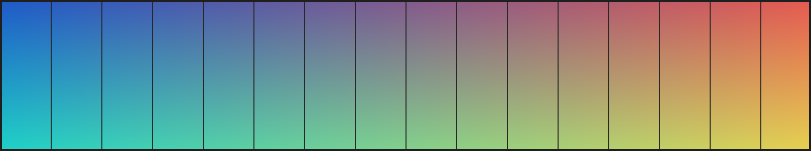

# MarkView E2E 検証用データ

このディレクトリは **E2E テスト（40 章・41 章）で使う入力一式**です（E2E-012）。
自動テストと手動テストで同じものを使い、用途ごとに別のデータを用意しません。

`MarkView testdata/e2e` で起動すると、ディレクトリ指定の規則（FR-013）によって
このファイルが自動で開きます（E2E-214）。

## 置いてあるもの

| 場所 | 用途 |
| --- | --- |
| `README.md` | このファイル。起動時に自動表示される（FR-013） |
| `docs/design.md` | 相対リンクの遷移先（E2E-261）。アンカー付きリンクの対象（E2E-263） |
| `docs/img/sample.png` | ローカル画像（1600 x 300）。本文幅を超えるため縮小され、原寸表示と拡大画面のボタンが付く（E2E-236, E2E-351）。画像ファイルとしても開く（E2E-264, E2E-393） |
| `docs/img/badge.png` | 80 x 20 の小さな画像。縮小されないため、ボタンが付かない（E2E-351） |
| `docs/img/medium.png` | 900 x 200 の画像。初期サイズのウィンドウでは収まり、狭めると縮小される（E2E-351） |
| `diagrams/multi.puml` | 図が 5 つの PlantUML ファイル（E2E-391） |
| `diagrams/no-diagram.puml` | `@start…` の行が無い PlantUML ファイル。`No diagrams found.` とソースが出る（E2E-391） |
| `diagrams/no-end.plantuml` | `@end…` の行が無い図（E2E-391） |
| `diagrams/part.iuml` | 取り込み用の断片。**開けるファイルではない**——ツリーに出ず、リンクでは既定のアプリケーションで開く（FR-025, E2E-264） |
| `diagrams/flow.mmd` | 先頭に空行のある Front Matter と、`click` を定義したノードの Mermaid ファイル（E2E-392） |
| `diagrams/two.mmd` | 図が 2 つ書かれた Mermaid ファイル。構文エラーの表示になる（E2E-392） |
| `diagrams/blank.mermaid` | 中身が空白だけの Mermaid ファイル。`No diagrams found.` だけが出る（E2E-392） |
| `images/alpha.png` | 右半分が透明な 240 x 120 の画像。画像ファイルとして開くと市松模様が見える（E2E-393） |
| `images/nosize.svg` | `width` / `height` を持たない SVG。本文の幅いっぱいに出る（E2E-236, E2E-393） |
| `images/broken.png` | 拡張子は `.png` だが画像でないファイル。壊れた画像の表示になる（E2E-393） |
| `outside/external.md` | ツリールート外への遷移先（FR-052, E2E-265） |
| `broken/invalid-utf8.md` | 不正な UTF-8 を含む（FR-021, E2E-323） |
| `plantuml-limits.md` | PlantUML の描けないもの（E2E-240） |
| `mermaid.md` | Mermaid 図と、`click` を定義したノード（E2E-234） |
| `media.md` | 図と画像の原寸表示と拡大画面（G15。E2E-351〜E2E-354） |
| `tables.md` | 表の並べ替え（G16。E2E-361, E2E-362） |
| `contextmenu.md` | 右クリックメニューとリンク先のコピー（G17。E2E-371, E2E-372） |
| `id-collision.md` | 文書の id と画面の id の衝突（E2E-327） |
| `markers.md` | 生 HTML で偽装した図とコードブロックの目印（E2E-328） |
| `node_modules/` `vendor/` `.hidden/` | **ツリーに出てはいけない**ディレクトリ（FR-031, E2E-241） |
| `notes.txt` | 開けないファイル。**ツリーに出てはいけない**（FR-031）。リンクでは既定のアプリケーションで開く（E2E-264） |
| `generated/` | 巨大ファイルなど。`go run ./scripts/gentestdata` で作る。**編集モードと、ファイルを書き換える手順の検証用の `generated/edit/`** は `-edit` で作り直す（G18・G20 ほか。E2E-206）。コミットしない |

`testdata/showcase.md`（BR-053）は**複製しません**。記法の網羅はあちらが担い、
ここは「ファイルとディレクトリの関係」を確かめるためのものです。

## 生成が要るもの

12 MB / 60 MB のファイル（E2E-322）と、極端に深い入れ子・巨大な表（E2E-323）、
描き終えるまで時間のかかる PlantUML（E2E-271）、約 1 MB の文書（E2E-381）、
大きな画像と画素の多い画像（`large-12mb.png` / `large-60mb.png` / `huge-pixels.png`。E2E-395）は
リポジトリに含めません。検証の直前に作ります。

```bash
go run ./scripts/gentestdata          # testdata/e2e/generated/ に作る
go run ./scripts/gentestdata -edit    # generated/edit/ の中身だけを作り直す（G18・G20 の各ケースと、ファイルを書き換える手順の前）
go run ./scripts/gentestdata -clean   # 消す
```

## ファイルツリーの確認

ツリーのルートをこのディレクトリにすると、**既定のフィルター（Markdown と図を表示し、画像を隠す。FR-037）では**
以下のようになるはずです（E2E-241）。

- ディレクトリが**先**、ファイルが**後**に並ぶ。ファイルは種類で分けずに名前の順に並ぶ
- `node_modules` `vendor` `.hidden` は**出ない**
- `diagrams` は**出る**。その下に図のファイルが 6 つ並ぶ（`part.iuml` は開けるファイルではないため**出ない**）
- `notes.txt` も**出ない**（開けるファイルではないため）
- 画像は**出ない**。画像だけのディレクトリ（`docs/img` と `images`）は**ディレクトリごと出ない**。
  フィルターで画像を入れると現れる（E2E-248）
- `generated` は**出る**。除外の対象ではなく、中身に Markdown があるからである。
  ここから `large-12mb.md` を選んで E2E-322 を実施できる

`.git` も同じ規則で除外されます。名前が `.` で始まるディレクトリはすべて対象です。

## 見出しの入れ子

アウトライン（FR-040）とスクロール連動（FR-042）を確かめるため、
ここから下は見出しを深くしていきます。

### レベル 3 の見出し

本文です。アウトラインの階層表示を確認してください。

#### レベル 4 の見出し

本文です。

##### レベル 5 の見出し

本文です。

###### レベル 6 の見出し

本文です。ここまでで 6 段になります。

## 日本語の見出しへのリンク

見出しアンカーは GitHub 互換の規則で作ります（MD-021）。
日本語の見出しでも機能することを確かめてください（E2E-263）。

- [同じ文書の「置いてあるもの」へ](#置いてあるもの)
- [同じ文書の「ファイルツリーの確認」へ](#ファイルツリーの確認)
- [同じ文書の「レベル 3 の見出し」へ](#レベル-3-の見出し)

## 画像

### 相対パスのローカル画像

`docs/img/` に置いた画像です。**本文幅より広い**ため、縮小されて収まるはずです。



### 存在しない画像

次の画像はファイルがありません。alt テキストとプレースホルダになり、
**これ以降の描画が止まらない**ことを確かめてください（E2E-236）。


### リモート画像

ネットワークに接続した状態でのみ表示されます（MD-071）。
切断時は上と同じくプレースホルダになります。


### 大きさを持たない SVG

`images/nosize.svg` は `width` / `height` を持たず、`viewBox` だけを持つ SVG です。
**本文の幅いっぱいに、縦横比（2 : 1）を保って**出るはずです（GitHub と同じ。E2E-236。BUG-029）。


## リンク

### 画像へのリンク

画像を**開く**リンクです。クリックすると **MarkView で画像ファイルとして開きます**（FR-053, FR-027, E2E-264）。
2 つ目はファイルがありません。表示はこの文書のままで、ステータス領域に知らせが出ます。

- [図を MarkView で開く](./docs/img/sample.png)
- [存在しない画像を開く](./docs/img/nosuch.png)

### 図のファイルへのリンク

PlantUML ファイルも MarkView で開きます（FR-050, FR-025, E2E-394）。

- [PlantUML ファイルを開く](./diagrams/multi.puml)

### 開けないファイルへのリンク

MarkView で開けないファイルへのリンクは、OS の既定のアプリケーションに委譲されます（FR-050, E2E-264）。
`part.iuml` は PlantUML の取り込み用の断片で、開けるファイルではありません（FR-025）。

- [notes.txt を既定のアプリケーションで開く](./notes.txt)
- [取り込み用の断片を開く](./diagrams/part.iuml)

### 外部リンク

既定のブラウザで開き、**MarkView のウィンドウ内では遷移しません**（AR-060, E2E-264）。

- <https://github.com/kznagamori/go_MarkView>
- [Markdown の仕様（CommonMark）](https://commonmark.org/)

### 壊れたファイルへのリンク

- [不正な UTF-8 を含むファイル](./broken/invalid-utf8.md)

## 途中まで読み進めたところ

ここは文書の中ほどです。**`Alt+←` で戻ったときにこの位置へ復元されるか**を
確かめるための目印です（FR-051, E2E-262）。

次のリンクをクリックしてから戻ってきてください。

- [docs/design.md を開く](./docs/design.md)
- [docs/design.md の「設計の方針」へ直接飛ぶ](./docs/design.md#設計の方針)

## 検索用の繰り返し

検索（FR-080, E2E-271）で複数のヒットを作るため、同じ語を散らしてあります。
`marker` という語がこの節に 5 回出てきます。

1 つ目の marker です。
2 つ目の marker です。
3 つ目の marker です。
4 つ目の marker です。
5 つ目の marker です。

## 長さを稼ぐ本文

スクロール位置の保存（FR-051）と、アウトラインの現在位置追従（FR-042）を
確かめるには、ウィンドウ 1 画面に収まらない長さが要ります。

### 段落 1

MarkView は Markdown の**閲覧に特化した**軽量デスクトップアプリケーションです。
表示中のファイルを書き換えるのは、編集モードでの 4 種類——チェックボックス・表のセル・コードブロックと図・
選んだ文字の取り消し線と文字色——だけです（FR-140）。
それ以外の編集には、既にある道具（外部エディタ）を使います。

### 段落 2

変換とシンタックスハイライトは Go 側で行います（AR-031）。
フロントエンドで実行するのは Mermaid・KaTeX・PlantUML だけです。

### 段落 3

開いたファイルのパス・ツリールート・表示履歴・検索語は、
**ディスクのどこにも書きません**（NFR-042）。

### 段落 4

設定の保存先はテンポラリのみです。`%APPDATA%` や `~/.config`、
レジストリには書きません（UI-112, NFR-033）。

### 段落 5

ネットワークへは接続しません（AR-020）。リモート画像だけが例外で、
それも WebView が直接取得します。

### 段落 6

ここが文書の末尾です。ここまでスクロールしたとき、アウトラインの
「段落 6」が現在位置として強調されているはずです（FR-042）。
