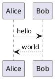
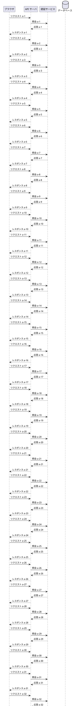
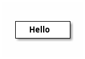
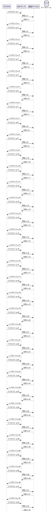

# PlantUML の描けないもの（E2E-240）

このファイルは **E2E-240（PlantUML の制限）を実施するための検証用データ**です（E2E-012）。
利用者に見せる文書ではなく、「描けないものが、理由とともに示されるか」を人が確かめるために、
**失敗する記法だけを集めて**あります。**描ける図は対照として 2 つだけ**置いています（1 節の小さな図と、9 節の上限のすぐ下の大きな図）。

`showcase.md`（BR-053）と分けているのは、あちらが **GitHub と並べて目視比較する**ための文書
（MD-002）であり、失敗例を混ぜると比較する側が読みにくくなるためです。

> [!IMPORTANT]
> **実施の前にネットワークを切断してください。** 取り込み指令（`!include` 系）で
> 外部への接続試行が起きないことも、このケースの確認対象です（NFR-032）。

## 1. 正常な図（対照）

**この図だけは描けます。** 以下の失敗が、他の図の描画を妨げていないことを確かめるために置いています。



## 2. 構文エラー

**PlantUML のエラー図がそのまま出ます**（FR-024）。行番号と該当行を含むため、こちらで書き直しません。
Mermaid（FR-023）とは見え方が違いますが、これは処理系の返し方が違うためです。

```plantuml
@startuml syntaxerror
Alice -> : missing target
this is not plantuml at all
@enduml
```

## 3. 取り込み指令（`!include`）

**図にならず、理由と元のソースが出ます**（MD-084, IMP-119）。Go 側で検査して描画対象から外すため、
処理系には渡りません。

```plantuml
@startuml include
!include shared/common.puml
Alice -> Bob : hi
@enduml
```

## 4. 取り込み指令（`!includeurl`）

外部の URL を指す形です。**ここで待たされたら、それ自体が不具合**です（NFR-032）。

```plantuml
@startuml includeurl
!includeurl http://example.invalid/theme.puml
Alice -> Bob : hi
@enduml
```

## 5. 標準ライブラリ（C4 モデル）

`!include <C4/...>` は取り込み指令の一種であり、**同梱した処理系は標準ライブラリを持ちません**（MD-083）。
**C4 モデル図は描けません。**


## 6. 上限（100,000 px）を超える図

処理系が描画を拒みます（MD-083）。**Java 版の PlantUML には無い制限**です。上限の値は MarkView が処理系へ渡しており、
v1.2.0-rc.1 までは 4096 px でした（[BUG-030](../../docs/bugs/2026-11-11-bug-030-plantuml-size-limit.md)）。

> [!IMPORTANT]
> **このブロックの書き方には理由があります**（[BUG-010](../../docs/bugs/2026-09-06-bug-010-plantuml-4096-testdata.md)、BUG-030）。
>
> - **繰り返しは処理系の `!while` と `!procedure` で書きます。** メッセージを何千行も書かずに、上限を超える
>   高さの図を作れます。どちらも取り込み指令ではないため、拒まれません（MD-084）
> - **区間あたり 110 回（メッセージ 3,520 本）にしてあります。** 100 回では高さ 105,960 px と上限に近く、
>   処理系の版でメッセージの間隔が変わると上限に届かなくなるおそれがあるためです
> - **処理系は配置を計算し終えてから大きさを確かめます。** このブロックは、理由が出るまでに 1 秒ほどかかります
>   （その間は画面が止まります。BUG-030）
>
> **実測値**: `java.lang.RuntimeException: Diagram too large for browser rendering: 419x116520 (max 100000; override via the maxSvgSize option, or set it to 0 to disable this check)`（PlantUML 1.2026.9。Chromium）
>
> **`@startuml toolarge` の名前を消さないでください。** 描画スモークテスト（BR-054）が**ブロックを名前で見分けます**。どのブロックも先頭行が `@startuml` のままでは、機械が区別できません。



## 7. `salt`（UI モック）

同梱した処理系が対応していない図種別です（MD-083）。

```plantuml
@startsalt
{
  Login    | "         "
  Password | "         "
  [Cancel] | [  OK   ]
}
@endsalt
```



## 8. `ditaa`

同上（MD-083）。



---

## 確認の観点（E2E-240）

- 1 の図は**描けている**。以降の失敗が他の図を止めていない
- 2 は **PlantUML のエラー図が図として出る**（行番号を含む）
- 3・4・5 は**図にならず**、理由と元のソースが英語で出る
- **6 は図にならず、理由と元のソースが出る。** **`Syntax Error?` の図が出たら不具合**です——大きさの制限に達する前に、ソースが文法違反で弾かれています（BUG-010）
- 7・8 は、**エラー図が出るか、理由と元のソースが出るかのどちらか**である（判定は「SVG が得られたか」だけで行うため。DSP-272）。**どちらであっても空白にならない**
- 描けなかったブロックのコピーボタンから、**元の PlantUML ソース**が取れる
- **待たされる箇所がない**（外部への接続試行がない。NFR-032）

## 9. 上限のすぐ下の図（描ける。6 節の対照）

**この図は描けます。** 縦に長いシーケンス図（参加者 4 人・`opt` 4 つ）で、高さは約 90,000 px です。
上限（100,000 px）のすぐ下の大きさでも描けることと（MD-083。[BUG-030](../../docs/bugs/2026-11-11-bug-030-plantuml-size-limit.md)）、
**描いている間も元のソースが出ていて、図の場所が空白にならないこと**（DSP-272）を確かめるために置いています。

> [!IMPORTANT]
> **区間あたり 85 回（メッセージ 2,720 本）で、高さ 90,120 px です**（実測。PlantUML 1.2026.9。Chromium）。
> 上限との間に 1 割ほどの余裕を残しています。処理系の版でメッセージの間隔が変わっても、上限を超えないためです。
>
> **`@startuml nearlimit` の名前を消さないでください。** 描画スモークテスト（BR-054）が、この図が描けたこと（上限が
> 4096 px のままになっていないこと）を名前で見分けて確かめます。


